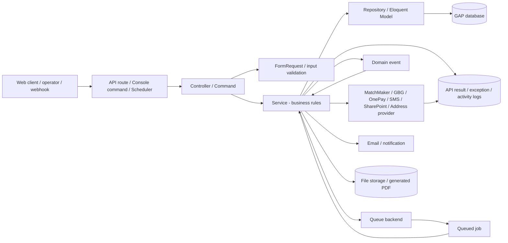

# Backend Business Flow Specification

> **Canonical location**: `.business-spec/` — living business logic reference.

> **Trạng thái**: `LIVING_SPEC`
> **Ngày tạo**: 2026-09-22
> **Đối chiếu source gần nhất**: 2026-09-30 — working tree và test suite; chưa xác minh deployment/DB production.
> **Cập nhật phạm vi GAP-691**: 2026-10-05 — bỏ legacy Agreement URL, chuyển ba Blade vào `views/pdf`, gộp agreement generation vào PermanentCandidateIntakeService; giữ mapping Hawk3/GPHL/Tech theo working tree, deployment chưa xác minh.
> **Cập nhật date GAP-691**: 2026-10-06 — agreement DTO dùng ngày generate d/m/Y theo app timezone; full regression chưa pass vì unrelated mapping/asset/MM-debug user edits so với fixtures cũ.
> **Cập nhật GAP-723**: 2026-10-12 — public referee employment-reference PUT requires a body token matching the path reference ID before update/notification; no token expiry, revocation, single-use state, or database schema change.
> **Cập nhật GAP-534**: 2026-10-12 — thêm bulk archive CRS và public profile-deletion token flow; implementation và test đã xác minh trên working tree, deployment/persistent DB chưa xác minh.
> **Author**: Codex
> **Mục đích**: Nguồn tham chiếu để AI, BA, QA và developer đọc hiểu flow nghiệp vụ hiện tại và kiểm tra logic khi code thay đổi.

## 1. Phạm vi và nguyên tắc đọc

Tài liệu này là bản reverse-engineering từ source code hiện tại, không phải yêu
cầu nghiệp vụ mới. Các rule bên dưới mô tả hành vi đang được implement hoặc
được suy ra trực tiếp từ route, controller, service, repository, model,
migration, command và scheduler.

Phạm vi hiện tại:

- 246 API route declarations trong source; runtime route collection resolve 245 API entries do một declaration compliance trùng method/URI bị trùng. Đếm bằng `route:list --json` với SQLite in-memory và `LOG_CHANNEL=single`.
- 10 scheduler/cron command.
- 1 queued job.
- 4 event/listener chính.
- Các command CLI dùng cho vận hành, đồng bộ dữ liệu và maintenance.
- Các bảng nghiệp vụ chính và quan hệ database; xem
  [backend-database-relationship.md](backend-database-relationship.md).
- Danh sách method/path/controller cụ thể; xem
  [backend-api-route-inventory.md](backend-api-route-inventory.md).
- Danh sách outbound API call từ CRS sang MatchMaker/Epsilon; xem
  [backend-matchmaker-api-call-inventory.md](backend-matchmaker-api-call-inventory.md).
- Hướng dẫn triage và support client; xem
  [client-support-runbook.md](client-support-runbook.md).
- Hiện trạng dữ liệu Candidate/User và tích hợp CRS–MatchMaker, cùng định hướng
  CRM/SSO; xem
  [crs-matchmaker-crm-current-state.md](crs-matchmaker-crm-current-state.md).

### 1.1. Quy ước cho AI review

- `MUST`: điều kiện bắt buộc.
- `MUST NOT`: điều kiện cấm.
- `IF ... THEN ... ELSE ...`: nhánh nghiệp vụ.
- `POST-CONDITION`: trạng thái phải đạt sau khi flow thành công.
- `SIDE EFFECT`: email, file, event, queue, external API hoặc audit log.
- `CODE_FACT`: thấy trực tiếp trong source.
- `STATIC_INFERENCE`: suy ra từ call chain/model/migration, cần xác minh runtime nếu có nghi ngờ.
- `EXPECTED_NOT_ENFORCED`: yêu cầu an toàn/mong muốn, chưa được code bảo đảm; không dùng làm mô tả hành vi hiện tại.
- `COVERAGE_PARTIAL`: đã có entry point/flow nhưng chưa kiểm chứng mọi validator, filter và nhánh lỗi. Số route/SPEC không phải tỷ lệ coverage nghiệp vụ.
- Nếu thiếu runtime data, AI phải trả kết quả `UNVERIFIED`, không tự kết luận flow đang chạy thành công.

Các quy tắc kiến trúc ở §2/SPEC-001 là convention của project, không phải bằng
chứng mọi controller/repository hiện hữu đều tuân thủ. Khi mô tả implementation,
ưu tiên `CODE_FACT` và ghi riêng deviation, không chuyển một mong muốn thành invariant.

Khi review một thay đổi, AI phải so sánh theo thứ tự:

1. Trigger và actor.
2. Preconditions và input origin.
3. Ordered steps.
4. Decision rules/invariants.
5. Database reads/writes.
6. External calls và side effects.
7. Error handling.
8. Post-condition.

## 2. Kiến trúc xử lý tổng quát



Nguyên tắc data flow:

- Controller chịu trách nhiệm nhận request, authorization context và response.
- Service chịu trách nhiệm business rule, orchestration, transformation và external integration.
- Repository/Model chịu trách nhiệm query hoặc persistence.
- File metadata lưu trong `files`; binary/PDF lưu ở storage.
- External call phải được truy vết bằng `api_result_logs` (phân biệt `type = RESULT/ERROR/EXCEPTION`) hoặc application log tùy adapter.

## 3. Business lifecycle chính của candidate

```mermaid
flowchart LR
    Invite[Invitation / tracking]
    Signup[Candidate signup]
    Profile[Personal info / address / emergency contact]
    Questions[Declaration / PPE / interview answers]
    Job[Create candidate_job]
    RTW[Passport / share code / RTW files]
    Contract[Release and sign contracts]
    Review[Consultant review / appointment / issue]
    Compliance[Compliance review and approve]
    MM[Transfer to MatchMaker]
    Pack[Application pack and contract upload]
    Live[MatchMaker Live / job status matchmaker]
    Worker[Welfare / ongoing worker operations]

    Invite --> Signup --> Profile --> Questions --> Job
    Job --> RTW --> Review --> Contract --> Compliance --> MM --> Live --> Pack --> Worker
    Review -. missing data .-> Profile
    Review -. escalated issue .-> Compliance
    RTW -. expired .-> RTW
    MM -. external error .-> Review
```



Sơ đồ là bản đồ tổng quan, không phải state machine bắt buộc cho mọi candidate.
Release contract cần personal/RTW/interview progress complete (SPEC-012); approve
candidate và approve RTW là hai thao tác khác nhau (SPEC-017). Transfer MM cập nhật
local LIVE trước bước generate/transfer application pack, nên lỗi pack có thể xảy
ra sau khi candidate đã LIVE (SPEC-019).

## 4. Trigger inventory

### 4.1. API route groups

RouteServiceProvider áp dụng prefix `/api`, middleware `api` và rate limit 60
request/phút. Các path dưới đây là path sau prefix `/api`.

| Domain | Endpoint groups | Mục đích | Source |
|---|---|---|---|
| User | `/user/status`; `/user/auth/*`; `/user/me`; `/user/me/branches` | User authentication, reset password, profile và branch access | `routes/user.php` |
| Candidate public | `/candidate/status`; `/candidate/auth/*`; `/candidate/gbg/webhook`; `/candidate/stop_remind_me/*`; `/candidate/tracking_records*`; `/candidate/third_party_terms_and_conditions/*`; `/candidate/referee/*` | Candidate entry, auth, webhook, reminder opt-out, tracking, referee | `routes/candidate.php` |
| Candidate profile | `/candidate/me`; `/candidate/me/address`; `/candidate/me/emergency_contact`; `/candidate/me/employee_histories`; `/candidate/me/agencies`; `/candidate/me/skills`; `/candidate/me/bank_account` | Candidate profile, contact, history, skills, financial information | `routes/candidate.php` |
| Candidate application | `/candidate/me/jobs`; `/candidate/me/jobs/{jobId}/key_information_document/*`; `/candidate/progresses`; `/candidate/question_groups/*` | Candidate-job, document acknowledgement, progress, answers | `routes/candidate.php` |
| Candidate files/identity | `/candidate/me/files/*`; `/candidate/files/*`; `/candidate/me/passport/*`; `/candidate/me/share_codes/*` | Upload/sign/delete file, GBG passport, right-to-work share code | `routes/candidate.php` |
| Consultant candidate | `/consultant/candidates*`; `/consultant/progresses/*`; `/consultant/appointments*`; `/consultant/jobs*` | Candidate search/review, job state, progress, appointments | `routes/consultant.php` |
| Consultant operations | `/consultant/candidates/*/employee_histories`; `/*/files`; `/*/skills`; `/*/question_groups`; `/*/missing_*`; `/*/communication_note` | Candidate support data and workflow operations | `routes/consultant.php` |
| Consultant escalation | `/consultant/escalated_issues*`; `/consultant/candidates/*/escalated_issues*` | Create, assign, update, log and resolve blockers | `routes/consultant.php` |
| Consultant integrations | `/consultant/candidates/{id}/match_maker`; `/*/application_pack`; `/*/worker_welfare_check`; `/consultant/sms/*` | MatchMaker transfer, pack, welfare and SMS | `routes/consultant.php` |
| Compliance | `/compliance/candidates*`; `/compliance/branches*`; `/compliance/email_templates*`; `/compliance/escalated_issues*` | Compliance review, approve, branch/template/issue administration | `routes/compliance.php` |
| Admin | `/admin/candidates*`; `/admin/branches*`; `/admin/users*`; `/admin/tags*`; `/admin/agencies*` | Admin reset/delete/unblock and master data | `routes/admin.php` |
| General | `/tracking_records`; `/addresses/search`; `/addresses/detail`; `/addresses/drill_down` | Attribution tracking and address provider lookup | `routes/general.php` |

### 4.2. Scheduler/cron

| ID | Schedule | Command | Business purpose | Main tables/external |
|---|---|---|---|---|
| CRON-001 | Every minute | `services:ping` | Ping MatchMaker GAP và GAP_EAST | MatchMaker; logs |
| CRON-002 | Daily 02:00 | `logs:clean` | Xóa `api_result_logs` cũ hơn 3 tháng | `api_result_logs` |
| CRON-003 | Every minute, no overlap | `runBatchProcess:GatherAlternativeBankAccountInformationFromMails` | Đọc email OnePay và hoàn thiện bank/NI | OnePay/Graph; `candidate_bank_accounts`, `candidates` |
| CRON-004 | Hourly, no overlap | `candidates:remind-screening-call-completion` | Gửi email nhắc screening call | `candidates`, `candidate_jobs`, `candidate_progress_emails` |
| CRON-005 | Every minute, no overlap | `sms:sendPendingCampaigns` | Gửi SMS campaign pending | Esendex; `sms_campaigns`, `sms_receivers` |
| CRON-006 | Every 10 minutes, 08:00–20:00 Europe/London | `gbg:check_result` | Recheck GBG passport result REFER | GBG; `candidates`, `files`, `escalated_issues` |
| CRON-007 | Daily theo config | `candidates:sync-matchmaker-status` | Sync status MatchMaker về GAP | MatchMaker; `match_maker_candidates`, `candidates` |
| CRON-008 | Daily theo config | `candidates:sync-marketing-preference` | Sync marketing preference | MatchMaker; `answers` |
| CRON-009 | Daily theo config | `candidates:sync-onplan` | Sync cờ `on_plan` | MatchMaker; `candidates` |
| CRON-010 | Daily 02:00 | `files:expire-rtw` | Chuyển RTW file hết hạn sang `EXPIRED` | `files`, `candidates`, `candidate_jobs` |

Tất cả scheduler append output vào `/var/log/laravel-schedule.log`.

### 4.3. Queue, event và listener

| ID | Trigger | Processor | Purpose | Side effect |
|---|---|---|---|---|
| JOB-001 | Sau `performCheck`, kể cả score thấp | `GenerateWorkerWelfareCheckCertificateJob` | Generate welfare certificate sau face match; sync/async tùy queue connection | PDF/file, MatchMaker contact log, email khi score < 75% và flow đến bước gửi |
| EVT-001 | Appointment repository save | `AppointmentUpdateEvent` → `AppointmentUpdateListener` | Recalculate candidate progress | `candidates`/`candidate_jobs` progress |
| EVT-002 | Escalated issue repository save | `EscalatedIssueUpdateEvent` → `EscalatedIssueUpdateListener` | Recalculate progress sau issue change | Progress và audit |
| EVT-003 | `CandidateService::updateCandidate` nhận RTW approval = APPROVED | `OverallApproveEvent` → `OverallApproveListener` | Request OnePay nếu alternative bank đủ điều kiện; không dispatch từ `approveCandidate` | OnePay email; later mailbox sync |

### 4.4. Console command inventory ngoài scheduler

Các command dưới đây được đăng ký trong `app/Console/Commands/` nhưng không
được gọi trong `Kernel::schedule()` tại thời điểm reverse-engineering. Những
command có tác động dữ liệu hoặc external service phải được xem là operational
tool, không tự chạy lại nếu chưa kiểm tra input và post-state.

| Command | Mode | Mục đích | DB/storage/external chính | Source |
|---|---|---|---|---|
| `runBatchProcess:CheckCommandAlive` | Debug | Kiểm tra command có khởi động được | Application log | `CheckCommandAlive.php` |
| `runBatchProcess:ConvertEcsEnvJsonFile` | Ops/config | Convert ECS YAML/JSON thành parameter JSON theo environment | `env_files/*`; filesystem | `ConvertEcsEnvJsonFile.php` |
| `file-delete {id}` | Manual mutation | Đổi/xóa file theo file ID | `files`; storage | `DeleteFile.php` |
| `candidates:export-signed` | Manual export | Lấy candidate đã ký và export dữ liệu/tài liệu | `candidates`, `candidate_jobs`, `files`; export storage | `ExportSignedCandidates.php` |
| `onepay:get {fromDate} {toDate}` | Manual batch | Đọc mail OnePay trong khoảng ngày chỉ định | `candidate_bank_accounts`, `candidates`; Graph/OnePay | `GatherOnePayFromMailsForSpecificDays.php` |
| `application-pack:generate {candidateId} {userId}` | Manual mutation | Generate application pack cho candidate | `candidates`, `users`, `candidate_jobs`, `files`; PDF/storage | `GenerateApplicationPack.php` |
| `branch:generate-map-url` | Manual maintenance | Tạo URL map/image map cho branch | `branches`; Google Maps/location utility | `GenerateBranchMapUrl.php` |
| `candidate-document:generate {candidateId} {type}` | Manual mutation | Generate signed work/medical document | `candidates`, `candidate_jobs`, `files`; PDF/storage | `GenerateCandidateDocument.php` |
| `candidates:generate-sample-data {branchId} {numbOfCandidates}` | Fixture | Tạo candidate mẫu để test flow | candidates, jobs, answers, appointments, skills, employment histories | `GenerateSampleCandidatesForBranch.php` |
| `jobs:generate-sample-data {branchId} {numbOfJobs}` | Fixture | Tạo job mẫu cho branch | `jobs`, `branches`, candidate/file dependencies tùy implementation | `GenerateSampleJobsForBranch.php` |
| `answer-add` | One-off migration | Bổ sung question/answer category còn thiếu | `questions`, `answers` | `Once/AddAnswer.php` |
| `candidates:calculate-progresses` | One-off migration | Recalculate progress cho candidate/job hiện hữu | `candidates`, `candidate_jobs`, source workflow tables | `Once/CalculateCandidateProgresses.php` |
| `answer-convert` | One-off migration | Convert answer value theo answer options | `questions`, `answer_options`, `answers` | `Once/ConvertAnswers.php` |
| `candidates:import-mm` | One-off integration | Import/map candidate từ MatchMaker về GAP | `candidates`; MatchMaker | `Once/ImportMMCandidates.php` |
| `files:set-expiry-date-rtw` | One-off migration | Backfill expiry date cho RTW files | `files`, `candidates`, `candidate_jobs` | `Once/SetExpiryDateRtwFiles.php` |
| `candidates:archive` | Manual batch | Archive candidate jobs và xử lý document/progress liên quan | `candidates`, `candidate_jobs`, `files`; progress | `ArchiveCandidates.php` |
| `candidates:reset {email}` | Manual mutation | Reset candidate theo email | candidate và related state | `ResetCandidate.php` |
| `candidates:reset-documents` | Disabled/no-op | `handle()` return SUCCESS ngay; phần reset phía sau không chạy | Không reset dữ liệu ở implementation hiện tại | `ResetCandidateDocuments.php` |
| `matchmaker:save-contact-logs {candidateId} {matchmakerPeopleNumber}` | Diagnostic/no external write | Đọc candidate; lời gọi `saveContactLogs` đang comment; SUCCESS không chứng minh MM đã nhận log | `candidates` read | `SaveContactLogsToMatchMaker.php` |
| `mail:test {template} {email}` | Test/manual | Chạy các scenario email/appointment/issue test | candidate, appointment, issue; MailSender | `SendTestEmail.php` |
| `cmd:test {--branch-id=1} {--candidate-id=} {--job-id=} {--cv-file-id=} {--agreement-file-id=}` | Test/manual job run | Validate four positive IDs; snapshot sample PDF/click data with actual filenames; dispatchSync Permanent job; verify completed state/exit code. Existing DB profile feeds MM. branch-id remains unused compatibility option | candidate/job/files reads; Redis lock; PDF/storage/files writes; MM calls and is_permanent completion. No automatic reset/profile overwrite. | `TestCommand.php` |
| `candidate:update-password {email} {password?}` | Manual mutation | Reset password candidate | `candidates` | `UpdateCandiatePassword.php` |
| `candidate:update-progress {email} {progress_name} {status}` | Manual mutation | Override/cập nhật progress cho candidate/job | `candidates`, `candidate_jobs` | `UpdateCandiateProgress.php` |
| `user:update-password {email} {password?}` | Manual mutation | Reset password user | `users` | `UpdateUserPassword.php` |

## 5. Spec contract chuẩn

Mỗi flow bên dưới được mô tả theo cùng một contract:

```text
TRIGGER       : endpoint / command / event / scheduler
ACTOR         : ai hoặc component khởi tạo
PRECONDITION  : điều kiện được phép chạy
INPUT         : nguồn dữ liệu và format
STEPS         : thứ tự xử lý bắt buộc
RULES         : IF/THEN, MUST, MUST NOT, invariant
DB READ       : repository/model/table đọc
DB WRITE      : repository/model/table ghi
EXTERNAL      : API/provider ngoài
OUTPUT        : response hoặc command result
FAILURE       : lỗi và trạng thái khi lỗi
SIDE EFFECT   : email/file/event/job/log
POST-CONDITION: trạng thái phải đạt khi thành công
SOURCE        : path/class/method chứng minh
```

## 6. Detailed business flow specs

### SPEC-001 — API request lifecycle

- **TRIGGER**: Bất kỳ route dưới `/api`.
- **ACTOR**: Frontend, operator hoặc webhook.
- **PRECONDITION**: Route tồn tại; auth, branch, compliance hoặc job middleware đạt điều kiện nếu route yêu cầu.
- **INPUT**: HTTP method/path, body, query, JWT, `Gap-Job-ID`, webhook payload.
- **STEPS**: Route → Controller → FormRequest/validation → Service → Repository/Model → response.
- **RULES**:
  - `MUST` kiểm tra authentication và ownership trước mutation.
  - `MUST` giữ business rule trong Service.
  - Repository chỉ truy cập dữ liệu.
- **DB READ/WRITE**: Tùy flow; core là `candidates`, `candidate_jobs`, `jobs`, `branches`, `files`.
- **EXTERNAL**: Tùy flow; GBG, MatchMaker, OnePay, Esendex, SharePoint, address provider.
- **FAILURE**: 401/403 auth, 422 validation, business exception hoặc external error.
- **POST-CONDITION**: Response và mọi side effect phản ánh cùng một business decision.
- **SOURCE**: `app/Providers/RouteServiceProvider.php`, `routes/*.php`.

### SPEC-002 — Candidate signup

- **TRIGGER**: `POST /api/candidate/auth/signup`.
- **ACTOR**: Candidate hoặc người nhận invitation.
- **PRECONDITION**: Email/invitation hợp lệ; password đạt rule.
- **INPUT**: Email, password, invitation context và cookie `branch_id`, `job_id`, `job_ref`, referrer, UTM.
- **STEPS**:
  1. Parse tracking cookie.
  2. Validate email/password/invitation.
  3. `CandidateService::signUp` resolve branch, job và MatchMaker context.
  4. Create/update candidate và authentication state; signup không tạo candidate_job. Application được tạo qua POST /candidate/me/jobs (SPEC-007).
  5. Issue JWT và sign out thiết bị khác.
- **RULES**: `MUST NOT` tạo duplicate candidate theo rule email/invitation; tracking được gắn nếu có.
- **DB READ**: `candidate_invitations`, `branches`, `jobs`, `match_maker_candidates`.
- **DB WRITE**: `candidates`, `candidate_tokens`, `authentication_logs`, tracking history nếu enabled; copy invitation data theo SPEC-032.
- **EXTERNAL**: Có thể lookup MatchMaker.
- **FAILURE**: Invalid invitation/password/duplicate hoặc external lookup failure. Signup nối thêm invitation/MM snapshot writes và email; không có bảo đảm atomic xuyên các bước chỉ từ entry point. Kiểm tra account, join_date và jobs trước retry; xem SPEC-032.
- **POST-CONDITION**: Candidate tồn tại, gắn đúng branch/job/source và có thể login.
- **SOURCE**: `routes/candidate.php`; `app/Http/Controllers/Api/Candidate/AuthController.php`; `app/Services/CandidateService.php`.

### SPEC-003 — Candidate auth và password reset

- **TRIGGER**: Candidate auth login/logout/refresh/forgot/reset/check token.
- **ACTOR**: Candidate.
- **PRECONDITION**: Login cần credential; reset cần reset token còn hiệu lực.
- **STEPS**: Verify lock/credential → issue/revoke/refresh JWT; hoặc tạo reset token → email → validate token → hash password.
- **RULES**: Candidate bị lock không được login nếu rule cấm; reset token invalid/expired không được update password.
- **DB READ/WRITE**: `candidates`, `candidate_password_resets`, `authentication_logs`, candidate token state.
- **EXTERNAL**: MailSender/email template.
- **FAILURE**: Invalid credentials/token/locked account.
- **POST-CONDITION**: Session và password state nhất quán.
- **SOURCE**: `app/Http/Controllers/Api/Candidate/AuthController.php`; `PasswordController.php`.

### SPEC-004 — Candidate profile và MatchMaker identity verification

- **TRIGGER**: `GET/PUT /api/candidate/me`; MM token/NI/profile picture verification.
- **ACTOR**: Candidate.
- **PRECONDITION**: JWT; profile chưa bị lock; MatchMaker context tồn tại khi verify.
- **STEPS**:
  1. Load candidate detail.
  2. Validate personal/address/contact/password update.
  3. Nếu dữ liệu nhạy cảm đổi, gọi duplicate check.
  4. Token/NI verification theo endpoint.
  5. Profile image: liveness → download MM image → face match → lưu score/file/status.
  6. Update candidate và registration progress.
- **IDENTITY FLAGS — CODE_FACT**: `checkDuplication` tìm MM snapshot theo email và tạo token 5 chữ số. `verifyToken` chỉ set token_verified khi token khớp; `completeVerificationProcess` set verification_completed riêng; `confirmCandidateDuplicated` pull MM data rồi set confirmed. Không coi ba flags là một trạng thái verified duy nhất hoặc coi MM duplicate là lỗi luôn phải chặn.
- **NI LOOKUP**: Choices gồm 4 giá trị random + cached NI; verify dùng cached NI nếu có, nếu không gọi MM basic info bằng peo_no + db_source rồi lưu NI. Một số lookup dùng firstByFilter(email), nên phải kiểm tra snapshot/db_source thực tế khi cùng email có nhiều MM records.
- **PROFILE/CONTACT**: Address và emergency-contact endpoint mutate cùng candidate; NOK lấy payload nok và progress riêng, update progress theo latestJob. Đổi name/DOB khi đã có approved RTW evidence có thể tạo escalated issue “Candidate information updated after RTW approved”, không phải tự approve lại identity.
- **COVERAGE_PARTIAL**: Các nhánh face/liveness fallback, danh sách điều kiện duplicate từng trường và mọi profile validator cần trace thêm theo endpoint cụ thể; token_verified không chứng minh face/RTW đã approve.
- **DB READ/WRITE**: `candidates`, `match_maker_candidates`, `match_maker_duplication_processes`, `candidate_face_matching_rates`, `files`.
- **EXTERNAL**: MatchMaker, GBG face/liveness, storage.
- **POST-CONDITION**: Verification status/score có thể truy vết; progress phản ánh kết quả.
- **SOURCE**: `app/Http/Controllers/Api/Candidate/MeController.php`; `MatchMakerDuplicationService.php`; `IdentificationCheckService.php`.

### SPEC-005 — Declaration, PPE và question answers

- **TRIGGER**: Submit PPE/declaration và `GET/POST /candidate/question_groups/{type}`.
- **ACTOR**: Candidate hoặc consultant interview.
- **PRECONDITION**: Question group/type và candidate/job context hợp lệ.
- **STEPS**: Load group → validate required answers/options → upsert `answers` → update declaration/personal data → calculate progress.
- **RULES**: Answer phải thuộc question/group; thiếu required answer không được complete progress.
- **DB READ/WRITE**: `question_groups`, `questions`, `question_group_questions`, `answer_options`, `answers`, `candidates`, `candidate_jobs`.
- **EXTERNAL**: Không bắt buộc; email nếu rule kích hoạt.
- **POST-CONDITION**: PPE/declaration/interview progress phản ánh answer state.
- **SOURCE**: `QuestionController.php`; `QuestionService.php`; `RegistrationProgressService.php`.

### SPEC-006 — Employment history và referee

- **TRIGGER**: Candidate/consultant employment history CRUD; public referee token read/update.
- **ACTOR**: Candidate, consultant hoặc referee.
- **PRECONDITION**: Candidate auth hoặc referee token hợp lệ; email domain không bị block. Public referee PUT phải nhận body token.
- **STEPS**: Resolve history/reference → validate ownership/domain → create/update/delete → create reference request → referee GET bằng token → referee PUT bằng `id` và body token → compare token before write/notification.
- **RULES**: Referee `MUST NOT` truy cập ngoài token; history/reference phải gắn đúng candidate. ID-only update, missing token và mismatched token `MUST` be rejected with the generic not-found/invalid-token behavior. Token không hết hạn/revoke/single-use trong implementation này.
- **DB READ/WRITE**: `employment_histories`, `employment_history_references`, `candidates`, `files`.
- **EXTERNAL**: MailSender; SharePoint nếu flow được bật.
- **SIDE EFFECT**: Reference email, export PDF ở consultant flow; valid referee update notifies the branch and writes application audit log without raw token.
- **POST-CONDITION**: Reference có trạng thái/audit để consultant review.
- **SOURCE**: `MeEmployeeHistoryController.php`; `CandidateEmployeeHistoryController.php`; `RefereeEmploymentHistoryReferenceController.php`.

### SPEC-007 — Candidate apply job

- **TRIGGER**: `GET/POST /api/candidate/me/jobs`.
- **ACTOR**: Candidate.
- **PRECONDITION — CODE_FACT**: Branch/legal entity hợp lệ; `canApplyJob` từ chối khi highest job = MATCHMAKER và MM status khác RRR. `POST /candidate/me/jobs` bỏ `checkCandidateLockEdit`, nên `profile_locked` không phải điều kiện chặn chung cho endpoint này.
- **STEPS**: Validate can apply → check legal entity categories → get/create job mapping → create `candidate_job` → initialize timing/progress.
- **RULES**: `MUST NOT` tạo duplicate `candidate_job`; conflict legal entity/category phải chặn flow.
- **JOB STATUS — CODE_FACT**: Consultant update nhận ARCHIVED/INTERVIEW/MATCHMAKER/SCREENING_CALL. Khi archive hoặc unarchive một job, service đổi cả jobs cùng branch trừ job khác đang MATCHMAKER; unarchive gửi welcome-back email và update bỏ star của user hiện tại. Đây không phải cùng flow với transfer worker lên MM; chỉ đặt job status MATCHMAKER không chứng minh worker đã được tạo.
- **DB READ/WRITE**: `candidates`, `jobs`, `branches`, `legal_entities`, `candidate_jobs`, `candidate_timings`.
- **EXTERNAL**: MatchMaker category check nếu cần.
- **POST-CONDITION**: Candidate có application hợp lệ trong job context.
- **SOURCE**: `MeJobController.php`; `CandidateService.php`; `JobService.php`.

### SPEC-008 — Bank và financial information

- **TRIGGER**: Candidate submit financial info hoặc compliance update bank.
- **ACTOR**: Candidate hoặc compliance.
- **PRECONDITION**: Financial step mở; bank/tax/nationality input hợp lệ.
- **STEPS**:
  1. Update personal/tax data.
  2. Save financial agreement answers.
  3. Nếu alternative bank: reserve/request OnePay.
  4. Nếu UK bank: gọi GBG bank check.
  5. Save result/status và update financial progress.
- **RULES**: Không mark verified khi external check chưa đạt. Alternative bank request chỉ chạy khi đủ condition bank/account/nationality.
- **DB READ/WRITE**: `candidate_bank_accounts`, `candidates`, `candidate_addresses`, `questions`, `answers`, `api_result_logs`.
- **EXTERNAL**: `GBGBankCheckService`, OnePay/Microsoft Graph, MailSender.
- **POST-CONDITION**: Bank state là verified, pending hoặc review có lý do rõ ràng.
- **SOURCE**: `MeBankAccountController.php`; `CandidateService.php`; `GBGBankCheckService.php`; `OnepayService.php`.

### SPEC-009 — File upload, approval và lifecycle

- **TRIGGER**: Candidate/consultant/compliance file list/upload/status/approve/delete/sign.
- **ACTOR**: Candidate, consultant hoặc compliance.
- **PRECONDITION**: Auth/branch/job ownership; file type hợp lệ; upload không bị block.
- **STEPS**: Validate type/extension/size/ClamAV → resolve candidate/job → face/liveness nếu cần → store binary + metadata → update status/expiry/progress.
- **RULES**:
  - Candidate `MUST NOT` tự approve file.
  - File phải thuộc candidate/job context.
  - Candidate status update trên `PUT /api/candidate/files/{id}/status` chỉ lookup và update khi `files.id`, authenticated `candidate_id` và middleware-resolved job context cùng khớp; file candidate-level với `job_id = 0` được phép trong job context nếu vẫn thuộc đúng authenticated candidate.
  - Candidate self-service status update chỉ nhận `uploaded`, `released`, `read` hoặc `signed`; file ngoài scope trả not-found và không ghi DB.
  - RTW approved file phải có expiry khi loại file yêu cầu.
  - Delete phải xử lý storage và metadata.
  - Candidate CV upload cho phép PDF/DOC/DOCX/PNG/JPG/JPEG, validate detected MIME PDF/Word/`image/png`/`image/jpeg`, tối đa 10 MiB; ClamAV/auth/upload-block rules giữ nguyên (GAP-691, 2026-10-08). Candidate-level CV không cần `Gap-Job-ID`; invalid format/size trả 400/1006 trước storage/File create.
  - Verification 2026-10-08: affected files/intake/MM suites PASS 122 tests / 7,020 assertions; full default PHPUnit PASS 600 tests / 9,049 assertions. Nine new MeFile datasets cover image/Word uploads, size boundary and invalid-format/size no-write behavior. User PNG (95,738 bytes) pass read-only CV validator; localhost authenticated upload, production ClamAV/storage/MM/deployment remain UNVERIFIED. Evidence: [GAP-691 CV follow-up §12](../.specs/GAP-691/GAP-691-implementation-plan.md#12-follow-up--cv-pngjpeg-upload-validation-2026-10-08-done).
- **DB READ/WRITE**: `files`, `candidates`, `candidate_jobs`, `candidate_face_matching_rates`.
- **EXTERNAL**: ClamAV, GBG face/liveness, ShareCode/Passport, storage/PDF.
- **POST-CONDITION**: File status, binary và progress nhất quán.
- **SOURCE**: `MeFileController.php`; `MeFileStatusUpdate.php`; `FileRepository.php`; `FileService.php`; Consultant/Compliance `CandidateFileController.php`.

### SPEC-010 — Passport identity check với GBG

- **TRIGGER**: Passport token/result endpoints; scheduler recheck REFER. GBG webhook là log-only endpoint riêng.
- **ACTOR**: Candidate, GBG webhook hoặc scheduler.
- **PRECONDITION**: Consent/terms; GBG transaction/reference hợp lệ.
- **STEPS — CODE_FACT**: Token/result flow: request token → candidate completes check → `saveCheckResults` fetch result/files → save passport/report/face files → evaluate `canApproved`/face score → update candidate journey/result/time/expiry. Recheck REFER đi qua SPEC-023.
- **WEBHOOK — CODE_FACT**: `observe` đọc raw body, ghi `ApiLog::addResponse` nếu body không rỗng và trả OK. Không fetch GBG, tạo file, approve RTW hoặc cập nhật candidate; không có dedup theo reference trong action này.
- **RULES**: Result endpoint có nhánh approve report khi `canApproved`, xử lý score ảnh riêng; kết quả không approve và khác REFER chuyển report REJECTED. Không suy ra webhook thành công nghĩa là RTW thành công. Idempotent processing là `EXPECTED_NOT_ENFORCED`, không phải bảo đảm hiện tại của webhook.
- **DB READ/WRITE**: `candidates`, `candidate_jobs`, `files`, `candidate_face_matching_rates`, `escalated_issues`, `api_result_logs`.
- **EXTERNAL**: GBG IDSP Passport, Face Match, storage.
- **POST-CONDITION**: Passport result/report/score/status trace được với external response.
- **SOURCE**: `app/Http/Controllers/Api/Candidate/GBGIdspCertifiedPassportCheckController.php::saveCheckResults/observe`; `app/Services/GBGIdspCertifiedPassportCheckService.php`; `app/Console/Commands/GbgPassportCheckResult.php`.

### SPEC-011 — Right-to-work share code

- **TRIGGER**: `GET /api/candidate/me/share_codes/{code}`.
- **ACTOR**: Candidate.
- **PRECONDITION**: JWT; share code và candidate/job context hợp lệ.
- **STEPS**: Validate code → browser automation UK GOV → parse result/expiry → save report/evidence file → update candidate/file/progress → escalate/email nếu bất thường.
- **RULES**: Invalid/expired/mismatch không được mark RTW complete. Automation failure phải phân biệt với business rejection.
- **DB READ/WRITE**: `candidates`, `candidate_jobs`, `files`, `tracking_record_histories`, `escalated_issues`.
- **EXTERNAL**: UK GOV automation, storage, MailSender.
- **POST-CONDITION**: RTW completion chỉ được set khi result hợp lệ và evidence đã lưu.
- **SOURCE**: `MeShareCodeController.php`; `ShareCodeService.php`.

### SPEC-012 — Contract, medical document và application pack

- **TRIGGER**: Candidate sign file; consultant release contract; `candidate-document:generate`; `application-pack:generate`; consultant application pack endpoint.
- **ACTOR**: Candidate, consultant hoặc operator.
- **PRECONDITION — CODE_FACT**: Release kiểm tra `Candidate::isReadyToReleaseDocuments`: cả ba aggregate progress personal information, RTW và interview phải COMPLETED. Sign kiểm tra job header, contracts không LOCKED, personal complete và RTW complete với `withoutApproval=true`; hai gate này không giống nhau.
- **STEPS**: Load candidate/job/source files → select type → render/translate/questionnaire → generate PDF → save file/metadata → update contract status/timing → email hoặc transfer MM nếu flow gọi tiếp.
- **STATE TRANSITIONS — CODE_FACT**:
  - Release gửi KID email trước; nếu contract status rỗng/INITIAL thì set RELEASED và contracts IN_PROGRESS. Gọi release lại có thể gửi lại email dù status đã qua RELEASED.
  - Mark KID read chỉ chuyển RELEASED → WATCHED_KEY_INFORMATION_DOCUMENT và gửi email contract; trạng thái khác trả OK nhưng không chuyển tiếp.
  - Sign work contract: generate PDF → SIGNED_SERVICES_AND_TERMS_OF_ENGAGEMENT → gửi medical email.
  - Sign medical: generate PDF → SIGNED_MEDICAL_HISTORY → contracts COMPLETED → `profile_locked=true`.
  - Service lưu timestamp/IP `kid_link_viewed`, `toe_signed`, `medical_signed` theo loại transition. Sign action không kiểm tra đầy đủ chuỗi trạng thái trước đó; không coi enum order là enforced state machine.
- **FAILURE**: PDF/file, state và email không phải một transaction xuyên hệ thống; email lỗi sau khi lưu có thể để lại signed/released state. Kiểm tra file/timing trước retry.
- **DB READ/WRITE**: `candidates`, `candidate_jobs`, `candidate_timings`, `files`, `employment_histories`, `employment_history_references`.
- **EXTERNAL**: `DocumentService`, `TranslationService`, `MedicalQuestionnaireService`, `ApplicationPackService`, storage/PDF.
- **POST-CONDITION**: Generated file linked đúng candidate/job; status phản ánh generated/signed/released.
- **SOURCE**: `app/Http/Controllers/Api/Candidate/MeFileController.php::sign`; `app/Http/Controllers/Api/Candidate/MeJobController.php::markKeyInformationDocumentAsRead`; `app/Http/Controllers/Api/Consultant/CandidateJobController.php::releaseContractDocument`; `app/Services/CandidateService.php::updateCandidateJobContractDocumentStatus`; `app/Models/Candidate.php::isReadyToReleaseDocuments`; `DocumentService.php`; `ApplicationPackService.php`.

### SPEC-013 — Registration progress

- **TRIGGER**: Progress API; file/question/appointment/issue/profile mutation; `candidates:calculate-progresses`; event listener.
- **ACTOR**: Candidate, consultant, compliance, event hoặc batch command.
- **PRECONDITION**: Candidate/job source records đã load.
- **STEPS — CODE_FACT**: Phân biệt stored step progress (`candidates.progresses`, `candidate_jobs.progresses`) với aggregate/filter progress trên candidate. API có thể ghi stored progress được truyền vào; repository/utility tính lại aggregate và issue/appointment override.
- **MANUAL UPDATE**: `updateProgress` chỉ gán key thuộc config candidate/candidate_job. RTW đang LOCKED trả null; consultant controller ép employment history về NO_INFO nếu không có history. Không có universal validator bảo đảm mọi source mandatory đã đủ trước khi nhận COMPLETED.
- **DEFAULT**: Candidate RTW và financial = LOCKED; các bước candidate còn lại = NO_INFO. Job contracts = LOCKED; các key job khác = NO_INFO.
- **AGGREGATION**:
  - Personal complete khi mọi stored candidate progress trừ RTW đều COMPLETED.
  - Stored RTW COMPLETED nhưng `right_to_work_approval_status` chưa APPROVED → aggregate IN_PROGRESS, trừ caller dùng `withoutApproval=true`.
  - Contract lấy mức cao nhất qua candidate jobs theo PROGRESS_STATUS_ORDER; không chỉ job đang xem.
  - Interview BOOKED → IN_PROGRESS; FINISHED → COMPLETED; thiếu/cancel/khác → NO_INFO.
  - Issue chưa resolved có thể override thành ESCALATED theo category/type; xem SPEC-016.
  - Advert response % đếm 7 nhóm personal/skills/employment/emergency/PPE/address/declarations, không tính RTW/financial/contracts.
- **DB READ/WRITE**: `candidates`, `candidate_jobs`, `files`, `answers`, `appointments`, `escalated_issues`, `candidate_timings`, `candidate_progress_emails`.
- **SIDE EFFECT**: Appointment/issue events, reminder email.
- **POST-CONDITION**: Stored progress và aggregate có thể khác nhau có chủ đích. Khi UI hiển thị lệch, đối chiếu đúng field/resource, candidate/job scope và issue trước khi override.
- **SOURCE**: `app/Services/RegistrationProgressService.php::updateProgress`; `app/Utilities/RegistrationProgressUtility.php`; `app/Http/Controllers/Api/Consultant/ProgressController.php::update`; `app/Repositories/CandidateRepository.php`; event listeners.

### SPEC-014 — Appointment lifecycle

- **TRIGGER**: Create/change/list/cancel consultant appointment.
- **ACTOR**: Consultant.
- **PRECONDITION**: User branch access; candidate/job và slot hợp lệ.
- **STEPS**: Validate scope/slot/state → create/update/cancel → update timing/progress → send email → dispatch `AppointmentUpdateEvent`.
- **RE-REGISTRATION TRIGGER**: Consultant `AppointmentController::createOrChangeAppointment` gọi `resetProgressForReRegRequiredCandidate` khi tạo appointment mới (`appointmentId` rỗng), trước khi tạo appointment. Đây là trigger reset thực tế; sync MM status tự nó không tương đương toàn bộ reset. Xem SPEC-034.
- **RULES**: Cancel không được coi là completed; không cho unauthorized branch access; event phải chạy sau source mutation.
- **DB READ/WRITE**: `appointments`, `candidate_job_appointments`, `candidate_jobs`, `candidates`.
- **EXTERNAL**: MailSender hoặc calendar integration nếu enabled.
- **POST-CONDITION**: Appointment state và candidate progress nhất quán.
- **SOURCE**: `AppointmentController.php`; `AppointmentService.php`; `AppointmentRepository.php`; `AppointmentUpdateListener.php`.

### SPEC-015 — Missing information/document request

- **TRIGGER**: Consultant/compliance tạo `missing_information_request` hoặc `missing_document_request`.
- **ACTOR**: Consultant hoặc compliance.
- **PRECONDITION**: Candidate/job/branch access; request type/body hợp lệ.
- **STEPS**: Resolve candidate/job/branch → create `activity_logs` request → resolve email template → send candidate email → expose request history.
- **RULES**: Request phải được audit kể cả email fail; duplicate/reopen theo ActivityLogService.
- **DB READ/WRITE**: `activity_logs`, `candidates`, `candidate_jobs`, `jobs`, `branches`.
- **EXTERNAL**: MailSender/EmailTemplateService.
- **POST-CONDITION**: Candidate được thông báo hoặc request failure có log để retry.
- **SOURCE**: `MissingInformationController.php`; `MissingDocumentController.php`; `ActivityLogService.php`.

### SPEC-016 — Escalated issue lifecycle

- **TRIGGER**: Create/update/assign/delete issue và issue log endpoints.
- **ACTOR**: Consultant hoặc compliance.
- **PRECONDITION**: Issue permission; candidate/branch access; assignee hợp lệ.
- **STEPS**: Create/update/assign → write issue log/change log → notify nếu rule → dispatch `EscalatedIssueUpdateEvent` → recalculate progress.
- **RULES — CODE_FACT**: Trạng thái dùng cột `status`, không phải `approval_status`. CREATED/ASSIGNED chưa resolved; APPROVED/SOLVED/DELETED được utility coi là resolved. Issue scope theo candidate, không còn `job_id`.
- **PROGRESS IMPACT**: Type RIGHT_TO_WORK hoặc category RIGHT_TO_WORK_PROOF ảnh hưởng RTW; category DOCUMENTS ảnh hưởng documents; các issue còn lại ảnh hưởng personal information. Category/type cần được đọc cùng status, không chỉ đếm tổng issue.
- **APPROVAL OVERRIDE**: `updateCandidate(is_all_escalated_issues_approved=true)` chuyển issue chưa APPROVED/DELETED sang APPROVED và ghi log. `approveCandidate` chuyển mọi issue lấy được sang SOLVED; không áp dụng gate RTW giống `checkIfCandidateRtwCanBeApproved`. Xem SPEC-017.
- **DB READ/WRITE**: `escalated_issues`, `escalated_issue_logs`, `escalated_issue_change_logs`, `users`, `candidates`, `candidate_jobs`.
- **POST-CONDITION**: Issue state, assignee, audit và progress cùng phản ánh blocker.
- **SOURCE**: `EscalatedIssueService.php`; `EscalatedIssueRepository.php`; `EscalatedIssueUpdateListener.php`; `app/Models/EscalatedIssue.php`; `app/Utilities/RegistrationProgressUtility.php`; `app/Services/CandidateService.php::approveCandidate/updateCandidate`.

### SPEC-017 — Compliance review và approval

- **TRIGGER**: Compliance candidate search/detail/update/approve/status/file approval/bank/expiry.
- **ACTOR**: Compliance user.
- **PRECONDITION**: `auth:userApi`, middleware role/branch context, candidate tồn tại. Không giả định mọi action dùng cùng approval gate.
- **FLOW A — APPROVE CANDIDATE (`CODE_FACT`)**: Compliance `approve` → `CandidateService::approveCandidate` → set các candidate jobs APPROVED → set các escalated issues SOLVED và ghi change log → candidate.status APPROVED. Method này không gọi evidence validator và không dispatch `OverallApproveEvent`.
- **FLOW B — APPROVE RTW (`CODE_FACT`)**: `updateCandidate` nhận `right_to_work_approval_status=APPROVED` → `checkIfCandidateRtwCanBeApproved` → timestamp RTW approval; journey OTHERS thiếu expiry dùng max expiry configured → stored RTW COMPLETED, financial IN_PROGRESS nếu chưa complete → save progress → dispatch `OverallApproveEvent`.
- **RTW GATE**: Ít nhất 1 approved file thuộc passport report/right-to-work/additional RTW; ít nhất 1 approved profile image; ít nhất 1 approved captured face; không có issue category RIGHT_TO_WORK_PROOF ở CREATED/ASSIGNED. Không đồng nhất với check mọi issue ở flow transfer MM.
- **DEVIATION — CODE**: Mô tả cũ “approve candidate luôn validate evidence rồi phát overall event” không phản ánh implementation. Nếu business yêu cầu gate này, đó là `EXPECTED_NOT_ENFORCED`, cần task sửa code riêng.
- **DB READ/WRITE**: `candidates`, `candidate_jobs`, `files`, `escalated_issues`, `candidate_bank_accounts`, `candidate_face_matching_rates`.
- **POST-CONDITION**: Xác định đã chạy flow A hay B từ endpoint/payload; không suy luận candidate.status APPROVED đồng nghĩa RTW approved, đã request OnePay hoặc đã transfer MM.
- **SOURCE**: `app/Http/Controllers/Api/Compliance/CandidateController.php::approve`; `app/Services/CandidateService.php::approveCandidate/updateCandidate/checkIfCandidateRtwCanBeApproved`; `app/Events/Listeners/OverallApproveListener.php`.

### SPEC-018 — RTW approval event → alternative bank request

- **TRIGGER — CODE_FACT**: `OverallApproveEvent` từ nhánh approve RTW trong `CandidateService::updateCandidate`, không từ `approveCandidate`.
- **ACTOR**: Event listener.
- **PRECONDITION — LISTENER GATE**: Bank account tồn tại, bank_name bằng `config('alternative_bank.name')`, account_number rỗng, nationality_code có giá trị và lookup được nationality. Address/tax là dữ liệu downstream dùng khi request; không có gate kiểm tra đầy đủ chúng trong listener.
- **STEPS**: Load bank account → kiểm tra bank/condition → resolve nationality → `OnepayService::requestAccount` → send application email → mailbox cron xử lý reply.
- **RULES**: Nếu listener gate không đạt thì không request OnePay. Listener không hoàn thiện account; mailbox ingestion là bước riêng. Không có dedup riêng trong listener khi RTW APPROVED được gửi lại trong lúc account_number vẫn rỗng.
- **DB READ/WRITE**: `candidate_bank_accounts`, `candidates`, `candidate_addresses`, `api_result_logs`.
- **EXTERNAL**: OnePay/Mail/Graph.
- **POST-CONDITION**: Có thể gọi request account nếu đủ gate; account chỉ có số sau phản hồi được ingestion. Không coi phát event là bằng chứng OnePay đã chấp nhận.
- **SOURCE**: `OverallApproveListener.php`; `OnepayService.php`; `GatherAlternativeBankAccountInformationFromMails.php`.

### SPEC-019 — Transfer candidate to MatchMaker

- **TRIGGER**: `POST /api/consultant/candidates/{id}/match_maker`.
- **ACTOR**: Consultant.
- **PRECONDITION**: Candidate belongs to branch; ready-to-MM; signed work/medical documents; valid approved RTW; no unresolved issue; interview/answers/bank/address đủ.
- **STEPS**:
  1. Controller load candidate và validate branch/readiness.
  2. `CandidateService::resetRtwIfExpired` nếu expiry đã qua.
  3. `MatchMakerService` chọn API settings từ branch legal entity.
  4. Resolve job, answers, interview, employment history.
  5. Validate DNU/issues/signed docs/RTW/health notion.
  6. Determine duplicate/existing worker.
  7. Register new worker qua `Candidates/RegisterCandidate` hoặc update existing worker qua Epsilon.
  8. Upload profile picture qua `Candidates/SavePictureString/{peo_no}`.
  9. Upload compliance answer qua `Compliance/UploadAnswer/{peo_no}`.
  10. Upload RTW files qua `Compliance/UploadAttachment/{peo_no}`.
  11. Upload contact logs qua `Candidates/AddToContactLog?peo_no={peo_no}` và additional files/application pack qua MatchMaker.
  12. Update local `match_maker_people_number`, status `LIVE`, job status `MATCHMAKER`, appointment `FINISHED`.
  13. Generate application pack và transfer pack.
- **RULES**:
  - `MUST NOT` move candidate nếu readiness false.
  - DNU, unresolved issue, thiếu signed document hoặc RTW expired phải chặn.
  - Worker identity phải được map với đúng MatchMaker DB source.
  - Trước outbound registration/update/check-duplicate, CRS viết hoa ký tự ngay sau apostrophe (`'` hoặc `’`) rồi loại bỏ dấu nháy khỏi `first_name`, `middle_name`, `last_name`; tên gốc trong CRS không đổi.
  - Local candidate chỉ nên coi là `LIVE` sau khi external worker flow đạt điều kiện của implementation.
- **DB READ**: `candidates`, `candidate_jobs`, `jobs`, `branches`, `candidate_bank_accounts`, `answers`, `appointments`, `employment_histories`, `files`, `escalated_issues`, `match_maker_candidates`.
- **DB WRITE**: `candidates`, `candidate_jobs`, `appointments`, `files`, `activity_logs`, `match_maker_candidates` cleanup/update.
- **EXTERNAL**: MatchMaker/Epsilon, storage/PDF, MailSender.
- **FAILURE**: External error được ghi API log; request trả server-side error. Cần kiểm tra local post-state vì một số bước external xảy ra trước local update.
- **SIDE EFFECT**: Worker create/update, uploads, contact logs, application pack, declaration, timing.
- **POST-CONDITION**: Candidate local có correct MM number/status/job state và pack transfer được xác nhận.
- **SOURCE**: `CandidateController::sendCandidateToMatchMaker`; `MatchMakerService::sendCandidateToMatchMaker`; `EpsilonApi`.

### SPEC-020 — Worker welfare check và certificate queue

- **TRIGGER**: Consultant worker welfare check endpoint; queue job sau khi face match.
- **ACTOR**: Consultant và queue worker.
- **PRECONDITION**: Candidate job status `MATCHMAKER`; MM status `LIVE`; interview/welfare image tồn tại.
- **STEPS — CODE_FACT**: Load candidate/images → GBG face match → save score/check → dispatch job với record IDs → job tải lại ảnh/render PDF → create file/set `certificate_file_id` → sync MM → gửi email compliance nếu score < 75%.
- **SCORE**: Raw score <= 1 được nhân 100, ngược lại dùng như phần trăm, làm tròn 2 chữ số. `candidate_welfare_checks.facematch_score` là %, `candidate_face_matching_rates.score` là tỷ lệ 0–1. Pass khi >= `CandidateWelfareCheck::PASS_SCORE_THRESHOLD` (75.0). Cả pass và fail score đều dispatch certificate job.
- **QUEUE/FAILURE**: Job implements ShouldQueue nhưng execution sync/async phụ thuộc queue connection. Không khai báo tries/backoff/dedup riêng trong job. `certificate_file_id` được lưu trước MM sync; certificate tồn tại không chứng minh sync thành công. Email fail-score không phải email báo mọi exception; nếu PDF/MM lỗi trước đó thì không đến bước gửi. Exception gửi mail được log và không rethrow tại nhánh mail.
- **RETRY**: Kiểm tra certificate/file/contact log trước retry; không có guard bỏ qua record đã có certificate trong `processPostCheck`, nên không bảo đảm exactly-once.
- **DB READ/WRITE**: `candidate_welfare_checks`, `files`, `candidates`, `candidate_face_matching_rates`.
- **EXTERNAL**: GBG Face Match, storage/PDF, MatchMaker, MailSender.
- **POST-CONDITION**: Đối chiếu riêng score, certificate, MM result và mail; không gộp chúng thành một cờ success.
- **SOURCE**: `app/Services/WorkerWelfareCheckService.php::performCheck/processPostCheck`; `app/Models/CandidateWelfareCheck.php`; `app/Jobs/GenerateWorkerWelfareCheckCertificateJob.php`. Service đang có local modifications tại lần review; trạng thái deployed `UNVERIFIED`.

### SPEC-021 — SMS campaign lifecycle

- **TRIGGER**: Consultant SMS endpoints; `sms:sendPendingCampaigns`; Esendex callback.
- **ACTOR**: Consultant, scheduler hoặc Esendex.
- **PRECONDITION**: Campaign/recipient rule hợp lệ; provider config available.
- **STEPS**: Estimate → create campaign/receivers → scheduler select pending ngoài `WAIT_TIMEOUT` → send via Esendex → update receiver/campaign → callback/report.
- **RULES**: Không resend trong wait timeout; cancel/resume state controls sendability; on-plan/marketing answer có thể lọc recipient.
- **DB READ/WRITE**: `sms_campaigns`, `sms_receivers`, `sms_candidate_campaigns`, `candidates`, `questions`, `answers`.
- **EXTERNAL**: Esendex, MatchMaker on-plan, MailSender.
- **POST-CONDITION**: Campaign và từng receiver phản ánh provider result.
- **SOURCE**: `SmsController.php`; `SmsService.php`; `app/Console/Commands/SendSmsCampaigns.php`.

### SPEC-022 — Screening reminder cron

- **TRIGGER**: `candidates:remind-screening-call-completion` mỗi giờ.
- **ACTOR**: Scheduler.
- **PRECONDITION**: Candidate job `SCREENING_CALL`; branch reminder schedule; candidate không opt-out/has job elsewhere.
- **STEPS**: Query eligible candidates → exclude ineligible → check time/progress → create de-dup email record → send template.
- **RULES**: Không duplicate cùng interval; tôn trọng `no_remind`, `has_job_elsewhere`, branch schedule.
- **DB READ/WRITE**: `candidates`, `candidate_jobs`, `branches`, `candidate_progress_emails`.
- **EXTERNAL**: MailSender/email template.
- **POST-CONDITION**: Chỉ candidate đủ điều kiện nhận reminder; lịch sử gửi audit được.
- **SOURCE**: `Kernel.php`; `RemindScreeningCallCompletion.php`.

### SPEC-023 — GBG REFER recheck cron

- **TRIGGER**: `gbg:check_result` mỗi 10 phút trong giờ configured.
- **ACTOR**: Scheduler.
- **PRECONDITION**: Candidate passport result `REFER` hoặc journey obsolete.
- **STEPS**: Query REFER → call GBG → replace stale report/files → evaluate score → update passport/status → create escalation for low score → mark obsolete journey `TIME_PASSED`.
- **RULES**: REFER không được auto-approve khi chưa có result mới; low score không approve; reprocessing phải tránh state sai.
- **DB READ/WRITE**: `candidates`, `candidate_jobs`, `files`, `candidate_face_matching_rates`, `escalated_issues`, `api_result_logs`.
- **EXTERNAL**: GBG, storage, MailSender.
- **POST-CONDITION**: Có một current report/result state có thể trace.
- **SOURCE**: `app/Console/Commands/GbgPassportCheckResult.php`.

### SPEC-024 — MatchMaker status/on-plan/marketing sync

- **TRIGGER**: Ba daily commands `candidates:sync-matchmaker-status`, `candidates:sync-onplan`, `candidates:sync-marketing-preference`.
- **ACTOR**: Scheduler.
- **PRECONDITION**: Feature enabled; MatchMaker source available; mapping key rõ ràng.
- **STEPS**:
  - Status: fetch updated status theo `GAP`/`GAP_EAST` → map `peo_no` → update local status/reset flag → notify re-registration.
  - On-plan: fetch GAP và GAP_EAST → xử lý danh sách không rỗng, thu `updatedIds` → reset mọi candidate đang on_plan=true ngoài `updatedIds` về false. Query reset không giới hạn theo db_source.
  - Marketing: fetch preference → resolve marketing question/option → upsert answer.
- **DEVIATION — CODE/EXTERNAL**: `EpsilonApi::getOnPlans` trả `[]` khi response null/non-success; command không phân biệt API failure với danh sách rỗng hợp lệ và vẫn chạy reset. Nếu một nguồn lỗi, candidate của nguồn đó có thể bị reset; nếu cả hai trả rỗng, toàn bộ on_plan=true có thể bị clear. “External failure không mass-reset” là `EXPECTED_NOT_ENFORCED`, không phải rule đã implement.
- **SUPPORT**: Kiểm tra config `matchmaker.sync_statuses`, response của cả hai db_source và sync window trước khi giải thích on_plan=false là MM không có plan. Không tự chạy lại command để thử vì có write diện rộng.
- **DB READ/WRITE**: `match_maker_candidates`, `candidates`, `candidate_jobs`, `jobs`, `branches`, `questions`, `answer_options`, `answers`.
- **EXTERNAL**: MatchMaker, MailSender.
- **POST-CONDITION**: Local được cập nhật theo nhánh command thực tế; on_plan=false chưa đủ chứng minh external state hợp lệ.
- **SOURCE**: `app/Console/Commands/SyncCandidatesMatchMakerStatus.php`; `app/Console/Commands/SyncCandidatesOnPlan.php::handle`; `app/Console/Commands/SyncCandidatesMarketingPreference.php`; `app/Externals/EpsilonApi.php::getOnPlans/handleResponse/get`.

### SPEC-025 — OnePay mailbox ingestion

- **TRIGGER**: OnePay mailbox cron mỗi phút hoặc `onepay:get {fromDate} {toDate}`.
- **ACTOR**: Scheduler/operator.
- **PRECONDITION**: OnePay response email; Graph credentials; subject có candidate identifier.
- **STEPS**: Authenticate Graph → read messages → parse candidate/account/NI/tax → validate email/identity → upsert bank và candidate NI → log invalid messages.
- **RULES**: Không attach account nhầm candidate; invalid subject/field phải skip và audit; reprocessing không corrupt account.
- **DB READ/WRITE**: `candidate_bank_accounts`, `candidates`, `api_result_logs`.
- **EXTERNAL**: Microsoft Graph/OnePay inbox.
- **POST-CONDITION**: Bank state có account/NI và có thể tiếp tục finance flow.
- **SOURCE**: `OnepayService.php`; `GatherAlternativeBankAccountInformationFromMails.php`; `app/Console/Commands/GatherOnePayFromMailsForSpecificDays.php`.

### SPEC-026 — RTW expiry cron

- **TRIGGER**: `files:expire-rtw` daily 02:00.
- **ACTOR**: Scheduler.
- **PRECONDITION**: Approved RTW file có `expiry_date <= today`.
- **STEPS**: Query due files → load candidate/MM status → nếu không exempt thì set file `EXPIRED` → downstream progress/compliance đọc status.
- **RULES**: Không xóa file; timezone/date comparison phải nhất quán; exempt/current MM state không expire theo rule hiện tại.
- **DB READ/WRITE**: `files`, `candidates`, `candidate_jobs`.
- **POST-CONDITION — CODE_FACT**: Command lưu file.status EXPIRED, bỏ qua candidate có highest job MATCHMAKER. Không trực tiếp đổi candidate RTW approval hoặc recalculate progress trong command; reset RTW ở flow khác phải trace riêng.
- **SOURCE**: `ExpireRtwFiles.php`.

### SPEC-027 — Admin candidate reset/delete/unblock

- **TRIGGER**: Admin candidate reset/delete/delete NOK/MM status/unblock upload/reset passport/apply branch link và file delete.
- **ACTOR**: Admin.
- **PRECONDITION**: Admin auth; target tồn tại; operation có scope rõ ràng.
- **STEPS**: Resolve candidate/file + relations → validate operation → CandidateService reset/delete hoặc repository status update → cleanup file/job/answer theo rule → recalculate progress/branch mapping.
- **RULES**: Destructive operation phải verify target; không để orphan file/storage/job; status override phải audit.
- **DB READ/WRITE**: `candidates`, `candidate_jobs`, `files`, `answers`, `match_maker_candidates`, `branches`.
- **EXTERNAL**: MatchMaker, storage, MailSender tùy operation.
- **POST-CONDITION**: Candidate ở state reset/deleted/unblocked đã biết và có audit.
- **SOURCE**: Admin `CandidateController.php`; Admin `FileController.php`; `CandidateService.php`.

### SPEC-028 — Email template resolution

- **TRIGGER**: Compliance email template CRUD hoặc bất kỳ flow gửi email.
- **ACTOR**: Compliance user hoặc Service.
- **PRECONDITION**: Template scope/legal entity/branch xác định; HTML hợp lệ.
- **RESOLUTION — CODE_FACT**: Sending cần master theo type; thiếu master throw APIErrorException. Khi `mail.richtext_enabled=false`, trả master. Khi bật: custom đúng branch + legal entity → custom legal entity → global custom → master. Branch 0 không resolve branch scope.
- **CUSTOM DATA**: Custom override content/title (title chỉ override nếu khác null), previous_content, editor metadata, header/footer flags và rich-text flag. Sanitization nằm trong `saveCustom` khi ghi content, không phải mọi lần send.
- **CACHE**: Key `email_template:resolved_custom:{type}:{branchId}:v{version}`, TTL 3600s. SaveCustom tăng version theo type để lần đọc sau không dùng cache version cũ. Thay trực tiếp DB/config không đi qua saveCustom không tự tăng version; cache hit có thể tiếp tục trả nội dung cũ đến khi hết TTL/invalidate.
- **SUPPORT**: Thu template type, branch/legal entity, feature flag, custom từng scope và cache version; không chỉ so sánh master content.
- **DB READ/WRITE**: `email_templates`, `email_customs`, `branches`, `legal_entities`, cache.
- **POST-CONDITION**: Email dùng đúng template scope/version.
- **SOURCE**: `app/Services/EmailTemplateService.php::resolveCustom/saveCustom/resolveTemplateForSending/resolveTemplateInstanceForSending`; Compliance `EmailTemplateController.php`.

### SPEC-029 — Tracking và address lookup

- **TRIGGER**: Tracking endpoints và address search/detail/drill-down.
- **ACTOR**: Browser/client.
- **PRECONDITION**: Payload/cookie/address key hợp lệ.
- **STEPS**: Normalize tracking và save history; address endpoint gọi provider và map result; candidate profile endpoint mới là nơi persist selected address.
- **RULES**: Address search không mutate candidate; provider failure không tạo fake address.
- **DB READ/WRITE**: `tracking_record_histories`; branch/location data nếu distance logic enabled.
- **EXTERNAL**: Loqate/Data8, Google Maps/location utilities.
- **POST-CONDITION**: Attribution dùng được cho signup; address result dùng được cho profile update.
- **SOURCE**: `TrackingRecordController.php`; `AddressSearchController.php`; address services.

### SPEC-030 — Audit log và integration log retention

- **TRIGGER**: External call/mutation/authentication; `logs:clean` daily.
- **ACTOR**: Application hoặc scheduler.
- **STEPS**: Ghi activity/API result/exception/auth log → dùng để debug/retry/audit → cleanup `api_result_logs` cũ hơn 3 tháng.
- **RULES**: External error phải phân biệt với business rejection; cleanup không được xóa business tables.
- **DB READ/WRITE**: `activity_logs`, `api_result_logs`, `authentication_logs`.
- **POST-CONDITION**: Log gần đây đủ để trace; retention không làm mất dữ liệu nghiệp vụ.
- **SOURCE**: `ApiLogAccessor.php`; `ApiResultLog.php`; `app/Console/Commands/LogCleaner.php`.

## 7. Known implementation notes và vùng cần verify

- Route inventory đã được ghi nhận từ Laravel route collection với `DB_CONNECTION=sqlite` (240 entries); đây chỉ là route bootstrap, không chứng minh business queries tương thích SQLite hoặc PostgreSQL/production hoạt động.
- Compliance có hai declaration `GET /api/compliance/candidates/{id}/contact_logs`, runtime inventory chỉ có một entry; tra action/middleware thực tế thay vì đếm declarations.
- `match_maker_candidates` là snapshot/cache liên kết với local candidate bằng email/`peo_no`, không phải lúc nào cũng có `candidate_id` FK; AI phải coi đây là logical mapping.
- MatchMaker source được chọn từ branch legal entity; khi candidate đổi legal entity, phải verify `GAP`/`GAP_EAST` và `peo_no` tương ứng.
- Trong flow transfer MatchMaker, external calls xảy ra theo chuỗi trước khi local candidate được cập nhật hoàn tất; khi retry cần kiểm tra local post-state để tránh duplicate worker.
- Một số direct Guzzle call log body vào `api_result_logs` nhưng exception message trả về có thể chỉ chứa operation/status; trace phải đọc cả `url`, `message`, `http_code`, `extra_info`.

### SPEC-031 — Trace lỗi `worker not found` khi move candidate sang MatchMaker

- **ERROR SIGNATURE**: MatchMaker trả message `worker not found` trong lúc move candidate sang MM.
- **INTERPRETATION**: Đây thường là lỗi MatchMaker không resolve được worker theo `peo_no`/database source ở một bước sau registration hoặc update; không nên hiểu ngay là Laravel queue worker bị mất.
- **TRACE ORDER**:
  1. Xác định request `POST /api/consultant/candidates/{id}/match_maker`, thời gian lỗi và `candidate_id`.
  2. Đọc `candidates.match_maker_people_number`, `prev_match_maker_people_number`, `match_maker_status`, `gap_people_number`, `gap_east_people_number` nếu có.
  3. Join candidate → `candidate_jobs` → `jobs` → `branches` để lấy `branch.legal_entity_id`.
  4. Resolve API setting từ legal entity và xác định `db_source` thực tế: `GAP` hoặc `GAP_EAST`.
  5. Đối chiếu `match_maker_candidates` theo email + `db_source` + `peo_no`; đây là snapshot logical, không phải FK chắc chắn.
  6. Search `api_result_logs` theo thời gian, `api_name = MATCH_MAKER`, URL, `http_code`, `message` và `extra_info` để xác định endpoint cuối cùng bị lỗi.
  7. Kiểm tra thứ tự endpoint: register/update worker → picture → compliance answer → RTW attachment → contact log → application pack.
  8. Nếu registration đã thành công nhưng bước sau lỗi, kiểm tra worker tồn tại trên đúng MM database trước khi retry; không retry mù vì local candidate chỉ được update hoàn tất ở cuối flow.
- **HIGH_PROBABILITY_CAUSES**:
  - `peo_no` cũ/sai trong `match_maker_people_number` hoặc `prev_match_maker_people_number`.
  - Worker tồn tại ở `GAP` nhưng branch hiện tại chọn `GAP_EAST`, hoặc ngược lại.
  - Snapshot `match_maker_candidates` stale hoặc cùng email nhưng khác `db_source`.
  - Registration tạo worker thành công nhưng một endpoint upload/contact log/application pack nhận identity không tồn tại.
  - Candidate local đã có state một phần từ lần chạy trước; retry dùng nhầm nhánh duplicate/update.
- **DATA_QUERIES_TO_RUN**:

  ```sql
  SELECT c.id, c.email, c.match_maker_people_number,
         c.prev_match_maker_people_number, c.match_maker_status,
         cj.status AS job_status, cj.job_id, j.branch_id,
         b.name AS branch_name, b.legal_entity_id
  FROM candidates c
  LEFT JOIN candidate_jobs cj ON cj.candidate_id = c.id
  LEFT JOIN jobs j ON j.id = cj.job_id
  LEFT JOIN branches b ON b.id = j.branch_id
  WHERE LOWER(c.email) = LOWER(:email);

  SELECT peo_no, email, status, db_source, has_crs_account, updated_at
  FROM match_maker_candidates
  WHERE LOWER(email) = LOWER(:email);
  ```
- **EXPECTED_EVIDENCE**: Candidate identity, branch/legal entity, MM `db_source`, `peo_no`, exact failing URL/status/body và local post-state phải cùng một trace window.
- **SOURCE**: `app/Http/Controllers/Api/Consultant/CandidateController.php`; `app/Services/MatchMakerService.php`; `app/Externals/EpsilonApi.php`; `config/matchmaker.php`; `app/Models/ApiResultLog.php`.

## 8. Detailed business flow additions

### SPEC-039 — Permanent candidate intake (GAP-691)

- **CURRENT QUESTION DISPLAY LABEL SOURCE — CODE_FACT (2026-10-08, 007 §10)**: Transport/distance/recruitment display labels now come from `questions.data.options`, categories PRIMARY_METHOD_OF_TRANSPORT / WILLING_TO_TRAVEL / WHERE_DID_YOU_HEAR_ABOUT_US_CANDIDATE_ANSWER. Submit reuses its existing questions batch via named `getByCategories`, orders by id and preserves first-per-category behavior; resolves selected labels outside DB transaction and serializes `display_labels` alongside unchanged raw `snapshot.data`. New jobs do not read questions again; DB edits after enqueue do not affect PDF labels. Missing question/options/key or null/empty/whitespace/non-string label falls back to raw payload value. Legacy jobs without the map batch-read current DB labels once only if a stored reusable form does not exist. Existing stored PDFs stay unchanged. Three hardcoded option maps removed; title/contact/journey mappings and FE captions remain. Answer persistence/associations, MM mapping, public routes/request/response/errors unchanged. Target production option data unverified; no migration/seeder run.

- **CURRENT FLOW UPDATE (2026-10-07)**: Entity entry Blades `tech`, `personnel`, `driving` include `pdf.work_finder_agreements.gphl`; `legal_entity.blade.php` has been removed. Tech uses one technical logo. Production branch mapping is empty; only entities 1/2/4/5/6/8 map to Personnel. Historical mapping/template snapshots below are superseded by this current source state.
- **CURRENT FORM/ASYNC CONTRACT — CODE_FACT (2026-10-08)**: Submit accepts exactly two distinct files (CV, Work Finder Agreement). Approved upload compatibility: candidate upload of `permanent_candidate_form` remains supported with Gap-Job-ID and normal file validation; success201 stores file metadata/binary. Permanent intake accepts only CV/Agreement and creates its own form; manual uploads do not replace the generated attachment. Intake captures validated payload, file names and persisted first-click IP/raw timestamp, writes profile/address/answers, then explicitly enqueues `SyncPermanentCandidateToMatchMakerJob` on Redis connection `redis`, queue `default`. HTTP 202 top-level response has candidate_id/job_id/candidate_job_id/submission_status=pending, no submission ID or polling API. No new table/migration. The queue snapshot supplies all PDF view data; later profile edits do not change PDF content. The same queue value carries finalized scalar MatchMaker profile/address/answer data available after submit persistence; the worker only hydrates missing Job/Branch/question definitions and live file/status state. Job uses shared Redis candidate lock, revalidates files/ownership, skips already permanent candidates, renders/stores A4 PDF using Welfare `pdf.layouts.certificate` with GetStartedPerm section titles/labels, main heading Permanent Candidate Registration, no subtitles; queued candidate names appear in the personal-information fields without a separate prominent heading; completed-information tables have muted labels without field underlines. Shared Welfare layout is unchanged. Then MM uploads CV → Agreement → generated form before completion. Only job success sets is_permanent=true. Generated form filename fingerprints the snapshot; retries reuse file only if metadata/storage exist. First-click timestamp displays unchanged; missing legacy metadata is Not recorded. Deployment/actual MM delivery UNVERIFIED. Design/evidence: [GAP-691/007](../.specs/GAP-691/007-backend-generated-permanent-form-in-mm-job.md), [GAP-691/009](../.specs/GAP-691/009-reuse-service-data-in-permanent-sync-job.md).
- **ASYNC/PDF VERIFICATION (2026-10-08)**: Affected suites PASS 144 tests / 7,094 assertions; full PHPUnit PASS 613 tests / 9,146 assertions. New Feature coverage runs actual submit/serialization/generator call chain and mocked MM boundary, verifies FE labels, raw timestamp/IPv6, sanitized/escaped values, Unicode, long multi-page PDF, retry reuse/missing storage regeneration, cleanup and file scope. Job tests verify ordering/completion, lock contention/release, transient/non-retryable failures and legacy payload compatibility. External MM delivery/production deployment unverified.
- **AGREEMENT INPUT (2026-10-07)**: Existing POST Agreement endpoint only requires `job_id`; candidate/address/intermediary inputs remain optional for legacy clients. No new GET route is introduced. Generation keeps ownership/PDF/storage/File response behavior.

- **ENTITY TEMPLATE UPDATE — CODE_FACT (2026-10-07)**: `tech`, `driving`, `personnel` entry Blades include `pdf.work_finder_agreements.legal_entity`; shared CSS/legal body/candidate fields/Appendix retain Tech content, including Tech company name/number/privacy wording. This change clones Tech presentation with brand-logo substitutions only, not a GPHL wording migration. Tech keeps two resource PNGs; Driving embeds exactly one `resource_path('images/work_finder_agreements/driving-force-logo.png')`, Personnel embeds exactly one `resource_path('images/work_finder_agreements/gap-personnel-logo.png')`; white Personnel has the original human emblem and no group subline, white Driving has recruitment subline and no emblem. Single-logo footer uses width 240px with automatic height (Driving approximately 58.84px, Personnel approximately 37.77px) and transparent image background preserving the supplied PNG alpha; local PNG decode failures use existing generation exception and cleanup. Current entity fallback mapping: 1/2/4/5/6/8 → Personnel, 7 → Driving, 3 → Tech. Existing branch overrides still win. This supersedes historical entity 1–7 → Tech mapping snapshots below; API/routes/schema/DTO remain unchanged. Approved design: [003-driving-personnel-agreement-templates.md](../.specs/GAP-691/003-driving-personnel-agreement-templates.md). Deployment/config cache and production generation remain UNVERIFIED.
- **TECH VIA LAYOUT — CODE_FACT (2026-10-06)**: Ô intermediary `Via` dùng `.field.via-field` với `min-height: 13.83pt`; missing/null/empty input vẫn render nội dung rỗng, không chèn underscore/NBSP hoặc tên giả. Border-bottom 0.5pt nằm dưới label kể cả khi Worker name/address có nội dung và Via trống. DejaVu Sans, escaping, width và wrapping giữ nguyên; intermediary dài tự tăng chiều cao, không fixed-height clip. `WorkFinderAgreementRequest` cho phép field missing/null/string; API `XssProtection` bỏ HTML tags trước intake service, service luôn cung cấp DTO key `(string) ($data['intermediary_name'] ?? '')`. Không đổi request/DTO/resource/date/mapping, signature, legal body, Appendix hoặc footer logos; PDF/File đã lưu không tự regenerate. Thiết kế và verification ở plan GAP-691/002 mục 15.
- **TECH VIA REGRESSION EVIDENCE (2026-10-06)**: Tám datasets mới qua production HTTP kiểm tra blank/populated/Unicode/long intermediary và đo Dompdf geometry; blank border-box height 0.5 → 14.33pt, populated lệch 0.00168pt, long/unbroken height/pagination giữ nguyên. PDFKit previews blank/populated/long/Appendix đã review. Focused gate pass 26 tests / 5,795 assertions; affected Feature pass 64 tests / 6,789 assertions. Affected Service còn ba date failures; full suite 578 tests / 9,037 assertions (02:11.593), còn một MM-debug mock error + sáu Slack DNS errors và ba date-format failures; không có Via/layout/PNG/mapping failures. Task Via không chỉnh các deviations ngoài scope, không claim full-green hoặc deployment/server-timeout verification. Reports và self-check ở [GAP-691 plan mục 15.6](../.specs/GAP-691/002-css-letterhead-rendering.md#156-execution--self-check-2026-10-06).
- Candidate vẫn tạo tài khoản và `candidate_job` bằng luồng signup/apply hiện tại trước khi mở form Permanent. `job_id` trong intake là internal `jobs.id`; API xác minh candidate sở hữu job qua `candidate_jobs`.
- `GET /api/candidate/me/permanent-intake/config?job_id=...` trả `PermanentCandidateIntakeConfig` với `approved_documents`; Work Finder Agreement được tạo riêng bằng `POST /api/candidate/me/permanent-intake/work-finder-agreement`, render Blade thành PDF, upload storage, tạo `files` record job-scoped type `work_finder_agreement` và trả HTTP `200 OK` cùng Candidate `File` resource như API upload: tám field top-level (`id`, `type`, `url`, `converted_file_url`, `status`, `original_file_name`, `uploaded_at`, `toe_signed_ip`), `url` là temporary URL; không có HTML hoặc `data` wrapper. Upload CV vẫn HTTP `201 Created`. Mapping template ưu tiên branch, fallback legal entity; entity IDs 1–7 hiện dùng Tech V6.
- Tech Blade (`resources/views/pdf/work_finder_agreements/tech.blade.php`) dựng letterhead/footer bằng CSS/HTML theo `tech.html`; hai footer logos dùng PNG local nhỏ `gap-technical-logo.png` / `gap-construction-logo.png` rasterize từ source DOM, không đọc DOCX, letterhead PNG full-page hoặc remote image tại runtime. Letterhead và footer lặp mỗi trang A4; Appendix bắt đầu trang riêng, bảng có header trắng, body xanh nhạt và viền navy theo source. Dùng Helvetica cho text cố định và DejaVu Sans cho candidate fields Unicode (không embed Calibri); chữ ký vẫn trống; DTO date lấy ngày hiện tại khi generate qua Carbon::now()->format(AGREEMENT_DATE_FORMAT), baseline approved d/m/Y theo app timezone (config hiện UTC), working-tree date-format deviation ghi bên dưới. Tech Date field hiển thị ngày generate, không phải bằng chứng ký/accepted; PDF/File đã lưu không tự regenerate. Tests render qua caller production, kiểm tra CSS branding, candidate escaping và PDF hợp lệ; không chứng minh pixel-perfect với Microsoft Word.
- GPHL và HAWK 3 có Blade riêng tại `resources/views/pdf/work_finder_agreements/{gphl,hawk3}.blade.php`, dựng letterhead/footer/social branding bằng CSS/HTML theo các file reference `gphl.html` và `hawk3.html`; GPHL chỉ có một PNG personnel/group, HAWK 3 chỉ dùng PNG cho emblem chim từ exact SVG path/gradient, giữ wordmark/subtext CSS. Ba PNG letterhead full-page đã bị xóa vì không còn runtime usage. Hai mẫu giữ 7 numbered clauses, acknowledgement/thank-you và Appendix 4 cột/5 data rows, không ép Appendix sang trang mới; không có candidate name/address/signature/date placeholders theo nguồn. GPHL dùng cyan/body xám, HAWK 3 dùng teal/navy; font local Helvetica/DejaVu Sans fallback, chưa embed Calibri. Letterhead/footer fixed và legal text selectable. **CONFIG BASELINE**: view names dùng `pdf.work_finder_agreements.*`; branch 14 → Hawk3; branches 57, 76, 77, 95, 99, 116, 117, 138, 139, 140, 141, 144, 150 → GPHL; entity 1–7 → Tech; working-tree mapping snapshots ghi bên dưới. CSS reference files giữ lại; footer-logo paths là local constants trong Blade, không nhận path từ caller. Integration tests dùng default mapping và config overrides để verify branch-first/entity-fallback qua existing HTTP 200/PDF/storage/File pipeline, generate không MM. **SOURCE inconsistency preserved**: GPHL DOCX cũng ghi HAWK 3 Version 5 – 23/10/2019 ở footer và dùng Hawk 3 privacy URL; code giữ nguồn, không tự sửa brand/link pháp lý.
- `POST /api/candidate/me/jobs/{jobId}/work_finder_agreement/click` ghi nhận click đầu tiên vào `candidate_timings.work_finder_agreement_link_clicked_at` và `_ip`; từ GAP-691/006 (2026-10-08) trả dedicated `WorkFinderAgreementClick` Resource HTTP 200 với năm top-level fields `success/message/detail/clicked_at/ip`, không có `data`/`errors` success wrapper. Service sử dụng refreshed timing do Repository trả lại; repeated click trả pair đầu tiên, không lấy current request metadata thay thế. Theo amendment GAP-691/006 §11, `clicked_at` trả nguyên raw persisted timestamp string (ví dụ `2026-10-08 09:15:30`); không parse/format/convert timezone/truncate precision và không cam kết ISO date-time/offset. Legacy timestamp có null IP trả `ip: null`, không backfill; thiếu persisted timestamp trả Candidate custom APIErrorException `severError` 500/1005. Auth/ownership/lock/error envelopes giữ nguyên. Checkbox đồng ý được validate khi submit nhưng chưa lưu. **CURRENT SOURCE DEVIATION (2026-10-08/007)**: rescan shows recordAgreementClick returns void and controller basic success only; prior raw-metadata response snapshot is not present. 007 does not restore that API response; generated PDF reads persisted timing directly.
- **FORM PDF METADATA HANDOFF (2026-10-08)**: FE chờ click metadata rồi render **Agreement first clicked at** và **Agreement first click IP** trong `permanent_candidate_form` PDF (timestamp nguyên giá trị trả về; không infer/append UTC/offset, null IP → `Not recorded`); click error/timeout cần retry trước export/upload và metadata scoped đúng Candidate/job. Dữ liệu là mở Agreement, không phải consent/signature/submit time. Backend không sửa hoặc attest metadata bên trong PDF; persisted timing vẫn là nguồn đối chiếu. Upload/submit/MM unchanged. Raw timestamp docs synchronized `crs-api-docs` final commit `b53010aa8f355ba549464e8bcb71ed33d2a84ebe`; raw focused 13 tests / 67 assertions, affected 142 / 7,100 và full default PHPUnit 612 / 9,114 PASS (02:01.330, no LOG_CHANNEL override). Historical ISO snapshot evidence được giữ riêng trong plan; current tests/docs assert raw persisted value unchanged. FE implementation/QA và deployed proxy/timezone/HTTP behavior UNVERIFIED. Design/evidence: [GAP-691/006](../.specs/GAP-691/006-agreement-click-metadata-for-form-pdf.md). **CURRENT SOURCE DEVIATION (2026-10-08/007)**: rescan shows recordAgreementClick returns void and controller basic success only; prior raw-metadata response snapshot is not present. 007 does not restore that API response; generated PDF reads persisted timing directly.
- CV upload tiếp tục qua `POST /api/candidate/me/files/cv`, trả HTTP 201 top-level File resource đã lưu theo Candidate token; CV config cho phép PDF/DOC/DOCX/PNG/JPG/JPEG, MIME tương ứng (images: `image/png`, `image/jpeg`), tối đa 10 MiB. GAP-691 follow-up 2026-10-08 sửa typo `jpge` → `jpeg` và xác minh image MIME allowlist; không đổi auth/ClamAV/storage/submit/MM flow. API docs synchronized ở `crs-api-docs` commit `d245e111a336986a5bc6a7d0dd0d092dcd39244e`; deployment UNVERIFIED. Endpoint upload Other vẫn dành cho workflow khác; Permanent submit không nhận Other.
- `POST /api/candidate/me/permanent-intake` nhận `files[]` gồm `{file_id,type}`: đúng hai file, một CV và một Work Finder Agreement, không phụ thuộc `journey_type`. FormRequest kiểm tra exact size, allowlist CV/Agreement, distinct IDs/types và từ chối Other trước writes/MM; service batch-load file records rồi so khớp `candidate_id`, DB type, agreement `job_id` và storage object trước write. Không query trong loop. Agreement generate dùng `PermanentCandidateIntakeController::generateWorkFinderAgreement`, không gọi MM; submit truyền đúng agreement ID được chọn sang sync.
- Submit xác minh email với candidate đã đăng nhập; transaction ghi profile, address và ba câu trả lời (transport, travel distance, recruitment source), nhưng chưa set `is_permanent`. Transaction chỉ chứa writes; duplicate/escalated-issue side effect của profile update cũ không chạy lại; `first_applied_at` chỉ được gán nếu đang trống. File rows đã upload vẫn gắn Candidate trong `files`; không tạo relation table mới.
- **ASYNC FAILURE BOUNDARY — CODE_FACT (2026-10-09)**: Redis enqueue happens after local DB commit. Enqueue failure returns HTTP 502/code 1017 with dispatch-failure message, preserving saved profile and false is_permanent. Background non-retryable/generation/state errors before MatchMaker sync fail immediately; storage/MM transient errors escape for retry (maxExceptions=3, unlimited lock-contention reservations, retry deadline 24h). After MatchMaker sync records `match_maker_status=perm` and a people number, completion errors escape for retry; the next attempt skips form generation and MatchMaker side effects and only completes local `is_permanent`. Submit rejects the existing conflict when either is_permanent or this MatchMaker permanent marker is present. Failed jobs retain serialized context and critical logs; no status table or background HTTP response. The marker reduces duplicate side effects but does not provide DB/Redis atomicity or an exactly-once MM promise if the final local MM marker write itself fails. Typed constructor payloads without snapshot still delegate supplied file IDs to MM; the unused Permanent submit Event/Listener and registration have been removed; submit dispatches the Job directly.
- **MM NAME NORMALIZATION — CODE_FACT (2026-10-07)**: Standard và Permanent outbound name fields được normalize ngay trong `MatchMakerService`: ký tự sau `'` hoặc `’` được uppercase rồi dấu nháy bị loại bỏ (`O'nel` → `ONel`) trước giới hạn độ dài MM. Candidate local fields không bị mutate; standard duplicate update và duplicate pre-check dùng lại payload đã normalize.
- Success submit trả `PermanentCandidateIntakeResult` top-level với `candidate_id`, `job_id`, `candidate_job_id`, `submission_status`; không có `success/data/message` wrapper.
- MM candidate status local/external được map rõ thành `perm`/`PERM`; status này không map thành `LIVE`. Các trường chưa có mapping MM (`contact_dates`, `contact_times`, `journey_type`, Agreement metadata) vẫn là TODO; idempotency MM chưa triển khai theo quyết định GAP-691.
- **STAFF VISIBILITY — CODE_FACT**: `is_permanent` được thêm ở Phase 1, default `false`. Theo phạm vi điều chỉnh GAP-691, chỉ Candidate collection filters/search (Candidate list/search, Escalated Issue candidate list, Appointment list và SMS eligible-recipient filter) loại `is_permanent=true`. Detail/action lookup theo Candidate ID/IDs hoặc Escalated Issue ID không tự lọc theo cờ này; các API lookup chuyên biệt `getStaffCandidateById`, `getStaffCandidateWithAllRelations`, `getStaffCandidatesByIds` và `findForStaffById` đã bị xóa, callers dùng API repository/service gốc. Aggregate/count, reports, exports và campaign đã tạo cũng không loại record chỉ vì Permanent. Authentication, ownership, role và branch authorization vẫn áp dụng như trước; không có global Eloquent scope. Permanent intake cho phép pending candidate trước MM sync; các state/file/branch/address guards của MatchMaker vẫn áp dụng.
- **VISIBILITY TEST EVIDENCE**: Feature tests xác nhận Candidate list/search tiếp tục ẩn Permanent, trong khi ID detail/issue lookups cho phép record Permanent khi authorization hợp lệ; Appointment list và SMS eligible-recipient filter tiếp tục loại Permanent. Regression tests cũng bao phủ các luồng đã bỏ lọc theo cờ. Test suite không chứng minh production route/deployment state.
- **QUEUE CONFIG — CODE_FACT / INFRASTRUCTURE UNVERIFIED (2026-10-09)**: New jobs use the connection and queue defaults from `config/queue.php`/`.env`; the Job no longer forces a connection or queue in its constructor. Job timeout=300s and shared Redis lock TTL=360s remain; the effective queue backend depends on the environment default. Default local Supervisor uses stopwaitsecs=360; the dedicated worker program is removed, and the legacy permanent_intake connection remains for backlog drain. Worker availability, Redis durability and deployment must be verified on target; recruitment `jobs` is not a Laravel queue table. Failed jobs/logs are the current operations interface, no polling/history added.
- **LOGGING — CODE_FACT / CONFIG UNVERIFIED (2026-10-08)**: Request logs enqueue failure without raw snapshot/PII; background job failed() logs structured IDs/exception/error using existing critical convention. Slack threshold/delivery settings remain outside task; deployment webhook/delivery unverified.
- **SEED/DEPLOYMENT**: URL seeder/CSV cũ và đăng ký trong testing/local/development/production đã bị xoá. Forward migration `2026_10_05_110000_drop_work_finder_agreement_url_from_branches_and_legal_entities` drop hai cột `work_finder_agreement_url`; backup trước deploy nếu cần phục hồi, `down()` chỉ tạo lại cột nullable rỗng. Deploy code bỏ dependency trước khi drop schema; publish relocated Blade cùng config view namespace mới và rebuild config/view cache theo quy trình deploy. `File.url`, PDF storage và click timing/IP không đổi. Migration/schema production, alert delivery và MatchMaker behavior production chưa xác minh.
- **REGRESSION EVIDENCE (2026-10-05)**: URL removal/view relocation affected suites pass 101 tests / 1,335 assertions; full PHPUnit pass 547 tests / 3,248 assertions (SQLite in-memory, test disk/mocked integrations). Fresh migrate/seed, schema rollback/reapply, legacy input ignored, relocated views/default mapping và PDF/File HTTP 200 pipeline được kiểm tra; ba Blade giữ hash byte-for-byte, không đổi CSS/asset paths. Test success không chứng minh schema production đã migrate hoặc MM/storage deployment hoạt động.
- **SERVICE OWNERSHIP — CODE_FACT (2026-10-05)**: Controller chỉ inject `PermanentCandidateIntakeServiceInterface`; agreement action gọi `generateWorkFinderAgreement(Candidate, array): File`. Intake service trực tiếp xác minh ownership qua `getOwnedCandidateJob`, resolve Job/Branch và branch-first/entity-fallback template, build DTO từ draft hoặc persisted profile/address, render Blade → PDF → storage → FileRepository::create. Không inject/delegate sang service khác; standalone WorkFinderAgreementService/interface/binding đã xoá. Generate không mutate profile/is_permanent, enqueue Permanent sync Job hoặc gọi MM. Temp file luôn cleanup; lỗi sau upload/File create failure xoá uploaded object rồi trả custom Candidate APIErrorException, giữ error keys/status hiện có. Historical Agreement helper trong `cmd:test` vẫn dùng cùng intake contract; current entry point chạy Permanent job với snapshot mẫu và IDs CLI theo GAP-691/008. Live command execution chưa được xác minh. Không thay đổi routes/schema, request/DTO/resource hoặc submit sync workflow.
- **CONSOLIDATION REGRESSION EVIDENCE (2026-10-05)**: Phase 1 safe-boundary unit gate pass 5 tests / 66 assertions; final affected intake/MM sync/job/FileUtility/MeFile suites pass 70 tests / 1,154 assertions; full PHPUnit pass 555 tests / 3,270 assertions (05:54.590, SQLite in-memory, test disk/mocked integrations). Fresh tests verify consolidated container/Controller delegation, ownership/template failures, upload/File-create error cleanup, unchanged persisted candidate profile and no submit Event/MM during generation; existing HTTP 200/File/PDF/source layout/Unicode/default-mapping/submit sync regression tests pass. Config/three Blade/image assets giữ nguyên; CLI chỉ syntax/static caller check, không execute command. Test success không chứng minh deployment hoặc trạng thái DB/MM/storage production.
- **HEADER/FOOTER RENDERING — CODE_FACT (2026-10-06)**: Ba Blade dùng fixed wrappers theo toàn trang A4, đặt trước body để Dompdf lặp branding trên mọi trang. Các lớp GPHL/Tech dùng absolute offsets và chiều cao cụ thể; metadata/logo không dùng flex. Hawk3 social icons dùng absolute offsets cùng hàng; banner dùng 100 dải màu CSS nội suy/composite theo reference, có overlap 1px để tránh đường trắng do rasterization, không dùng `linear-gradient()`. Ngoại lệ PNG đã được approve chỉ dành cho footer logos: GPHL một personnel/group img 197×45 CSS px, Tech hai technical/construction imgs 179×29 và 214×29, gap 22px; Hawk3 một emblem img 44×44, cách text 8px. Bốn assets transparent, 4× sampling, tổng 58,995 bytes / 355,168 decoded pixels; export một lần từ đúng source DOM/SVG, runtime đọc local bằng resource_path và nhúng base64, không browser/network/full-page PNG. Blade kiểm tra PNG type và decode GD thật (không chỉ header/dimensions), giải phóng decode resource; asset thiếu/hỏng trả generation error HTTP 400 qua existing Service catch/cleanup, không lưu File/storage giả thành công. GPHL/Tech wordmarks rasterized không còn selectable; legal text/metadata vẫn selectable. Hawk3 chữ logo tiếp tục Helvetica fallback CSS, emblem không còn CSS approximation. Body/legal text, candidate data contract, API/storage pipeline và template mapping không đổi trong scope PNG. Feature tests lấy dữ liệu từ production caller, kiểm tra asset bytes/transparency, PDF image objects và Dompdf image resolution, đo border boxes/màu/font, A4 containment/không overlap/fixed branding trên trang bổ sung; PDFKit previews đã được review cùng source logos. Đây không phải cam kết pixel-perfect hoặc chứng minh timeout trên server đã hết.
- **WORKING-TREE SNAPSHOTS — CONFIG (2026-10-06)**: Khi chạy affected PDF gate đầu lượt remediation, mapping baseline Hawk3 branch 14/GPHL branch 57 vẫn khớp và 47 feature tests pass. Trong lúc full regression chạy, `config/work_finder_agreement.php` đổi Hawk3 branch 14 thành 1; PNG full-suite snapshot ghi nhận hai mapping failures. Khi rerun affected suites tuần tự, source đã được đổi lại branch 14 và default-mapping generation test pass; production-mapping assertion vẫn fail ở snapshot load trước thay đổi. Read-only check cuối xác nhận branch 14 đã khớp baseline; GPHL branches và Tech entity 1–7 không đổi. Task CSS/PNG không chỉnh/revert mapping. Deployment/config production chưa xác minh; không coi reports từ worktree đang đổi là một snapshot bất biến.
- **CURRENT WORKING-TREE DEVIATION — CODE/DATE (2026-10-06)**: Sau affected PDF gate ban đầu, `PermanentCandidateIntakeService::AGREEMENT_DATE_FORMAT` đã đổi từ approved `d/m/Y` thành `ymd`; PNG full-suite snapshot fail date expectations với `261006`. Read-only check cuối sau affected serial rerun ghi nhận constant tiếp tục đổi thành `Y/m/d`, nên Tech Date field hiện có dạng `2026/10/06`, khác `06/10/2026` baseline; `buildAgreementData` vẫn lấy clock hiện tại, DTO shape không đổi. GPHL/Hawk3 không render DTO date. Task CSS/PNG không sửa/revert Service constant hoặc cập nhật date tests ngoài scope. PDF đã lưu không tự regenerate; các test reports phản ánh thời điểm source được load, không chứng minh full-green cho state mới nhất.
- **CSS REMEDIATION REGRESSION EVIDENCE (2026-10-06)**: Gate ban đầu Feature 47 tests / 5,871 assertions và Service 12 tests / 137 assertions pass; geometry/multipage gate mới chạy lại sau các edits bên ngoài vẫn pass 6 tests / 4,897 assertions. Full PHPUnit chạy 561 tests / 8,142 assertions, còn 7 errors (MM-debug mock + 6 Slack DNS) và 1 mapping failure. Feature rerun trên branch/date edits mới chạy 47 tests / 5,497 assertions, còn 18 failures (16 date + 2 mapping), không phải full-green. Không chỉnh runtime MM/logging/mapping/date trong CSS task; chưa xác minh deployment/performance server. Execution và temporary visual artifacts ghi tại `.specs/GAP-691/002-css-letterhead-rendering.md` mục 13.7.
- **PNG LOGO REGRESSION EVIDENCE (2026-10-06)**: Final serial PNG/layout/legal/asset-integrity gate pass 15 tests / 5,059 assertions, gồm real PDF imgs, alpha/budgets, fixed multipage geometry, legal hashes/PII/privacy và missing/truncated-header PNG errors. Full-suite snapshot chạy 570 tests / 7,907 assertions (170.322s), còn 7 errors (MM-debug + sáu Slack DNS) và 21 failures (19 date + hai mapping); affected serial rerun Feature 56 tests / 5,663 assertions còn 17 failures, Service 12 tests / 113 assertions còn ba date failures, không storage errors. Mapping/date source tiếp tục đổi trong verification như snapshots phía trên; không sửa chúng trong scope PNG và không tuyên bố full-green cho state mới nhất. Review bốn PDFKit pages của ba PDF samples; local bootstrap/render ba mẫu 1.71s, không phải benchmark API/server. Execution/source/export metadata/reports ghi ở plan mục 14.6–14.7; deployment/timeout 60s vẫn UNVERIFIED.
- **MM DEBUG GUARD — CODE/SNAPSHOT CORRECTION (2026-10-06)**: Guard `if (!$this->debugMode)` trong syncPermanentCandidate chỉ bị comment ở snapshot local của test audit §11; tracked HEAD vẫn bỏ qua CV/Agreement upload trong debug. Fixture §11 set debug=true nhưng kỳ vọng upload nên phụ thuộc uncommitted runtime edit, không portable sang tracked source/server; user báo count temporary paths = 0. Khi bắt đầu follow-up §12 đã duyệt, actual Service lại khớp HEAD với guard active; task không restore/change guard. Trong source hiện tại, debug registration log payload/trả people number 0, skip uploads và vẫn update local PERM; non-debug registration đi qua Guzzle rồi uploads trước PERM update. MM test giờ dùng non-debug với isolated Client overload, synthetic API settings và strict external mocks; không đổi runtime/visibility/contracts hoặc gọi MM thật. §11 counts chỉ là historical dirty-tree evidence, không validation clean checkout/server.
- **GAP-691 TEST AUDIT EVIDENCE (2026-10-06)**: Giảm static GPHL/Hawk3 matrix 12 → 6, vẫn giữ cả template resolver paths/branch priority và empty/Unicode/long no-PII/legal assertions. Gom duplicate validation requests, sửa accepted=false test để files hợp lệ và assert riêng accepted field; giữ invalid-files no-service/no-write provider. Thêm optional Agreement-ID Job delegation và MM upload/failure/cleanup coverage; không đổi contracts/Blade/runtime. Current Service/Feature date fixtures của user dùng literal Y/m/d và pass. Serial core 86 tests / 6,674 assertions + adjacent 140 / 778 đều pass, deduplicate sáu staff cases còn **220 distinct affected tests PASS**. Default full 575 / 8,772 còn **5 Slack DNS errors / 0 failures** ngoài GAP-691; process-only `LOG_CHANNEL=single` full chạy **575 tests / 8,782 assertions PASS** (02:23.736). Không sửa production logging hoặc bỏ logging assertions để xanh; default-config full-green và production MM/Slack/storage/deployment vẫn UNVERIFIED. Execution/coverage owners/reports ở [GAP-691 integration/regression plan §11.7](../.specs/GAP-691/GAP-691-phase-5-integration-regression-living-specs.md#117-execution-coverage-ownership-và-final-verification).
- **MM TEST PORTABILITY EVIDENCE (2026-10-06)**: Follow-up §12 giữ ba CV-only/CV+Agreement/upload-failure datasets, mock actual HTTP registration boundary với exact URL/headers/mapped JSON/PERM, trả people number 12345 và verify identity/file bytes/ordering/cleanup/no-update-on-failure. Unexpected exceptions không bị count assertion trong finally che. Isolated PHPUnit processes không preserve global state, mock không leak sang suites khác. Working-tree active guard, exact tracked Service copy và commented-guard disposable copy đều PASS **3 tests / 80 assertions**; combined affected **78 / 6,224 PASS** và full mặc định **567 / 8,332 PASS** (03:25.024, 0 errors/failures, không LOG_CHANNEL override). Current Intake Feature có 50 cases; §12 không sửa/xóa Feature tests, không tái sử dụng counts từ snapshot §11. Actual Service/logging user hashes không đổi; không runtime edits để xanh. Default full pass chỉ áp dụng current environment/config, không chứng minh server/deployment hoặc MM/Slack production delivery. Reports/snapshots/self-check ở [GAP-691 plan §12.5](../.specs/GAP-691/GAP-691-phase-5-integration-regression-living-specs.md#125-execution-snapshot-correction-và-self-check).
- **DATE REGRESSION EVIDENCE (2026-10-06)**: Affected suites chạy 73 tests / 938 assertions; full PHPUnit chạy 555 tests / 3,015 assertions (03:23.904). Cả hai có 1 error (MM-debug mock) và 7 failures (6 Hawk3 asset hash, 1 GPHL mapping), không phải full pass. Date/current-day/midnight/Tech render assertions đã pass; GPHL static-template cases pass, Hawk3 source-image gate fail trước generation nên chưa xác minh lại pipeline Hawk3 với asset mới. Không đổi Blade/config/image/MM code hoặc migrations/production state trong task date.
- **TARGETED DATE GATE (2026-10-06)**: Fresh Service + Tech stored-PDF/escaping/DOM Date tests pass 16 tests / 261 assertions (00:10.093). Đây là gate riêng cho date change, không thay thế affected/full regression đang fail bởi các user edits ngoài scope.
- **SOURCE**: `app/Http/Controllers/Api/Candidate/PermanentCandidateIntakeController.php`; `app/Services/PermanentCandidateIntakeService.php`; `app/Http/Requests/Api/Candidate/PermanentCandidateIntakeRequest.php`; `app/Http/Requests/Api/Candidate/WorkFinderAgreementRequest.php`; `app/Http/Resources/Api/Candidate/File.php`; `app/Http/Resources/Api/Candidate/PermanentCandidateIntakeConfig.php`; `app/Http/Resources/Api/Candidate/PermanentCandidateIntakeResult.php`; `app/Models/File.php`; `app/Http/Controllers/Api/Candidate/MeFileController.php`; `app/Services/MatchMakerService.php`; `app/Jobs/SyncPermanentCandidateToMatchMakerJob.php`; `app/Repositories/CandidateTimingRepository.php`; Candidate staff controllers/repositories và `app/Services/SmsService.php`.

### SPEC-032 — Invitation và chuyển dữ liệu khi đăng ký

- **TRIGGER**: Consultant `POST /api/consultant/candidates/invite`; signup dùng invitation cùng email.
- **ACTOR/INPUT**: Consultant và branch context; name/email/phone/tag_ids/address/skill_ids/screening_call_note; optional nullable internal `job_id` (GAP-734).
- **PRECONDITION — CODE_FACT**: Branch tồn tại và có registration_link. Nếu email đã có candidate, chỉ cho invite khi ít nhất một branch của candidate thuộc cùng legal entity với branch gửi; không có giao nhau thì báo email đã đăng ký.
- **STEPS**:
  1. Resolve invitation link trước write/mail: omit/null job_id dùng nguyên branch link; selected job lookup theo id + branch_id, yêu cầu nonblank external_id/title/job_reference (external_id có thể là số, chữ hoặc kết hợp), thay values của job_id/job_title/job_ref trong URL. Giữ keys, fragment route, branch/tracking/UTM; link thiếu/malformed/ambiguous báo configuration error.
  2. Upsert invitation theo email; cập nhật name/note/sent_date/invited_by/branch_id, phone chỉ ghi đè nếu input không rỗng.
  3. Tags/address/skills chỉ thay thế khi input tương ứng không rỗng. Skills lấy dictionary MatchMaker của legal entity, bỏ ID không có trong dictionary.
  4. Lưu dữ liệu trước rồi gửi invitation email với resolved link; không ghi đè branch link hoặc tạo jobs/candidate_jobs trong invite.
  5. Khi `signUp` gọi `transferDataFromInvitee`: set join_date; copy tags, skills, address; skills/address progress thành IN_PROGRESS; note thành activity log SCREENING_CALL.
- **JOBS OPTIONS — CODE_FACT (GAP-734, local implementation; deployment UNVERIFIED)**: GET /consultant/jobs qua JobService giữ branch scope/offset/limit/order/count, thêm nullable jobs[].job_reference và invitation_default_job. Default object chỉ gồm external_id/title/job_reference từ branch-link job_id/job_title/job_ref; đủ scalar/nonblank params và http(s) host/context hợp lệ, nếu không trả null. Job reference không lấy từ application refs; FE filter job_reference, không BE keyword search. POST selected-job errors HTTP 400/wrongParameter 1006 trước write/mail; link config lỗi 500/serverSideError 1010. Không có schema change/backfill job_reference.
- **RULES**: Input `[]` không xóa tags/skills/address đã có trong invitation. Invitation chưa join không đồng nhất với candidate account; list INVITED xem SPEC-038.
- **DB READ/WRITE**: `candidate_invitations`, `invitation_tags`, `invitation_addresses`, `invitation_skills`, `candidate_tags`, `candidate_skills`, `candidate_addresses`, `activity_logs`, `candidates`; đọc branch/jobs để kiểm tra legal entity.
- **FAILURE**: Email/external dictionary lỗi có thể xảy ra sau một phần write; không giả định toàn bộ invite rollback hoặc chưa có record. Tra sent_date/join_date và mail log trước resend.
- **SOURCE**: `app/Http/Controllers/Api/Consultant/CandidateController.php::sendRegistrationInvitationLink`; `app/Services/CandidateService.php::invite/signUp/transferDataFromInvitee`.

### SPEC-033 — Request/approve/decline chuyển legal entity

- **TRIGGER**: POST `candidates/{id}/switch_legal_entity_request`; GET `candidates/switch_legal_entity/approve/{hash}` hoặc `decline/{hash}` trong consultant routes. Hai GET sau có mutation, không dùng làm health check.
- **PRECONDITION — CODE_FACT**: Candidate/from/to branch tồn tại; from và to phải khác legal entity; registration_link của to branch chứa job_id và job_title. Không nhận thêm request khi candidate đang có request pending.
- **REQUEST STATE**: Tạo hash + PENDING/requested_by rồi notify branch. `declineExpiredRequests` đổi PENDING có created_at cũ hơn 7 ngày thành DECLINED, handled_by=0; được gọi ở request và approve, không phải một cron riêng và không được gọi trong decline action.
- **APPROVE — ORDER**:
  1. Expire request cũ; lookup hash phải còn PENDING; load candidate relations/from/to và validate lại.
  2. Trong transaction: nếu highest job MATCHMAKER thì snapshot candidate; reset personal/progress/RTW/additional data; xóa candidate skills và candidate jobs cũ; tạo default job từ registration_link của branch đích. CandidateJob hiện không dùng SoftDeletes, không giả định có thể restore jobs bằng deleted_at.
  3. Nếu trước đó MATCHMAKER: đổi type files sang snapshot. Nếu không: archive nhóm passport/RTW/profile/captured face/work/medical contract và signatures được liệt kê trong method; không archive mọi loại file một cách mặc định.
  4. Lưu MM identity theo hướng chuyển: rời GAP thì giữ prev MM number vào gap_people_number, nạp gap_east_people_number vào prev; chiều ngược lại đối xứng. resetPersonalData đã chuyển current MM number vào prev trước bước này.
  5. Request → APPROVED/handled_by; xóa cache `match_maker_candidates` theo email; commit; gửi notification.
- **DECLINE**: Hash phải PENDING; set DECLINED/handled_by và gửi notification, không chuyển candidate data.
- **DIFFERENCE**: `applyBranchLink` chỉ tạo default job khi không xung đột legal entity hiện tại; không thay thế flow switching này. Switching không gọi `resetNokData`, khác resetCandidate/re-registration.
- **FAILURE**: DB transaction không rollback email/external state. Notification nằm sau commit; lỗi notification không có nghĩa switching đã rollback. Khi retry, đọc request.status, jobs active, snapshots và mapping MM trước.
- **DB READ/WRITE**: `legal_entity_switching_requests`, candidate/reset tables ở SPEC-034, `candidate_skills`, `candidate_jobs`, `files`, `candidate_snapshots`, `match_maker_candidates`; branch/legal entity là context.
- **SOURCE**: `app/Services/CandidateService.php::requestSwitchingLegalEntity/approveSwitchingLegalEntity/declineSwitchingLegalEntity/validateSwitchLegalEntity/applyBranchLink`; `app/Repositories/LegalEntitySwitchingRequestRepository.php::declineExpiredRequests`; `app/Models/LegalEntitySwitchingRequest.php`.

### SPEC-034 — Reset, re-registration và snapshot

- **TRIGGER**: Admin reset → `resetCandidate`; consultant tạo appointment mới → `resetProgressForReRegRequiredCandidate`; switch legal entity dùng một tập reset helpers khác (SPEC-033).
- **RE-REG GATE**: Candidate có current MM number, MM status RRR, highest job MATCHMAKER; hoặc reset_required=true. Sau gate này vẫn phải có contract files theo `checkIfCandidateHasContractFiles`, nếu không thì return. Không suy ra chỉ đổi MM status RRR là dữ liệu đã reset.

| Dữ liệu/bước | Reset thủ công | Re-registration | Switch legal entity |
|---|---|---|---|
| Candidate snapshot | Khi có contract files | Có, sau contract gate | Khi highest job MATCHMAKER |
| Existing jobs | Giữ jobs; status SCREENING_CALL; progress null; contract INITIAL | Giữ job status; progress null; contract INITIAL | Xóa jobs cũ; tạo default job branch đích |
| Personal/RTW/progress | Reset helpers | Reset helpers | Reset helpers |
| Emergency contact (NOK) | Clear | Clear | Không gọi resetNokData |
| Candidate skills | Không xóa trong các helpers này | Không xóa trong các helpers này | Xóa |
| Files | Có contract → snapshot; không có → archive | Snapshot | MATCHMAKER → snapshot; còn lại archive nhóm file chỉ định |
| Notification | Không gửi welcome-back trong resetCandidate | Welcome-back sau commit nếu resolve được branch | Notify branches sau commit |

- **RESET FIELDS**:
  - `resetPersonalData`: clear gender/nationality/ethnicity/NI/contact dates-times; unlock profile/upload, reminder flags, pathway flags/timing; current MM number chuyển vào prev rồi current=null; reset_required=false. Không xóa name/email/DOB trong helper này.
  - `resetProgressData`: progresses=null, advert_response=0, các aggregate=null; delete progress email history.
  - `resetRtwData`: approval=PENDING; clear approval timestamp, warning/face-approval, share code/result/expiry, passport result/time/expiry/result_id, other-journey expiry.
  - `resetAdditionalData`: delete qua repositories address, appointments, bank account, activity logs, escalated issues; delete answers của các interview/declaration/medical groups được liệt kê trong code. Không đồng nghĩa xóa tất cả answers/history/tags.
- **SNAPSHOT/ARCHIVE**: `takeCandidateSnapshot` lưu serialized `data` và `raw_data` (bỏ password nếu có). `snapshotFiles` đổi type thành `snapshot_YYYYMMDD_<old_type>`, bỏ qua files đã có prefix snapshot_; không sao chép binary. `archiveFiles` cũng bỏ qua snapshot files; `FileRepository::archive` lưu original_candidate_id rồi set candidate_id=0, không set một status ARCHIVED. Snapshot endpoint là đọc lịch sử, không phải restore API.
- **FAILURE/SUPPORT**: Capture state trước reset; đây là mutation nhiều bảng, không phải thao tác “refresh progress”. Một lần reset có thể khiến profile/RTW mở lại nhưng job vẫn MATCHMAKER trong re-reg; cần đọc thêm middleware lock (SPEC-035).
- **SOURCE**: `app/Services/CandidateService.php::resetCandidate/resetProgressForReRegRequiredCandidate/takeCandidateSnapshot/resetCandidateJobProgress/resetPersonalData/resetProgressData/resetRtwData/resetNokData/resetAdditionalData/snapshotFiles/archiveFiles`; `app/Http/Controllers/Api/Consultant/AppointmentController.php`; `app/Http/Controllers/Api/Consultant/CandidateController.php::getCandidateSnapshot`.

### SPEC-035 — Staff authentication, role/branch/job scope và lock

- **TRIGGER**: `/api/user/auth/*`, `/user/me*`, middleware trong route inventory; admin unlock user; consultant unlock profile.
- **STAFF AUTH**: Guard `userApi` khác `candidateApi`. Login từ chối user có attempt_count >= `User::LOCKED_ATTEMPT_COUNT` (5). Failed login tăng count và last_attempt; đúng ngưỡng gửi lockout email; login thành công reset count. Admin `UserService::unlock` reset count và gửi password reset email, không phải unlock profile candidate.

| Guard/context | Hành vi từ source | Điều không được suy luận |
|---|---|---|
| detectAdmin | User có global ROLE_ADMIN | Không phải mọi auth:userApi đều là admin |
| detectBranchForConsultant | Cần Gap-Branch-ID; allowToAccessTheBranch nhận global consultant role hoặc user_branch có branch+role | Middleware cấp branch context, không tự chứng minh candidate ở URL thuộc branch |
| detectBranchForCompliance | Nếu getUserBranchesByRole(ADMIN) khác null: cấp tất cả branch IDs; nếu COMPLIANCE khác null: cấp IDs từ collection | Global compliance role trả empty collection ở service; hiệu quả filter branch_ids=[] cần trace consumer, không tự gán nghĩa all/none |
| detectJobForCandidate | Không có application → lỗi; một job tự chọn khi thiếu header; nhiều jobs cần Gap-Job-ID; header phải thuộc candidate | Không áp dụng cho route không gắn middleware này; controller có thể tự yêu cầu header |
| checkCandidateLockEdit | Bypass GET; non-GET bị chặn khi profile_locked hoặc highest job MATCHMAKER | Unlock profile không bỏ điều kiện MATCHMAKER; apply-job POST có ngoại lệ bỏ middleware |
| autoLogout | Dùng auth.inactive_timeout và authentication log; quá hạn signOut rồi vẫn gọi next; còn lại log token/IP/activity | Không mô tả như middleware luôn return 401 ngay khi quá hạn |

- **PROFILE UNLOCK**: Consultant endpoint chỉ set profile_locked=false. Không reset contract, RTW, MM status, user login attempt hoặc upload_blocked.
- **SUPPORT**: Xác định actor/guard, route middleware thực tế, token validity, role global + user_branches, headers, job status và đúng loại lock. Không dùng unlock sai loại để sửa lỗi permission.
- **SOURCE**: `app/Http/Controllers/Api/User/AuthController.php`; `app/Services/UserService.php::signIn/allowToAccessTheBranch/getUserBranchesByRole/getUserAccessibleBranches/unlock`; `app/Models/User.php`; `app/Http/Middleware/DetectAdmin.php`, `DetectBranchForConsultant.php`, `DetectBranchForCompliance.php`, `DetectJobForCandidate.php`, `CheckCandidateLockEdit.php`, `AutoLogout.php`; `routes/candidate.php`.

### SPEC-036 — Tags, skills, communication note và thao tác support profile

- **TRIGGER**: Consultant/admin tags; candidate/consultant skills; communication note; star/unstar; change_journey; send_login_link; candidate photo-help inquiry.
- **CODE_FACT / DECISION TABLE**:

| Thao tác | Rule và side effect hiện tại |
|---|---|
| Tag candidate | Detach toàn bộ tags rồi attach tag_ids được gửi; đây là replace, không phải append. Không có transaction bao hai thao tác trong controller. |
| Merge tag | Union candidate IDs của source/destination, detach cả hai, attach unique IDs vào destination, delete source. Không migrate invitation_tags trong method; không coi merge candidate tags là merge toàn bộ invitation metadata. |
| Read/add/delete skills | Dùng dictionary MM theo branch/job legal entity. Read chỉ hiện skill ID còn có trong dictionary; add đã có ID trả dữ liệu hiện hữu; add/delete ID ngoài dictionary bị từ chối. |
| Replace skills | Xóa skills hiện hữu có ID trong dictionary rồi tạo lại các ID hợp lệ từ input; skills không có trong dictionary có thể còn trong DB nhưng không hiện ở read response. |
| Communication note | Upsert theo candidate; mỗi create/update ghi change log ADDED/UPDATED kèm user, content, timestamp; khác contact activity logs. |
| Star | Candidate phải có job trong branch; status job đầu tiên SCREENING_CALL/INTERVIEW; giới hạn config filter.max_starred_candidates theo branch/status/user. Unstar detach user-candidate; job status update cũng có thể unstar. |
| Change journey | Controller validate request rồi chỉ đổi journey_type; không tự reset passport/share-code/files/approval. |
| Send login link | Resolve candidate + branch context rồi gửi email; không đồng nghĩa đổi password/unlock account. |
| Cannot take photo | Yêu cầu key cannot_take_photo_by_candidate; so sánh giá trị chuỗi 'true'; khi flag trước đó chưa true thì set flag và gửi consultants. Không tự approve face/RTW. |

- **DB/EXTERNAL**: `tags`, `candidate_tags`, `invitation_tags`, `candidate_skills`, `communication_notes`, `communication_note_change_logs`, `starred_candidates`, `candidates`; MM dictionary và email.
- **SUPPORT**: Phân biệt record không tồn tại với record bị dictionary/filter ẩn; đọc đủ tags trước replace; không retry merge nếu source đã bị delete; tra email riêng với flag đã lưu.
- **SOURCE**: `app/Http/Controllers/Api/Consultant/TagController.php::tagCandidate`; `app/Repositories/TagRepository.php::merge`; `app/Services/CandidateService.php::getCandidateSkills/addCandidateSkills/updateCandidateSkills/deleteCandidateSkills/updateCommunicationNote/starCandidate/sendEmailAboutCannotTakePhotoForConsultant`; `app/Http/Controllers/Api/Consultant/CandidateController.php::changeJourney/sendCandidateLoginLink`; Candidate/Consultant `SkillController.php`.

### SPEC-037 — Staff/master data, branch và danh mục tra cứu

- **TRIGGER**: Admin users/branches/agencies/legal_entities; compliance branch CRUD; read-only catalog/profile-context endpoints. Không gộp những endpoint này vào admin reset candidate.
- **USER UPDATE — CODE_FACT**: Update name/mmid/roles/can_access_all_branches; email mới kiểm tra trùng cả deleted users. status=inactive set deleted_at, trường hợp khác clear deleted_at. Save user rồi xóa user_branches cũ và tạo lại: all current branches nếu can_access_all_branches, hoặc branches input; mỗi row mang user.roles và mmid. Không có nhánh “giữ nguyên branch mapping” khi thiếu branches và all-branches=false.
- **BRANCH — CODE_FACT**: Tạo branch dùng branch_id làm primary key, phải chưa tồn tại; external_id mặc định từ branch_id; enabled=true. Validate parent/legal entity tồn tại; controller update onsite/subsite yêu cầu parent khác chính nó. Service xử lý map coordinates và lưu registration_link/reminder settings. Khi tạo branch mới, tự thêm mapping cho users có can_access_all_branches=true. Legacy `work_finder_agreement_url` không còn trong model fillable, Branch request fields/service write allowlists hoặc shared response resource. Admin/Compliance list/detail/create/update không expose key; POST/PUT có key cũ thì bỏ qua, không thêm prohibited validation.
- **AGENCY**: Admin list ép active=true; create chặn trùng theo trimmed name; update/delete resolve ID rồi repository mutation. Không suy ra agency vắng khỏi list là chưa từng tồn tại.
- **RTW REPORT**: `sendRightToWorkReport(branchId)` resolve branch nhận mail, tạo CSV candidate có unlock_early_reason và unlock_date trong tháng trước. Query candidate tại method hiện không lọc branchId; không mô tả là report chỉ chứa candidate của branch nhận. Đây là `CODE` scope risk cần kiểm tra riêng trước vận hành.
- **LOOKUPS**: Countries/regions/nationalities/ethnicities/translations/legal_entities/agencies/branch lists là danh mục/context, không mutate candidate chỉ do đọc. Skills xem SPEC-036: cả `/consultant/skills` và `/consultant/skills/stored_skills` đang route tới `index` (MM dictionary), không tới `listStoredSkills`.
- **COVERAGE_PARTIAL**: Chưa kiểm chứng mọi field validator của CRUD, translation fallback, coordinate-provider failure hoặc từng lookup dataset; cần trace action cụ thể khi sửa hành vi này.
- **DB/EXTERNAL**: `users`, `user_branches`, `branches`, `legal_entities`, `agencies`; dictionary/config; map lookup và mail tùy action.
- **SOURCE**: `app/Services/UserService.php::update`; `app/Services/BranchService.php::addBranch/updateBranch/addUsersToBranch`; Admin/Compliance `BranchController.php`; `app/Http/Controllers/Api/Admin/AgencyController.php`; `app/Services/CandidateService.php::sendRightToWorkReport`; `routes/consultant.php`.

### SPEC-038 — Candidate search/list/detail và nguồn dữ liệu UI

- **TRIGGER**: Consultant candidate list/detail/update; admin/compliance có action/filter riêng, không giả định dùng cùng query.
- **CONSULTANT LIST — CODE_FACT**:
  1. Parse filter/column filters/order/page/job statuses; non-empty search ngắn hơn 3 ký tự bị từ chối.
  2. Có status INVITED → query unregistered invitations theo branch, trả về trước; đây không phải bảng candidates.
  3. Có status NO_ACCOUNT → query match_maker_candidates theo db_source của branch legal entity và has_crs_account=false, map mm_status filter; chưa có local candidate account là bình thường.
  4. Các trường hợp còn lại → getCandidatesByBranch; all_branches=true đổi branchId thành [] rồi truyền service; load jobs/address/notes/interview/issues/files cho response.
- **DETAIL**: Load candidate và relations rồi kiểm tra candidateBelongsToTheBranch; list/detail khác nguồn/scope có thể khiến một item xuất hiện ở tab này nhưng không truy cập như candidate local.
- **UPDATE ROUTING**: Profile/contact/duplicate data xem SPEC-004; RTW approval và approve-all-issues xem SPEC-017; journey/notes/skills/tags xem SPEC-036; snapshot xem SPEC-034.
- **SUPPORT**: Ghi tab/status, filter đầy đủ, all_branches, branch/legal entity và identifier (candidate ID, invitation ID hay MM peo_no). Không chạy sửa candidates chỉ vì UI INVITED/NO_ACCOUNT không trả kết quả.
- **COVERAGE_PARTIAL**: Semantics từng column filter, phân quyền all_branches và toàn bộ search repository joins chưa được chứng minh chỉ từ controller; cần trace `filterCandidateRequest`, `getCandidatesByBranch` và repository trước thay đổi filter.
- **SOURCE**: `app/Http/Controllers/Api/Consultant/CandidateController.php::index/get/update`; `app/Services/CandidateService.php::getUnregisteredInviteesByBranch/getCandidatesByBranch/candidateBelongsToTheBranch`; `app/Repositories/MatchMakerCandidateRepository.php`.

### 8.1. Coverage và deviation register sau đối chiếu 2026-09-29

| Nhóm | Trạng thái tài liệu | Evidence/giới hạn |
|---|---|---|
| GAP-691 intake/sync/visibility | SPEC-039 đã đối chiếu Phase 1–4 source và `files[]` amendment; coverage test theo route family | Full PHPUnit 511 tests/2,293 assertions; direct MM 4xx error log đi qua Slack khi config hợp lệ; deployment delivery chưa xác minh |
| Approval/OnePay, GBG webhook, manual/aggregate progress, on-plan failure | CODE_FACT đã sửa theo source | SPEC-010/013/017/018/024; chưa chạy production/replay |
| Invitation, legal-entity switch, reset/snapshot, permissions/locks | Bổ sung flow và nhánh dữ liệu | SPEC-032–035; transaction/email failure không phải exactly-once |
| Contract state, issue categories, welfare, template resolution | Bổ sung gates, state, config và partial-success | SPEC-012/016/020/028; queue/mail/provider thực tế UNVERIFIED |
| Tags/skills/notes/search/master data | Bổ sung routing và rule đã trace; COVERAGE_PARTIAL | SPEC-036–038; không coi route mapping là full validator/filter coverage |
| Các flow cũ còn mô tả tổng quát | COVERAGE_PARTIAL | Đặc biệt signup rollback, MM verification branches, question validation, share-code failure, bank/OnePay parse, reminder/SMS retry; kiểm tra từng call chain trước dựa vào các MUST/POST-CONDITION như guarantee |

- **CODE**: GAP-691 source map `PERM` riêng và staff Candidate queries/actions được lọc; terminal queue failure ghi critical, direct MM 4xx ghi error; cả hai mức đều được nhận bởi Slack threshold mặc định `error` qua default stack. Các deviation cũ (approval gate/event, webhook dedup, progress, on-plan, command no-op) tiếp tục theo source hiện tại. RTW report thiếu branch filter là finding cũ, chưa thay code.
- **DATA**: ERD đối chiếu migration chain, bao gồm `candidates.is_permanent`, first-click timestamp/IP ở `candidate_timings` và forward migration xoá URL agreement legacy ở legal entity/branch. Chưa query DB thật để khẳng định migrations production đã apply hoặc dữ liệu không orphan/stale.
- **CONFIG**: Slack webhook activation/delivery, default logging channel, feature flags, branch/role mappings, max-starred, template cache và queue connection production đều UNVERIFIED; không đọc secret để đưa vào spec. CV extension/MIME/size đọc từ code config, không chứng minh client/deployment đồng bộ.
- **EXTERNAL**: Response thực tế của MM/GBG/OnePay/mail và khả năng retry/dedup của provider chưa được kiểm thử ở lần cập nhật tài liệu này. MM idempotency chưa triển khai.
- **INFRASTRUCTURE**: Scheduler, queue workers, storage, ops alert delivery và log retention trên deployment chưa được kiểm tra. `ShouldQueue`/queue config/critical log trong source không chứng minh worker/alert đang chạy.
- **COVERAGE CLAIM**: Có 39 SPEC identifiers để tra cứu; không tuyên bố cover 100% business rules. Mọi thay đổi code cho deviation cần plan riêng dưới `.specs/`, không sửa code theo lần cập nhật tài liệu này.

## 9. AI business logic review output

Khi được yêu cầu kiểm tra một flow, AI nên trả về format sau:

```text
FLOW_ID: SPEC-xxx
RESULT: PASS | FAIL | PARTIAL | UNVERIFIED

OBSERVED:
- [file:line] behavior hiện tại

EXPECTED_FROM_SPEC:
- precondition/rule/post-condition liên quan

DEVIATIONS:
- Missing rule | Extra side effect | Wrong order | Wrong data scope | Error handling gap

DATA_IMPACT:
- tables/columns read
- tables/columns written

EXTERNAL_IMPACT:
- provider/endpoint/request identity

EVIDENCE_NEEDED:
- test, DB row, api_result_logs, queue result hoặc runtime trace cần bổ sung
```

Không sửa code chỉ từ bản spec này. Khi có deviation, trước tiên phải xác định
root cause là `CODE`, `DATA`, `CONFIG`, `EXTERNAL` hay `INFRASTRUCTURE`, sau đó
mới lập plan fix riêng.

GAP-691/008 (2026-10-09): TestCommand is a manual real-job runner with synthetic PDF payload and existing candidate/job/CV/Agreement records. It omits display_labels so generator resolves DB labels in its existing legacy batch path. Synchronous execution needs Redis lock/storage/MM but no worker; it does not verify worker retries. Missing IDs/records, already permanent, exceptions or no completion return failure. Actual environment integration remains UNVERIFIED; automated tests mock MM and use isolated storage/cache. [Command plan](../.specs/GAP-691/008-test-command-permanent-sync-job.md).

GAP-691/007 §12 (2026-10-09): Permanent PDF footer appends Hawk3 Talent Solutions via company.logo_hawk3_talen_solutions_thumbnail after Gap Personnel/Driving Force/Gap Technical. Service supplies optional additionalFooterLogos; shared certificate defaults remain three for Welfare. Permanent-only CSS fits four on one A4 row. Null/missing image paths omitted; stored files are not automatically restyled. User already removed prominent name heading from child view; name values remain in information fields and Service view data. Production asset/cache/deployment unverified.

GAP-691/007 §13–14 (2026-10-09): New job constructor receives one immutable PermanentCandidateSyncData with scalar IDs and optional PermanentCandidateFormSnapshotData; address and selected labels are typed value objects. Submit constructs typed snapshot before DB writes from validated payload, DB labels/file names/raw timing. New snapshot jobs pin Redis/default and preserve timeout300/maxExceptions3/retryUntil24h/Redis lock360. Shared Redis retry_after600; local default Supervisor stopwait360, dedicated program removed. Deprecated permanent_intake connection alias remains configuration compatibility only; no old-backlog drain is required for this new deployment. For this new deployment, no old payload migration is required: custom __unserialize/fromLegacyJob conversion is removed; standard SerializesModels restores typed Jobs and their saved routing/retry state. Deterministic stored PDF reuse remains, selected labels stay frozen. File Repository lookup is now findByCandidateIdAndJobIdAndTypeAndFileName with supplied type and latest(id) semantics. Service owns generation/resolution, DTOs have no DB/workflow. TestCommand maps its existing synthetic payload to DTO and uses dispatchSync. Unused Permanent Event/Listener are removed; submit dispatches the Job directly. Actual server worker/cache/old backlog/MM integration remains UNVERIFIED; production Supervisor file still has no worker definition.

GAP-691/007 §15–16 (2026-10-09): Service contract/implementation/callers aligned to SyncData. submit first builds PermanentCandidateIntakeContextData from validated input, ownership/files/address/answers, one question batch, one AnswerOption set batch with exact question/value matching in memory, and raw click metadata. Business rules run through private Service Pipeline closures using loaded records; profile/address/answer writes then enqueue typed SyncData. Worker acquires the candidate lock and calls preparePermanentCandidateSync: builder loads all Candidate/CandidateJob/Job/Branch/address/answers/files/MM question definitions/existing form metadata before pipeline validation/generation. PermanentCandidateExecutionData is passed through MM sync and completion with no subsequent SELECT/lazy-load; File returned by lookup/create is carried directly. Runtime models are never queued/cached on Service; each retry rebuilds current data. PDF stays frozen from submit; MM uses current persisted data loaded at attempt start. Completed candidate skips side effects after build; malformed context identifiers fail in-memory. Scalar legacy MM entry and standalone PDF generator build their required data once. No schema/public API/queue-routing change, no post-build SELECT dependency currently required; writes/storage/external calls remain. Docs-first flow commit78cc432 pushed main; actual deployment/MM delivery/worker setup remains UNVERIFIED. See plan007 §16.

GAP-691/007 §17–21 (2026-10-09): Controller passes the resolved PermanentCandidateIntakeRequest into Service.submit; its complete PHPDoc includes nested shapes and contact_times. Service builds context at entry using named properties; JSON files uses input('files') because inherited files is an upload FileBag. Validated projection is only for snapshot serialization/identity; unknown fields are excluded. Worker preparation owns common CV/Agreement validation, prepared MM processing checks required record associations/branch/entity/generated form without repeating CV/Agreement checks, and completion checks the update result without repeating ownership. Scalar MM and standalone wrappers retain their own guards. Missing Candidate/Job/candidate-job/address/forged IDs produce custom state errors without external effects or SELECT after build. Permanent Event/Listener/registration and custom old-payload deserialization/helper are removed; normal typed serialization remains. GAP-691 Job coverage is consolidated in Feature tests; unit tests exercise Services only. Docs-first commit aa119eb pushed main; deployment remains unverified.
GAP-691/009 (2026-10-09): Submit now carries a scalar prepared MM profile/address projection and prepared answer values plus any loaded question definitions in `PermanentCandidateSyncData`; the immutable PDF snapshot remains separate. `is_permanent` and MM identifiers/status are never frozen in that projection. Worker preparation reuses supplied profile/address/answers, queries only missing MM question categories and worker-only Job/Branch/file/storage/live-state data, and enriches raw answers by question_id when a missing definition is returned. A loaded question without an answer maps to `No answer`; a missing required definition retains the existing custom question error. Standalone/CV-only entries keep top-level file IDs and hydrate their own prepared data. No schema/public API change; implementation tests PASS 632/9516, deployment and external MM delivery remain unverified. See [plan009](../.specs/GAP-691/009-reuse-service-data-in-permanent-sync-job.md).

GAP-691/010 (2026-10-09): `SyncPermanentCandidateToMatchMakerJob` accepts one typed `PermanentCandidateSyncData` whose form snapshot and prepared MatchMaker profile are required at construction. The former scalar `MatchMakerService::syncPermanentCandidate()` entry point had no production caller and was removed with its contract/builder; all Permanent background processing uses the snapshot-backed Job and context pipeline. Queue routing remains Redis/default with retry_after600 and timeout300. Docs-first commits `5a87809ea62a418864b12ded2a3c65ea67067fae` and amendment `5fd3dd77e1b4768e574d9afc195491ea63b28b2c` were pushed; deployment and external MM delivery remain unverified. See [plan010](../.specs/GAP-691/010-remove-cv-only-job-branch.md).

GAP-691/012 (2026-10-09): The Service runtime DTO/context and direct `build → validate → handle` refactor were rolled back. Submit and MatchMaker Service methods use the prior request/scalar-ID flow. `SyncPermanentCandidateToMatchMakerJob` remains queued with `PermanentCandidateSyncData`; on each attempt it checks permanent state, asks Intake Service to generate/reuse the PDF, calls scalar MatchMaker sync with the queued IDs plus generated form ID, then completes the candidate. Queue lock, retry, PDF/MM ordering, and completion semantics remain unchanged; no API or schema change.

GAP-691/015 (2026-10-09): Completion retry is now separated from the pre-sync terminal failure boundary without adding a submission-state table. The Job still exits for an already `is_permanent` candidate; otherwise it reads the existing Candidate MatchMaker marker (`match_maker_status=perm` plus `match_maker_people_number`). With no marker it generates/reuses the permanent PDF, performs the scalar MatchMaker sync, and calls completion in the same handle. If completion fails after the marker exists, the exception is allowed to reach the queue retry path; the next handle skips PDF/MM side effects and retries only `completePermanentCandidate`. Permanent intake submit applies the same marker guard and returns the existing conflict response while `is_permanent` is still false. Feature tests cover the real queued-job boundary and submit guard; full PHPUnit passes 614 tests / 9,303 assertions. No API contract, migration, or docs-repository change; external MatchMaker and production worker delivery remain unverified. See [plan015](../.specs/GAP-691/015-permanent-sync-completion-retry.md).
## GAP-534 — Bulk archive and CRS profile deletion

`POST /api/consultant/candidates/bulk_archive` is protected by staff JWT and
consultant branch middleware. `BulkArchiveRequest` accepts 1–100 distinct
candidate IDs and a required `send_email` boolean. The Service batch-loads
candidate/job state for the selected branch, rejects permanent/approved/
MatchMaker/ineligible candidates, and atomically soft-deletes eligible
Candidates, archives eligible branch jobs, removes only the acting user's
stars, and inserts one `candidate_archive_logs` receipt per newly archived
candidate. A retry of a matching archived cycle is a no-op. When
`send_email=true`, a 32-byte Base64URL token is hashed with SHA-256 and the
encrypted `SendCandidateArchiveEmailJob` is dispatched only after commit;
the job uses the existing `candidate_archive` email template and does not
create a purge job.

`GET` and `POST /api/candidate/profile_deletion` are public token-scoped
routes outside candidate JWT/edit-lock middleware. The token is accepted only
from `X-Profile-Deletion-Token`. GET performs no mutation and returns only
`can_delete`; POST claims the latest unused seven-day archive token, removes
CRS-owned storage synchronously, then purges CRS candidate data in a
writes-only database transaction and returns only `deleted=true` after commit.
Tracking histories, activity logs, candidate-owned relationships and SMS
pre-campaign candidate IDs are removed/updated; archive receipts remain with
`candidate_id=NULL`, and only the consumed receipt is marked `deleted`.
MatchMaker/provider records, external tracking, sent mail and backups are out
of scope. Storage deletion cannot be rolled back by the database transaction.
