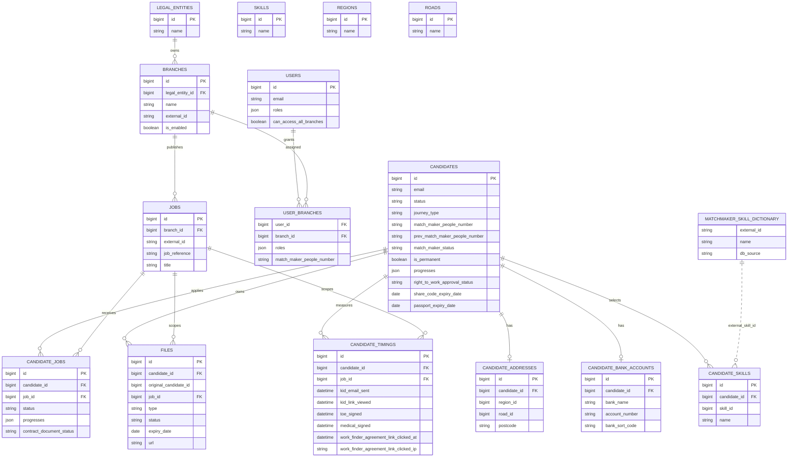
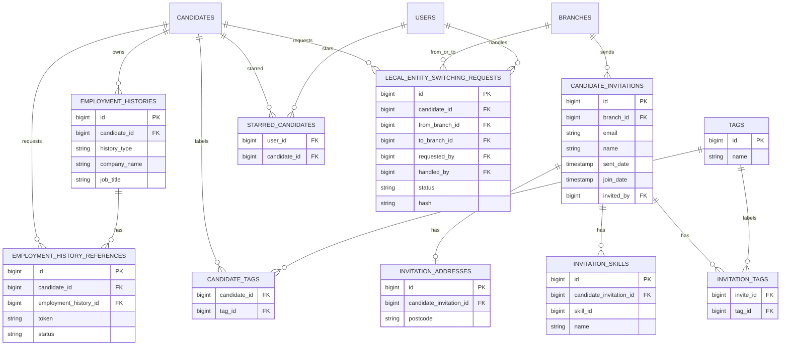
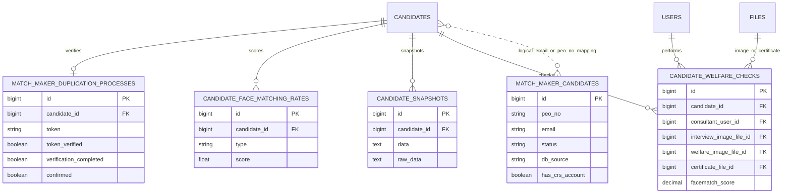
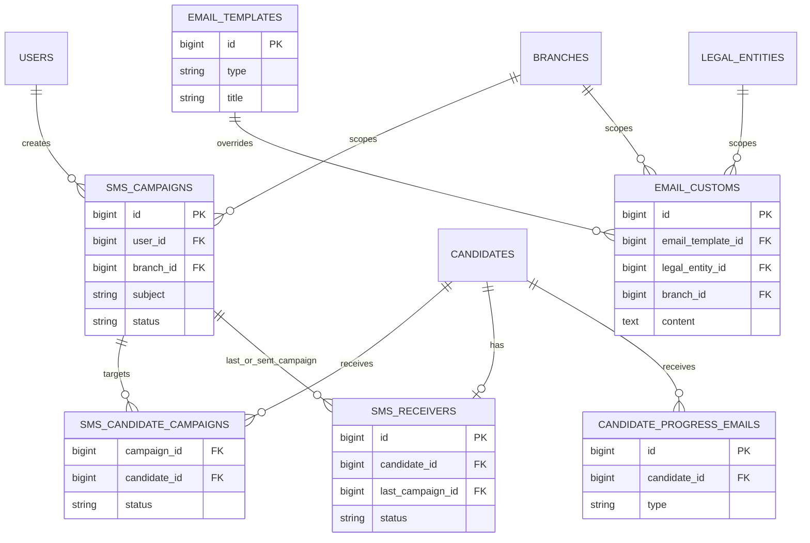

# Backend Database Relationship Specification

> **Canonical location**: `.business-spec/` — living database relationship reference.

> **Trạng thái**: `LIVING_SPEC`
> **Ngày tạo**: 2026-09-22
> **Đối chiếu schema gần nhất**: 2026-10-05 — GAP-691 legacy agreement URL removal, migration chain + model source; schema/data production chưa xác minh.
> **Author**: Codex
> **Nguồn**: Eloquent models, migrations, repositories và service call chain hiện tại.

## 1. Cách đọc sơ đồ

- Quan hệ có thể là foreign key thật hoặc quan hệ logical do migration chỉ tạo index/model tự map.
- `FK` trong dictionary nghĩa là migration/model có cột tham chiếu rõ.
- `LOGICAL` nghĩa là code dùng email, `peo_no`, candidate ID hoặc composite context nhưng database không bắt buộc foreign key.
- `jobs` trong sơ đồ là domain job table của GAP; không đồng nhất với queue backend/failed jobs.
- File binary/PDF không nằm trực tiếp trong DB; bảng `files` lưu metadata và URL/path tới storage.
- ERD là tập cột phục vụ trace, không phải full schema dump. Phải đọc cả migration tạo bảng và các migration alter/drop/rename về sau; không dùng schema lịch sử làm query hiện tại.

## 2. Core candidate/job ERD

GAP-734 (local source, deployment chưa xác minh): invite chọn job qua internal `jobs.id` scoped theo `jobs.branch_id`; URL dùng `jobs.external_id`, `jobs.title`, `jobs.job_reference` dưới keys `job_id`, `job_title`, `job_ref`. Default option parse từ `branches.registration_link`, không cần Job record. Invite không tạo jobs/candidate_jobs hoặc đổi branch link. `candidate_jobs.job_ref` lưu application attribution sau apply và vẫn là nguồn GET /consultant/jobs/job_refs; không mặc định bằng jobs.job_reference. JobService.getOrCreateJob chưa populate job_reference; task không backfill hoặc migration.

`skills` là local catalog; các flow candidate skills đang dùng dictionary MM theo
branch/job legal entity. `candidate_skills.skill_id` được index nhưng không có FK
tới local skills trong migration tạo bảng. Không inner-join local `skills` để kết
luận candidate không có skill. `MATCHMAKER_SKILL_DICTIONARY` là nguồn external,
không phải tên bảng DB. `candidate_timings` unique theo candidate_id + job_id;
MM start/end nằm trên candidate, không phải hai cột started_at/ended_at ở đây.

## 3. Questions, declaration, appointment và issue ERD

```mermaid
erDiagram
    CANDIDATES ||--o{ ANSWERS : submits
    QUESTIONS ||--o{ ANSWERS : receives
    ANSWER_OPTIONS ||--o{ ANSWERS : selected_by
    QUESTION_GROUPS ||--o{ QUESTION_GROUP_QUESTIONS : contains
    QUESTIONS ||--o{ QUESTION_GROUP_QUESTIONS : belongs

    CANDIDATES ||--o{ APPOINTMENTS : attends
    USERS ||--o{ APPOINTMENTS : conducts
    BRANCHES ||--o{ APPOINTMENTS : hosts
    CANDIDATE_JOBS ||--o{ CANDIDATE_JOB_APPOINTMENTS : links
    APPOINTMENTS ||--o{ CANDIDATE_JOB_APPOINTMENTS : links

    CANDIDATES ||--o{ ESCALATED_ISSUES : has
    USERS ||--o{ ESCALATED_ISSUES : creates_or_assigns
    ESCALATED_ISSUES ||--o{ ESCALATED_ISSUE_LOGS : records
    ESCALATED_ISSUES ||--o{ ESCALATED_ISSUE_CHANGE_LOGS : changes
    USERS ||--o{ ESCALATED_ISSUE_LOGS : writes
    USERS ||--o{ ESCALATED_ISSUE_CHANGE_LOGS : writes

    CANDIDATES ||--o{ ACTIVITY_LOGS : generates
    JOBS ||--o{ ACTIVITY_LOGS : scopes
    USERS ||--o{ ACTIVITY_LOGS : performs
    CANDIDATES ||--o| COMMUNICATION_NOTES : has
    COMMUNICATION_NOTES ||--o{ COMMUNICATION_NOTE_CHANGE_LOGS : versions
    USERS ||--o{ COMMUNICATION_NOTE_CHANGE_LOGS : writes

    QUESTION_GROUPS {
        bigint id PK
        string type
    }
    QUESTIONS {
        bigint id PK
        string category
        string type
    }
    QUESTION_GROUP_QUESTIONS {
        bigint question_group_id FK
        bigint question_id FK
    }
    ANSWER_OPTIONS {
        bigint id PK
        bigint question_id FK
        string value
    }
    ANSWERS {
        bigint id PK
        bigint candidate_id FK
        bigint question_id FK
        bigint answer_option_id
        text answer
    }
    APPOINTMENTS {
        bigint id PK
        bigint candidate_id FK
        bigint user_id FK
        bigint branch_id FK
        string type
        string status
    }
    CANDIDATE_JOB_APPOINTMENTS {
        bigint candidate_job_id FK
        bigint appointment_id FK
    }
    ESCALATED_ISSUES {
        bigint id PK
        bigint candidate_id FK
        bigint creator_user_id FK
        bigint assignee_user_id FK
        string category
        string type
        string status
        string extra_review
    }
    ESCALATED_ISSUE_LOGS {
        bigint id PK
        bigint escalated_issue_id FK
        bigint user_id FK
    }
    ESCALATED_ISSUE_CHANGE_LOGS {
        bigint id PK
        bigint escalated_issue_id FK
        bigint user_id FK
    }
    ACTIVITY_LOGS {
        bigint id PK
        bigint candidate_id FK
        bigint job_id FK
        bigint user_id FK
        string type
    }
    COMMUNICATION_NOTES {
        bigint id PK
        bigint candidate_id FK
        text content
    }
    COMMUNICATION_NOTE_CHANGE_LOGS {
        bigint id PK
        bigint communication_note_id FK
        bigint user_id FK
    }
```

## 4. Employment, invitation, tag và branch switching ERD

## 5. Identity, welfare, MatchMaker và snapshot ERD

`match_maker_candidates` không có `candidate_id` trong migration hiện tại. Code
map record này theo email, `peo_no` và `db_source`; đây là quan hệ logical, không
phải FK database. Đây là bảng quan trọng khi trace lỗi `worker not found`.

Trong welfare flow, `candidate_face_matching_rates.score` lưu tỷ lệ 0–1 còn
`candidate_welfare_checks.facematch_score` lưu phần trăm 0–100, pass khi >=75.
`certificate_file_id` được set trước bước sync MM nên không phải receipt của MM.
Snapshot giữ serialized data và raw_data; files snapshot được đổi `files.type`
sang `snapshot_YYYYMMDD_*`, không có quan hệ candidate_snapshot_id/file-copy mà
có thể tự suy ra từ hai bảng. Xem business SPEC-020/034.

## 6. SMS, email và progress ERD

## 7. Audit và external integration storage

Các bảng sau không có quan hệ business FK đầy đủ; chúng được dùng như audit/log
store và phải được trace theo thời gian, `api_name`, URL và `extra_info`:

| Table | Vai trò | Key trace |
|---|---|---|
| `api_result_logs` | External response/error/result | `api_name`, `url`, `type`, `http_code`, `message`, `extra_info`, `created_at` |
| `authentication_logs` | Login/authentication audit | user/candidate context, timestamp |
| `tracking_record_histories` | Acquisition/referrer/UTM history | candidate/context, source, timestamp |
| `cache` / `cache_locks` | Framework/cache state | cache key, lock |
| `failed_jobs` | Queue failure | job payload, exception, failed time |

`api_exception_logs` là schema legacy được tạo trong migration cũ và bị thay thế
bởi `api_result_logs`; exception hiện tại được lưu trong `api_result_logs` với
`type = EXCEPTION`.

GAP-691 foundation migration `2026_09_29_100000_add_permanent_intake_data_foundation`
adds `candidates.is_permanent` (boolean, default false), nullable first-click
timestamp/IP columns on `candidate_timings`, and historically added nullable
text `work_finder_agreement_url` to `branches` and `legal_entities`.
Forward migration `2026_10_05_110000_drop_work_finder_agreement_url_from_branches_and_legal_entities`
now drops both URL columns; they are absent from the current migration-chain
schema and model fillable lists. Its `down()` restores nullable text columns
only, not the deleted values; backup legacy IDs/URLs before deployment if
restoration is required. The historical foundation migration is unchanged.
The existing `files` table stores generated job-scoped Work Finder Agreement
PDFs using type `work_finder_agreement`; `files.url` remains unchanged. Click
fields still belong to the existing candidate/job timing row; no intake or
sync-state table is added. Migration/seed/rollback tests use SQLite in-memory;
production migration and data state remain UNVERIFIED.

## 8. Core table dictionary

Permanent intake stores BE-generated form PDFs using `files.type = permanent_candidate_form`, scoped to `candidate_id` and the selected `job_id`. Submit takes only CV/Agreement references; the Redis job carries validated payload and click metadata, generates the form before MM attachment upload and reuses file metadata/storage by deterministic snapshot filename. No submission table, new columns, migration or polling relationship is introduced. The recruitment `jobs` table is unrelated to queue storage; async delivery uses Redis and existing failed_jobs. Candidate is_permanent changes only after successful background synchronization. DB profile commit precedes Redis enqueue; no cross-store atomicity is claimed (2026-10-08, GAP-691/007).

| Table | Business role | Main owner/consumer | Important state |
|---|---|---|---|
| `candidates` | Candidate master và aggregated progress/MM state | CandidateService, Compliance, Admin | status, progress, RTW, MM number/status, `is_permanent` (default false; GAP marker, not MM status) |
| `candidate_jobs` | Candidate application theo từng job | CandidateService, JobService | status, progress, contract status |
| `jobs` | Job vacancy/domain job | JobService, branch flows | branch, external ID, title |
| `branches` | Operational branch/legal entity scope | BranchService, middleware | legal entity, enabled, reminder config; no legacy Agreement URL column |
| `legal_entities` | Legal entity configuration and MatchMaker source | BranchService, MatchMakerService | type, KID URL, company registration; no legacy Agreement URL column |
| `files` | File metadata và link storage | FileService, GBG/RTW/contract flows | type, status, expiry, candidate/job |
| `answers` | Candidate/interview/declaration answers | QuestionService, sync commands | question, option, answer |
| `appointments` | Screening/interview appointment | AppointmentService | type, status, time, candidate; job qua candidate_job_appointments |
| `escalated_issues` | Manual blocker/review work item, candidate scope | EscalatedIssueService, Compliance | type, category, status, creator_user_id, assignee_user_id |
| `activity_logs` | Candidate contact/request/audit timeline | ActivityLogService | type, content, actor, timestamp |
| `match_maker_candidates` | Local MM snapshot/cache | MatchMaker sync/search/duplicate flow | `peo_no`, email, db_source, status |
| `candidate_welfare_checks` | Welfare face check and certificate link | WorkerWelfareCheckService/job | score, image IDs, certificate ID |
| `candidate_timings` | Timing metrics per candidate/job | MatchMaker, progress and Permanent Agreement click | MM start/end, contract/KID timing, first Agreement link click time/IP (IP column length 45) |
| `candidate_snapshots` | Historical candidate state | reset/legal entity switching | serialized data |

### 8.1. Những tên cột/quan hệ legacy không dùng cho query hiện tại

| Legacy assumption | Implementation theo migrations hiện tại | Evidence |
|---|---|---|
| appointments.job_id | Đã drop; join qua candidate_job_appointments → candidate_jobs → jobs | `2022_12_14_075012_change_relation_between_appointments_table_and_candidate_jobs_table.php`; `2022_12_14_075835_create_candidate_job_appointments_table.php` |
| escalated_issues.job_id | Đã drop; issue gắn candidate, category quyết định tác động progress | `2022_12_21_093112_remove_job_id_from_escalated_issues_table.php` |
| escalated_issues.approval_status | Đã rename thành status | `2022_12_24_054348_change_approval_status_to_status_on_escalated_issues_table.php` |
| escalated_issues.user_id | Đã rename creator_user_id, thêm assignee_user_id | `2022_12_26_130921_differenciate_assignee_and_creator_on_escalated_issues_table.php` |
| candidate_face_matching_rates.rate | Cột thực tế score | `2022_12_27_051721_create_candidate_face_matching_rates_table.php` |
| users.role / user_branches.role | Role arrays roles, không phải một string role | `app/Models/User.php`; `2022_11_09_115150_create_user_branches_table.php` |

Đường dẫn migration ở bảng trên tương đối với `database/migrations/`. Đây là
`CODE_FACT` về schema mong đợi sau migration chain; nếu DB đang chạy khác thì
ghi nhận `DATA`/migration drift và xác minh, không tự sửa production schema.

## 9. Relationship verification checklist

Khi code thay đổi schema hoặc flow, AI phải kiểm tra:

- Cột `candidate_id`, `job_id`, `branch_id`, `user_id` có đúng ownership không.
- Quan hệ candidate ↔ job có đi qua `candidate_jobs`, không join trực tiếp sai context.
- File có được scope theo `candidate_id` và `job_id` khi cần không.
- Progress đọc đủ source tables: files, answers, appointments, issues và candidate/job state.
- MatchMaker mapping có đúng `peo_no` + `db_source` không.
- Xóa/reset có để lại orphan rows hoặc orphan storage không.
- Các quan hệ logical không được hiểu nhầm là FK chắc chắn.
- Query trong loop có gây N+1 hoặc ghi từng row thay vì batch không.
- Transaction chỉ bao quanh mutation; đọc/eager load nên thực hiện ngoài transaction theo project rule.

## 10. Source references

- Models: `app/Models/`
- Repository contracts/implementations: `app/Contracts/Repositories/`, `app/Repositories/`
- Schema: `database/migrations/`
- Candidate flow: `app/Services/CandidateService.php`, `app/Services/MatchMakerService.php`
- File flow: `app/Services/FileService.php`
- Progress flow: `app/Services/RegistrationProgressService.php`
- Welfare flow: `app/Services/WorkerWelfareCheckService.php`, `app/Jobs/GenerateWorkerWelfareCheckCertificateJob.php`
- External/log flow: `app/Externals/`, `app/Models/ApiResultLog.php`, `app/Facades/ApiLogAccessor.php`

### GAP-691 question label snapshot amendment — 2026-10-08

`questions.data.options` (JSON, cast array) supplies selected display labels for transport, distance and candidate recruitment source. Existing `answer_options.value`/`answers.answer_option_id` still provide associations, and `answers.answer` still stores raw payload keys. No schema changes. Selected labels are serialized into Redis job `snapshot.display_labels` during submit; new jobs do not reload them. Legacy snapshots use a batch options lookup when rendering a missing form, while stored PDFs retain existing content. Missing or invalid label data falls back to the raw key. No production data update or new table.

GAP-691 upload compatibility decision (2026-10-08): manual candidate uploads of permanent_candidate_form still create job-scoped files rows through the normal file upload flow. These are separate from intake-generated files identified by snapshot fingerprint and do not replace the background MM attachment. No schema change.

GAP-691/007 §13–14 (2026-10-09): no schema change. Redis/default now carries typed scalar/value-object job data; selected labels are internal snapshot.displayLabels fields. Original serialized scalar snapshot fingerprint is retained for old generated files. Generic File lookup supplies candidate_id/job_id/type/original_file_name and selects latest id. No new queue/submission table; legacy permanent_intake Redis alias retained for drain compatibility.

GAP-691/007 §15–16 (2026-10-09): No schema migration. Each worker attempt reads candidate_jobs/Candidate once, CV/Agreement in one batch and generated File metadata by existing generic fingerprint lookup; returned generated File is reused directly. Job/Branch/address/answers and MM question categories are loaded into the initial execution DTO. submit answer-option pairs are resolved from one question-ID/value-set query then exact pair matching in Service. Business Pipeline, MM mapping and completion perform no SELECT after build; existing writes remain. Runtime context contains typed Eloquent records only for this execution, never a serialized queue snapshot or cross-request cache. Retry reconstructs current records; PDF snapshot/fingerprint/raw click data remain immutable.

GAP-691/007 §17–21 (2026-10-09): No schema/relationship change. Per-execution models remain in the initial Service-built runtime context. Common file rules are checked during preparation; MM checks its remaining record/form prerequisites and completion updates the loaded Candidate without a duplicate ownership check. Independent entry points rebuild/validate their own data. No post-build SELECT, new table, queued Request/Model or old Job payload migration is introduced.
GAP-691/009 (2026-10-09): No schema/relationship change. The queue carries scalar prepared MM profile/address/answer/question data derived after the existing candidate, address and answer writes. Worker reads are limited to missing question definitions and Job/Branch/file/live-state prerequisites; queued values do not overwrite later profile edits. Existing `candidates`, `candidate_jobs`, `candidate_addresses`, `answers`, `questions` and `files` relationships remain unchanged.

GAP-691/010 (2026-10-09): No schema/relationship change. Snapshot-backed submit jobs continue to use the existing candidate, job, answer, question and file relationships; required snapshot/profile values are built before dispatch. The unused standalone scalar MatchMaker path and its extra data builder were removed, so no alternate relationship-loading path remains.

GAP-691/012 (2026-10-09): No schema/relationship change. Service queries and writes use the prior candidate, candidate-job, file, address, answer, question, job and branch repository flow. The Job carries the immutable snapshot/IDs and regenerates or reuses the form on retry; no runtime model/context DTO is serialized.

GAP-691/012 queue routing amendment (2026-10-09): No schema/relationship change. Queue backend selection is now environment configuration rather than a relationship or data concern of the Job.
