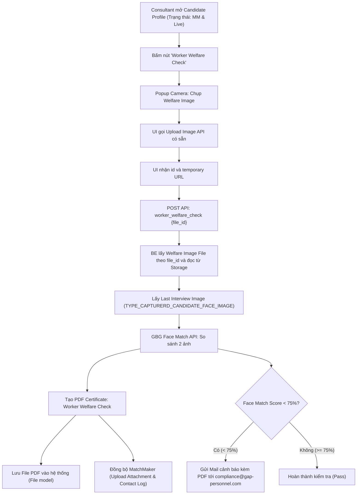
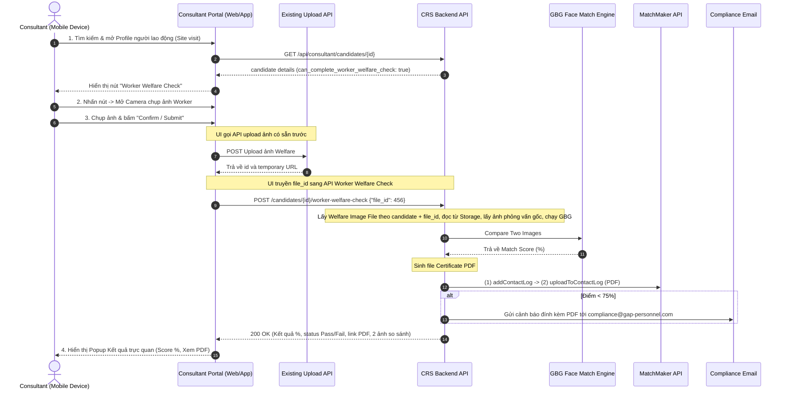

# Kế Hoạch Triển Khai & Phân Tích Yêu Cầu: Worker Welfare Check

## 1. Tổng Quan & Giải Thích Chi Tiết Yêu Cầu (Requirement Breakdown)

### 1.1. Bối cảnh & Mục tiêu nghiệp vụ (Why)
- **Vấn đề**: Theo quy định mới từ ERB (Employment Rights Bill / Employment Agency Standards), công ty cần các công cụ để chứng minh với khách hàng (clients) và hạn chế tối đa trách nhiệm pháp lý (liability) đối với tình trạng "mạo danh" — tức người đi làm tại doanh nghiệp (worker) không phải là người đã được phỏng vấn và duyệt hồ sơ (interviewed candidate).
- **Mục tiêu**: Bổ sung tính năng **"Worker Welfare Check"** trên Consultant Portal. Consultant khi gặp lao động tại site/nơi làm việc có thể dùng điện thoại/thiết bị chụp ảnh khuôn mặt người lao động, hệ thống sẽ tự động so khớp khuôn mặt (Face Match) với ảnh phỏng vấn đã lưu, xuất chứng chỉ đối chiếu có ảnh & tỷ lệ %, đồng bộ sang MatchMaker và gửi cảnh báo đến Compliance nếu không khớp (dưới 75%).

---

### 1.2. Phân tích chi tiết từng yêu cầu chức năng (What & How)



#### ① Điều kiện kích hoạt (Eligibility Condition)
- **Yêu cầu**: Nút **‘Worker Welfare Check’** chỉ hiển thị khi candidate có trạng thái **"MM and Live"**.
- **Quy tắc kỹ thuật Backend**:
  - Ứng viên đã được chuyển sang MatchMaker: `most_progressed_job_status === 'matchmaker'` (hoặc `CandidateJob::STATUS_MATCHMAKER`).
  - Trạng thái MatchMaker là Live: `match_maker_status === Candidate::MM_STATUS_LIVE` (`'live'`).
  - Cần expose cờ `can_complete_worker_welfare_check` (boolean) trong resource `CandidateDetail` để Frontend tiện ẩn/hiện nút.

#### ② Chụp, Upload và Truyền Welfare Image File ID
- **Cơ chế tích hợp (UI upload trước -> truyền file ID vào Backend)**:
  - Frontend sử dụng API upload ảnh có sẵn trong hệ thống để tải ảnh chụp từ camera lên S3 / Storage.
  - API upload trả về field `id` cùng temporary URL của file; Frontend dùng giá trị này làm `file_id` cho bước verify.
  - Frontend gọi API `POST /api/consultant/candidates/{candidate_id}/worker_welfare_check` truyền `file_id` dạng JSON body.
  - Backend tìm file theo `file_id` và `candidate_id`, xác nhận file có type `File::TYPE_WELFARE_IMAGE` và `job_id = 0`, sau đó đọc file từ Storage vào temp file phục vụ Face Match GBG và nhúng base64 vào PDF Certificate.
- **Lưu trữ**:
  - Bảng `candidate_welfare_checks` lưu lịch sử từng lần kiểm tra bằng các ID: `welfare_image_file_id`, `interview_image_file_id`, `certificate_file_id`, cùng `candidate_id`, `consultant_user_id`, `facematch_score` và timestamps.
  - `welfare_image_url` không được lưu trong bảng; nếu cần trả về cho Frontend, URL được tạo runtime từ quan hệ `welfareImageFile` bằng temporary URL.
- **Kiểm soát ownership**:
  - Không chấp nhận URL tùy ý từ Frontend.
  - `file_id` phải thuộc đúng candidate đang được kiểm tra, đúng type `welfare_image`, và là file candidate-level (`job_id = 0`).

#### ③ So khớp khuôn mặt (Face Matching)
- **Yêu cầu**: So khớp ảnh chụp lúc kiểm tra phúc lợi (`Welfare Image`) với ảnh phỏng vấn từ lần đăng ký gần nhất (`Interview Image from the last registration journey`).
- **Nguồn dữ liệu**:
  - `Interview Image`: Tìm file gần nhất của candidate có `type = File::TYPE_CAPTURERD_CANDIDATE_FACE_IMAGE` (`capturerd_candidate_face_image`). Lấy ngày giờ upload gốc (`uploaded_at` / `created_at`).
  - Gọi `GbgFaceMatchApi::compareTwoImages` (hoặc mở rộng `GBGIdentificationCheckService`) để nhận điểm số so khớp `score` (0.0 đến 1.0 -> quy đổi ra phần trăm 0% - 100%).
  - Lưu kết quả tỷ lệ vào bảng `candidate_face_matching_rates` với type `CandidateFaceMatchingRate::TYPE_WELFARE_CHECK_TO_CAPTURED_FACE_IMAGE`.

#### ④ Tạo chứng chỉ Worker Welfare Check (PDF Certificate)
- **Yêu cầu**: Kết quả được xuất thành chứng chỉ PDF tương tự phong cách của Journey Report / Proof of Address / Signed Document Log.
- **Nội dung bắt buộc trên chứng chỉ**:
  - **Header**: `Worker Welfare Check` + Gap Personnel Logo.
  - **Thông tin chung**:
    - *Date and Time check completed*: `DD/MM/YYYY - HH:MM:SS` (UK timezone: `Europe/London`).
    - *Worker Name*: `{CandidateFullName}`.
    - *Branch*: `{Branch the worker is linked to}`.
    - *Consultant*: `{Name of consultant who completed the check}`.
  - **Hình ảnh so khớp**:
    - *Image 1*: Last Interview Image kèm thời gian upload lên CRS: `DD/MM/YYYY - HH:MM:SS`.
    - *Image 2*: Welfare Check Image lấy từ `welfareImageFile`, kèm thời gian upload/chụp lưu trên File record: `DD/MM/YYYY - HH:MM:SS`.
  - **Kết quả**:
    - *Image Facematch % result*: ví dụ `82%`.
  - **Footer**: Tiêu chuẩn liveness & facematch GBG IDSP certified.

#### ⑤ Đồng bộ MatchMaker (MM Integration)
- **Cơ chế đã thống nhất (Chuẩn 2 thao tác, không dùng chk_no)**:
  - **Thao tác 1 (Tạo Contact Log)**:
    - Service sử dụng: `CandidateMatchMakerService::addContactLog` hoặc `MatchMakerService` gọi `POST /api/Onboarding/AddToContactLog?peo_no={peo_no}`.
    - Payload:
      - `peo_no`: Mã số MatchMaker của candidate.
      - `Subject`: `'Worker welfare check'`
      - `Body`: `'Worker welfare check facematch: {score}%'`
      - `Type`: Phù hợp với Contact Log category cho Onboarding/Compliance.
    - MatchMaker trả về `logNo` (ID dòng log vừa ghi nhận).
  - **Thao tác 2 (Đính kèm Certificate PDF vào Contact Log)**:
    - Service sử dụng: `CandidateMatchMakerService::uploadToContactLog` hoặc gọi `POST /api/Candidates/UploadAttachment`.
    - Payload:
      - `AttachRef`: `{logNo}` (ID dòng Contact Log vừa tạo ở bước 1).
      - `AttachType`: `3` (Đính kèm tương ứng cho Contact Log).
      - `AttachName`: `'Worker Welfare Check Certificate - {worker_name}.pdf'`
      - `FileData`: Binary stream / Base64 của file PDF vừa sinh.
  - **Lưu ý loại bỏ Thao tác 3**: Không gọi `UploadAttachment` với câu hỏi `chk_no` vì MatchMaker không có câu hỏi checklist dành riêng cho Worker Welfare Check (tránh ghi đè/ảnh hưởng Right to work hoặc câu hỏi kiểm tra khác).
  - **Xử lý lỗi ngoại lệ**: Bọc toàn bộ các lệnh gọi MatchMaker trong khối `try/catch` có log `Log::error`. Lỗi kết nối hoặc timeout từ MatchMaker sẽ không làm gián đoạn hay rollback kết quả kiểm tra Worker Welfare Check trong hệ thống CRS.

#### ⑥ Cảnh báo vi phạm / thất bại (Compliance Notification)
- **Yêu cầu**: Nếu tỷ lệ facematch **dưới 75%** (`< 75%`):
  - Tự động gửi email thông báo tới: `compliance@gap-personnel.com`.
  - Đính kèm file chứng chỉ PDF Worker Welfare Check.
  - **Subject**: `Failed Worker Welfare Check`
  - **Body**:
    ```text
    Hi Compliance

    A worker welfare check has been completed and the facematch was below 75%, please see attached.
    ```

#### ⑦ Yêu cầu UX/Mobile (Other Considerations)
- Consultant sẽ sử dụng điện thoại di động (mobile devices) để đi kiểm tra tại site của khách hàng.
- Do đó, giao diện Consultant Portal (đặc biệt là Candidate list/search/filters và Candidate Profile) cần đảm bảo thao tác chụp ảnh và bấm nút thuận tiện, responsive trên mobile.
- API Backend cần cung cấp đầy đủ thông tin trạng thái & error handling rõ ràng (camera error, face detection error, candidate status invalid).

---

## 2. Các Quyết Định Thiết Kế Đã Thống Nhất (Decisions Aligned)

> [!NOTE]
> **Quyết định 1: Cơ chế lưu trữ lịch sử Welfare Check**
> - **Chốt**: Tạo bảng `candidate_welfare_checks` để lưu đầy đủ lịch sử tất cả các lần kiểm tra của candidate (cho phép kiểm tra định kỳ nhiều lần tại site).
> - Expose relationship `welfareChecks` và method `latestWelfareCheck` trên `Candidate` model.

> [!NOTE]
> **Quyết định 2: Phương thức đồng bộ MatchMaker**
> - **Chốt**: Thực hiện chính xác 2 bước: (1) `addContactLog` để lấy `logNo` -> (2) `uploadToContactLog` (`AttachType = 3`) đính kèm certificate PDF vào chính dòng log đó.
> - Bỏ thao tác upload checklist `chk_no` để tránh ảnh hưởng dữ liệu compliance của MatchMaker.
> - Bọc trong `try/catch` bảo vệ tính toàn vẹn dữ liệu nội bộ.

> [!NOTE]
> **Quyết định 3: Xử lý trường hợp thiếu Interview Image**
> - Nếu candidate không có ảnh phỏng vấn gốc (`File::TYPE_CAPTURERD_CANDIDATE_FACE_IMAGE`), API phản hồi lỗi nghiệp vụ rõ ràng (HTTP 422: `"No previous interview face image found for this candidate. Please complete interview photo capture first."`) thay vì crash hệ thống.

---

## 3. Quy Trình Thao Tác Chi Tiết Trên Web / Mobile App (User Journey & Operations)

Hệ thống Consultant Portal được thiết kế tối ưu hóa hiển thị (Responsive) trên màn hình điện thoại di động để Consultant thuận tiện thao tác trực tiếp tại site khách hàng:



### Chi tiết các bước thao tác của Consultant:

#### Bước 1: Tìm kiếm & Truy cập Hồ Sơ Người Lao Động (Search & Profile Access)
- **Hoàn cảnh**: Consultant đang có mặt tại nhà máy, kho bãi hoặc công trường của khách hàng (Client site).
- **Thao tác**:
  - Mở trình duyệt Web trên điện thoại di động (hoặc App) và đăng nhập vào **Consultant Portal**.
  - Truy cập danh mục **Candidates**.
  - Sử dụng thanh tìm kiếm nhanh (gõ Tên, SĐT, hoặc MatchMaker Number `peo_no`) hoặc bộ lọc theo Branch để mở đúng hồ sơ người lao động đang làm việc tại site.

#### Bước 2: Nhận Diện Nút Hành Động "Worker Welfare Check"
- Khi vào trang **Candidate Profile**:
  - Hệ thống kiểm tra điều kiện:
    - Trạng thái tuyển dụng: Đã chuyển sang MatchMaker (`mostProgressedJobStatus === 'matchmaker'`).
    - Trạng thái MatchMaker: Đang hoạt động (`match_maker_status === 'live'`).
  - Khi thỏa mãn, nút **"Worker Welfare Check"** (icon camera hoặc huy hiệu kiểm tra) sẽ xuất hiện nổi bật tại Action Header / Floating Action Bar trên mobile.
  - *(Nếu chưa thỏa điều kiện, nút bị ẩn hoặc hiển thị mờ kèm tooltip giải thích lý do)*.

#### Bước 3: Mở Giao Diện Chụp Ảnh (Camera Modal)
- Consultant chạm vào nút **"Worker Welfare Check"**:
  - Modal Camera xuất hiện trực quan, xin quyền truy cập camera của thiết bị.
  - Consultant có thể chuyển đổi giữa Camera sau (nếu Consultant trực tiếp chụp cho người lao động) hoặc Camera trước (nếu người lao động tự selfie).
  - Có khung hướng dẫn định vị khuôn mặt (Face Oval Guide): Hướng dẫn worker tháo khẩu trang, kính râm, mũ bảo hộ che khuất mặt và đứng ở khu vực đủ ánh sáng.

#### Bước 4: Chụp Ảnh, Upload & Truyền File ID (Capture & Upload via Existing API)
- Consultant chạm nút chụp ảnh:
  - Màn hình dừng lại ở chế độ xem trước (Preview) bức ảnh vừa chụp.
  - Consultant có 2 lựa chọn:
    - **"Retake" (Chụp lại)**: Nếu ảnh bị rung lắc, mờ nhoè hoặc worker nhắm mắt.
    - **"Confirm / Submit" (Xác nhận gửi)**: Khi ảnh đã rõ nét, đúng diện mạo.
  - Khi bấm xác nhận:
    1. Giao diện Frontend gọi API `POST /api/consultant/candidates/{id}/files/welfare_image` để đưa file ảnh lên S3/Storage; response trả về `id` của record trong bảng `files` và temporary URL.
    2. Frontend gửi request JSON sang endpoint nghiệp vụ: `POST /api/consultant/candidates/{id}/worker_welfare_check` với payload `{"file_id": 456}`.

#### Bước 5: Hệ Thống Tự Động Xử Lý Tức Thì (Instant Backend Processing)
- Giao diện hiển thị màn hình chờ: *"Verifying worker identity with GBG..."*.
- Trong 2 - 4 giây, hệ thống Backend nhận `file_id` và thực hiện:
  - Tìm Welfare Image File theo `candidate_id`, `file_id`, `type = welfare_image`, `job_id = 0` và đọc dữ liệu ảnh từ Storage.
  - Lấy ảnh phỏng vấn gốc lúc đăng ký (`Interview Image`).
  - So sánh đối chiếu 2 khuôn mặt qua GBG Face Match API.
  - Tự động sinh chứng chỉ PDF (Worker Welfare Check Certificate) đầy đủ logo, thông tin worker, chi nhánh, tên consultant, thời gian kiểm tra và 2 bức ảnh đối chứng.
  - Lưu bản ghi lịch sử kiểm tra vào bảng `candidate_welfare_checks` (kèm `welfare_image_file_id`, không lưu URL ảnh welfare).
  - Tự động tạo dòng Contact Log và đính kèm file PDF sang MatchMaker.
  - Nếu kết quả dưới 75%: Tự động gửi email cảnh báo kèm PDF đến hòm thư `compliance@gap-personnel.com`.

#### Bước 6: Xem Kết Quả Trực Quan & Xem Chứng Chỉ (Result & Certificate View)
- Màn hình kết quả phản hồi tức thì cho Consultant:
  - **Tỷ lệ % Facematch**: Ví dụ: `88%` - kèm nhãn trạng thái xanh lá **PASSED** (nếu >= 75%) hoặc nhãn đỏ **FAILED** (nếu < 75%).
  - **So sánh trực quan**: 2 bức ảnh được đặt cạnh nhau (Ảnh phỏng vấn gốc vs Ảnh vừa chụp tại site).
  - **Nút "View Certificate"**: Consultant có thể chạm vào để xem hoặc xuất ngay file PDF chứng chỉ hoàn chỉnh để xuất trình cho khách hàng/quản lý site xem tại chỗ nếu cần.

---

## 4. Kiến Trúc & Thiết Kế Kỹ Thuật (Architecture & Technical Design)

Tuân thủ nghiêm ngặt quy chuẩn: `Controller -> FormRequest -> Service -> Repository`.

### 4.1. Database Design

#### A. Bảng mới: `candidate_welfare_checks`
```sql
CREATE TABLE `candidate_welfare_checks` (
    `id` bigint unsigned NOT NULL AUTO_INCREMENT,
    `candidate_id` bigint unsigned NOT NULL,
    `consultant_user_id` bigint unsigned NOT NULL,
    `interview_image_file_id` bigint unsigned NOT NULL,
    `welfare_image_file_id` bigint unsigned NOT NULL,
    `facematch_score` decimal(5, 2) NOT NULL,
    `certificate_file_id` bigint unsigned NULL,
    `created_at` timestamp NULL DEFAULT NULL,
    `updated_at` timestamp NULL DEFAULT NULL,
    PRIMARY KEY (`id`),
    KEY `cwc_candidate_id_idx` (`candidate_id`),
    KEY `cwc_consultant_user_id_idx` (`consultant_user_id`),
    KEY `cwc_interview_image_file_id_idx` (`interview_image_file_id`),
    KEY `cwc_welfare_image_file_id_idx` (`welfare_image_file_id`),
    KEY `cwc_certificate_file_id_idx` (`certificate_file_id`),
    CONSTRAINT `cwc_candidate_fk` FOREIGN KEY (`candidate_id`) REFERENCES `candidates` (`id`) ON DELETE CASCADE,
    CONSTRAINT `cwc_interview_image_file_fk` FOREIGN KEY (`interview_image_file_id`) REFERENCES `files` (`id`) ON DELETE RESTRICT,
    CONSTRAINT `cwc_welfare_image_file_fk` FOREIGN KEY (`welfare_image_file_id`) REFERENCES `files` (`id`) ON DELETE RESTRICT,
    CONSTRAINT `cwc_certificate_file_fk` FOREIGN KEY (`certificate_file_id`) REFERENCES `files` (`id`) ON DELETE RESTRICT
);
```

- `consultant_name`, `branch_name` và `checked_at` là các field response được resolve từ `consultantUser`, candidate/branch và `created_at`; không tạo thành cột riêng trong bảng.
- `interview_image_file_id`, `welfare_image_file_id` và `certificate_file_id` đều là foreign key references tới `files`.
- Không được xóa file đang được tham chiếu bởi lịch sử check. Luồng xóa file phải kiểm tra reference trước và trả custom API error phù hợp; không để DB exception generic lọt ra ngoài. Các file ID được kiểm tra ownership/type ở Service trước khi tạo history record.

#### B. Thêm File Types & Constants
- `App\Models\File`:
  - `public const TYPE_WELFARE_IMAGE = 'welfare_image';`
  - `public const TYPE_WORKER_WELFARE_CHECK_CERTIFICATE = 'worker_welfare_check_certificate';`
  - Hai type được thêm vào `getAllFileTypes()` và `getCandidateAssociatedFileTypes()`; không thêm vào các list face image, liveness, face matching, job, passport, address, right-to-work, contract signature hoặc mail-to-candidate.
- `App\Models\CandidateFaceMatchingRate`:
  - `public const TYPE_WELFARE_CHECK_TO_CAPTURED_FACE_IMAGE = 'welfare_check_to_captured_face_image';`

---

#### 4.2. API Contract

#### Upload dependency: Welfare Image File
```
POST /api/consultant/candidates/{candidate_id}/files/welfare_image
```
- Dùng generic Consultant Candidate File API hiện có.
- Vì `welfare_image` thuộc `getCandidateAssociatedFileTypes()`, file được lưu với `job_id = 0`.
- Response `201 Created` có tối thiểu `id`, `type`, `url`, `status`, `original_file_name`; Frontend lấy `id` làm `file_id` cho Endpoint 1. `url` là temporary URL để hiển thị preview, không phải giá trị được gửi sang verify.

#### Endpoint 1: Thực hiện Worker Welfare Check
```
POST /api/consultant/candidates/{candidate_id}/worker_welfare_check
```
- **Auth**: `auth:userApi` (Consultant User)
- **Headers**:
  - `Authorization: Bearer {token}`
  - `Gap-Branch-ID: {branch_id}`
- **Content-Type**: `application/json`
- **Request Body**:
```json
{
    "file_id": 456
}
```
- **FormRequest**: `App\Http\Requests\Api\Consultant\WorkerWelfareCheckRequest`
  - Validate: `file_id` is required, integer.
  - Service tiếp tục kiểm tra ownership/type/job scope: file phải thuộc candidate hiện tại, có type `File::TYPE_WELFARE_IMAGE`, `job_id = 0`.
  - Candidate check: Verify `mostProgressedJobStatus() === 'matchmaker'` và `match_maker_status === 'live'`.
- **Response Success (200 OK, JSON top-level)**:
```json
{
    "id": 1,
    "candidate_id": 1234,
    "consultant_name": "John Doe",
    "branch_name": "Manchester Branch",
    "checked_at": "17/09/2026 - 15:45:00",
    "facematch_score": 88.5,
    "is_passed": true,
    "welfare_image_file_id": 456,
    "welfare_image_url": "https://s3.../welfare_image.jpg",
    "interview_image_url": "https://s3.../interview_image.jpg",
    "certificate_url": "https://s3.../worker_welfare_certificate.pdf"
}
```
- `welfare_image_url` trong response là temporary URL được tạo từ `welfareImageFile`, không phải giá trị được lưu trong `candidate_welfare_checks`.
- Resource hiện tại của project không wrap response trong `data`; JSON success thực tế là object top-level.
- **Response Error (422 Unprocessable)**:
```json
{
    "success": false,
    "detail": "Candidate is not in Live status in MatchMaker or has no previous interview image."
}
```

#### Endpoint 2: Lấy lịch sử Worker Welfare Check của Candidate
```
GET /api/consultant/candidates/{candidate_id}/worker_welfare_checks
```
- **Headers**:
  - `Authorization: Bearer {token}`
  - `Gap-Branch-ID: {branch_id}`
- **Response (200 OK)**: Danh sách các lần kiểm tra đã thực hiện kèm URL chứng chỉ và điểm số.

---

### 4.3. Danh sách File cần tạo / sửa đổi

#### Files Tạo Mới [NEW]:
1. `database/migrations/YYYY_MM_DD_create_candidate_welfare_checks_table.php`: Migration tạo bảng lịch sử check.
2. `../../app/Models/CandidateWelfareCheck.php`: Model cho bảng mới.
3. `../../app/Contracts/Repositories/CandidateWelfareCheckRepositoryInterface.php`: Contract Repository.
4. `../../app/Repositories/CandidateWelfareCheckRepository.php`: Implementation Repository.
5. `../../app/Contracts/Services/WorkerWelfareCheckServiceInterface.php`: Contract Service.
6. `../../app/Services/WorkerWelfareCheckService.php`: Service thực hiện 100% logic:
   - Signature chính: `performCheck(int $candidateId, int $welfareImageFileId, int $consultantUserId, string $consultantName, int $branchId)`.
   - Validate điều kiện candidate.
   - Nhận `welfareImageFileId`, tìm File thuộc candidate và validate type/scope.
   - Tải dữ liệu Welfare Image từ Storage dựa trên File record, không tải arbitrary URL.
   - Tìm `Interview Image` gần nhất.
   - Gọi Face Match API so sánh 2 ảnh.
   - Render PDF Certificate bằng Dompdf.
   - Đồng bộ MatchMaker (Upload certificate + Contact Log).
   - Gửi mail tới `compliance@gap-personnel.com` nếu < 75%.
7. `../../app/Http/Requests/Api/Consultant/WorkerWelfareCheckRequest.php`: FormRequest validate `file_id`.
8. `../../app/Http/Resources/Api/Consultant/CandidateWelfareCheck.php`: Resource trả `welfare_image_file_id` và tạo `welfare_image_url` runtime từ quan hệ File.
9. `../../app/Mail/FailedWorkerWelfareCheckMail.php`: Mailable gửi cảnh báo cho Compliance kèm attachment.
10. `../../resources/views/mails/failed_worker_welfare_check.blade.php`: Blade view nội dung email Compliance.
11. `../../tests/Unit/Services/WorkerWelfareCheckServiceTest.php`: Unit test suite kiểm tra toàn bộ luồng.
12. `../../tests/Feature/Api/Consultant/WorkerWelfareCheckTest.php`: Feature test suite kiểm tra endpoint API.

#### Files Sửa Đổi [MODIFY]:
1. `../../app/Models/File.php`: Thêm constant `TYPE_WELFARE_IMAGE` và `TYPE_WORKER_WELFARE_CHECK_CERTIFICATE`; cập nhật `getAllFileTypes()` và `getCandidateAssociatedFileTypes()`.
2. `../../app/Models/CandidateFaceMatchingRate.php`: Thêm constant `TYPE_WELFARE_CHECK_TO_CAPTURED_FACE_IMAGE`.
3. `../../app/Models/CandidateWelfareCheck.php`: Đổi `welfare_image_url` thành `welfare_image_file_id`, thêm `$casts`/fillable phù hợp và quan hệ `welfareImageFile(): BelongsTo`.
4. `../../app/Models/Candidate.php`: Thêm quan hệ `welfareChecks(): HasMany` và cờ kiểm tra `canCompleteWorkerWelfareCheck(): bool`.
5. `../../app/Http/Resources/Api/Consultant/CandidateDetail.php`: Thêm field `can_complete_worker_welfare_check` và `latest_welfare_check`.
6. `../../app/Http/Resources/Api/Consultant/CandidateWelfareCheck.php`: Resolve welfare image URL từ `welfareImageFile` và expose `welfare_image_file_id`.
7. `../../app/Http/Controllers/Api/Consultant/CandidateController.php`: Nhận `file_id` và truyền vào Service.
8. `../../app/Repositories/CandidateWelfareCheckRepository.php` và `../../app/Contracts/Repositories/CandidateWelfareCheckRepositoryInterface.php`: Eager-load `welfareImageFile`; thêm query `existsByReferencedFileId()` để phục vụ delete protection cho cả ba file references.
9. `../../app/Services/FileService.php`: Chặn xóa Welfare Image File đang được tham chiếu bằng custom API exception; không xóa file trước rồi mới kiểm tra.
10. `../../routes/consultant.php`: Khai báo 2 routes mới cho Consultant; route upload welfare image dùng route generic hiện có, không cần route riêng.
11. `../../app/Providers/RepositoryServiceProvider.php`: Đăng ký DI binding cho `CandidateWelfareCheckRepositoryInterface`.
12. `../../app/Providers/ServiceServiceProvider.php`: Đăng ký DI binding cho `WorkerWelfareCheckServiceInterface`.

#### Tests cần cập nhật [MODIFY/ADD]:
- `../../tests/Unit/Services/WorkerWelfareCheckServiceTest.php`: Truyền `welfareImageFileId`, mock lookup File theo candidate, kiểm tra ownership/type/job scope và lưu `welfare_image_file_id`.
- `tests/Unit/Http/Requests/WorkerWelfareCheckRequestTest.php`: Đổi validation từ `image_url` sang `file_id` integer.
- `tests/Unit/Http/Resources/CandidateWelfareCheckResourceTest.php`: Dựng quan hệ `welfareImageFile`, kiểm tra `welfare_image_file_id` và URL runtime.
- `tests/Unit/Models/CandidateWelfareCheckTest.php`: Kiểm tra quan hệ `welfareImageFile`.
- `../../tests/Unit/Services/FileServiceTest.php`: Không cho xóa file đang được tham chiếu bởi bất kỳ lịch sử Worker Welfare Check nào.
- `../../tests/Feature/Api/Consultant/CandidateFilesTest.php`: Xác nhận upload `welfare_image` trả `id`, lưu file candidate-level và trả temporary URL.
- `../../tests/Feature/Api/Consultant/WorkerWelfareCheckTest.php`: Kiểm tra verify bằng `file_id`, file sai candidate/type bị từ chối và response trả URL runtime.

---

## 5. Kế Hoạch Xác Minh & Kiểm Thử (Verification Plan)

### 5.1. Automated Tests (Unit & Feature Test)
- Chạy lệnh test:
  ```bash
  ./vendor/bin/phpunit tests/Unit/Services/WorkerWelfareCheckServiceTest.php
  ./vendor/bin/phpunit tests/Unit/Http/Requests/WorkerWelfareCheckRequestTest.php
  ./vendor/bin/phpunit tests/Unit/Http/Resources/CandidateWelfareCheckResourceTest.php
  ./vendor/bin/phpunit tests/Unit/Models/CandidateWelfareCheckTest.php
  ./vendor/bin/phpunit tests/Feature/Api/Consultant/CandidateFilesTest.php
  ./vendor/bin/phpunit tests/Feature/Api/Consultant/WorkerWelfareCheckTest.php
  ./vendor/bin/phpunit
  ```
- Các ca test bao gồm:
  - `test_cannot_perform_check_if_candidate_not_in_mm_and_live`: Trả về exception phù hợp.
  - `test_cannot_perform_check_if_candidate_lacks_interview_image`: Báo thiếu ảnh phỏng vấn.
  - `test_perform_check_success_with_high_score`: Score >= 75%, sinh certificate, lưu DB, đồng bộ MM, không gửi mail.
  - `test_perform_check_triggers_compliance_email_when_score_below_75`: Score < 75%, gửi mail đính kèm certificate đến `compliance@gap-personnel.com`.
  - Request nhận `file_id` là integer; từ chối thiếu hoặc sai kiểu, không còn validate `image_url`.
  - Service từ chối file không thuộc candidate, sai type hoặc có `job_id` khác 0.
  - Service lưu `welfare_image_file_id`, không lưu URL welfare image.
  - Resource resolve `welfare_image_url` từ `welfareImageFile` và expose `welfare_image_file_id`.
  - Upload `/files/welfare_image` trả về `id`; verify sử dụng `id` đó.
  - Không cho xóa file đang được tham chiếu bởi `candidate_welfare_checks`.
  - Kiểm tra auth token và các mã HTTP status 401, 404, 422.

### 5.2. Manual Verification (Kiểm thử thực tế)
1. Dùng tài khoản Consultant đăng nhập hệ thống.
2. Mở một ứng viên có trạng thái `MM` và `Live`:
   - Xác nhận cờ `can_complete_worker_welfare_check = true`.
3. Gửi request POST ảnh khuôn mặt:
   - Kiểm tra ảnh welfare image được lưu trong S3 / Storage.
   - Lấy `id` từ response upload và truyền `file_id` vào API verify.
   - Kiểm tra bảng `candidate_welfare_checks` lưu `welfare_image_file_id`, không có cột/giá trị URL welfare image.
   - Kiểm tra điểm facematch được tính chính xác.
   - Kiểm tra file PDF certificate được tạo ra đúng mẫu, hiển thị đủ 2 ảnh, ngày giờ UK và thông tin consultant.
   - Kiểm tra email nhận được tại Mailpit/Mailtrap khi điểm < 75%.
