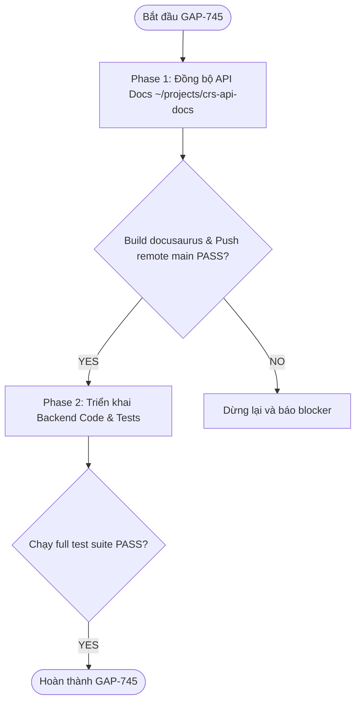

# SPEC-GAP-745: Consultant - Bulk SMS - Allow Email Communication

> **Trạng thái**: `COMPLETED`  
> **Ngày tạo**: 2026-10-23  
> **Cập nhật**: 2026-10-28  
> **Task Key**: `GAP-745`  
> **Author**: Antigravity  
> **Template**: `.specs/SPEC_TEMPLATE.md`  

---

## 1. Tổng quan & Bối cảnh

### 1.1. Bối cảnh
- Tính năng Bulk SMS hiện tại hoạt động ổn định, tuy nhiên trong thực tế có những trường hợp tin nhắn SMS bị nhà mạng phân loại là spam hoặc bị chặn khiến ứng viên không nhận được.
- Các chi nhánh đề xuất bổ sung tính năng **gửi kèm Email song song với SMS** cho cùng tệp ứng viên đã lọc.

### 1.2. Yêu cầu nghiệp vụ (Jira GAP-745)
1. **Tùy chọn gửi kèm Email**:
   - Khi Consultant soạn Bulk SMS, cung cấp checkbox `send_email`. Khi chọn, form mở rộng thêm các trường:
     - `email_subject`: Tiêu đề email (string, bắt buộc khi `send_email=true`).
     - `email_content`: Nội dung email định dạng Rich Text/HTML (bắt buộc khi `send_email=true`).
2. **Hỗ trợ Merge Field & Rich Text**:
   - Hỗ trợ merge field `{candidate_first_name}` theo chuẩn `snake_case` của hệ thống (thay bằng `$candidate->first_name`). Đồng thời `RichTextMailProcessor` hỗ trợ chuẩn hoá không phân biệt hoa thường nếu người dùng nhập `{CandidateFirstName}`.
   - Hỗ trợ rich text (font styling, emojis, danh sách, styling inline).
3. **Thương hiệu & Layout chuẩn**:
   - Tự động tích hợp Header chứa logo Legal Entity của chi nhánh.
   - Tự động tích hợp Footer chứa thông tin chi nhánh và bản quyền GAP Personnel (sử dụng view [`mails.richtext_base`](file:///Users/nexusfrontiertech/projects/gap-web-backend/resources/views/mails/richtext_base.blade.php)).
4. **Email Disclaimer (GDPR / Compliance)**:
   - Bắt buộc chứa disclaimer ở cuối email theo yêu cầu của Product Owner (Brian Halstead):
     > *"You are receiving this email as you’ve previously registered with this branch or via one of our group companies. gap personnel group comprises gap personnel, gap technical, Driving Force Recruitment and Hawk3 Talent Solutions. For more information click to view our {Privacy Policy}."*
   - Hyperlink `{Privacy Policy}` trỏ đến: `https://gap-personnel.com/privacy-policy/`.
5. **Sender Email**:
   - Gửi từ địa chỉ email của Branch (`$branch->email`, fallback về `config('mail.from.address')` nếu rỗng).
6. **Vòng đời & Pending Review (5 phút Delay)**:
   - Email tuân thủ cùng khoảng thời gian chờ review 5 phút (`WAIT_TIMEOUT = 300` giây) như SMS.
   - Trong thời gian chờ, Consultant có thể:
     - **Cancel** (`cancelCandidateCampaign`): Chuyển trạng thái sang `CANCELLED`, cả SMS và Email đều không gửi.
     - **Resume & Edit** (`resumeCandidateCampaign`): Chỉnh sửa subject/content của cả SMS và Email, đặt lại bộ đếm 5 phút.
   - Sau khi hết 5 phút chờ, cron job `sms:sendPendingCampaigns` sẽ kích hoạt gửi SMS và gửi Email song song.
7. **Phạm vi ứng viên & Kế thừa Global Search (GAP-727)**:
   - Task GAP-745 **không thay đổi và không tạo thêm logic lọc ứng viên hay Global Search mới**.
   - Email được gửi đến **chính xác cùng tệp ứng viên** của chiến dịch Bulk SMS (`$preCampaign->receiver_ids`).
   - Tự động kế thừa phạm vi ứng viên từ bộ lọc Bulk SMS hiện tại, bao gồm cả trường hợp Global Search liên chi nhánh / liên Legal Entity theo quy tắc GAP-727 (`resolveBulkSmsBranchScope` khi `all_branches=true`, `MM RRR` và có `skills`).
   - Đoạn disclaimer GDPR được Product Owner chỉ định bao hàm toàn bộ các công ty trong tập đoàn (`gap personnel, gap technical, Driving Force Recruitment, Hawk3 Talent Solutions`) để đảm bảo tuân thủ pháp lý khi gửi cho ứng viên thuộc chi nhánh/pháp nhân khác qua Global Search.
   - Địa chỉ gửi email (`from`) luôn lấy theo chi nhánh thực hiện chiến dịch (`$campaign->branch_id`).

---

## 2. Phân kỳ thực hiện (Mandatory Docs-First Phased Gate)

Tuân thủ nghiêm ngặt quy định **API Contract/API Docs Pre-Deployment Gate**: Vì task thay đổi request/response schema của các API Consultant SMS, dự án chia làm 2 Phase:



- **Phase 1 — API Documentation (`~/projects/crs-api-docs`)**:
  - Cập nhật tài liệu 4 endpoints trong `~/projects/crs-api-docs/docs/api/consultant/`:
    1. `get-sms-estimate.md`: Thêm `email_placeholders` vào response.
    2. `post-sms-candidate-campaign.md`: Thêm `send_email`, `email_subject`, `email_content` vào body và response.
    3. `put-sms-candidate-campaign-id-resume.md`: Thêm `send_email`, `email_subject`, `email_content` vào body và response.
    4. `get-sms-candidate-campaigns.md`: Thêm các trường email vào items response.
  - Build test docusaurus (`npm run build`): **PASS**.
  - Commit & Push remote `main`: **PASS**.
  - **Commit SHA**: `a2b86d871309f30b91cb2fc2c4bbfba08b3ba961` (branch `main`).
  - **Trạng thái Phase 1**: `PASSED` (Hoàn thành gate tài liệu trước khi code).

- **Phase 2 — Backend Implementation (`gap-web-backend`)**:
  - Tạo Migration thêm cột email cho bảng `sms_campaigns`.
  - Cập nhật Model `SmsCampaign` (fillable, casts, constants).
  - Cập nhật `estimateCandidateCampaign` trả về `email_placeholders`.
  - Cập nhật FormRequests `CandidateCampaign` và `ResumeCampaign`.
  - Cập nhật Resource `SmsCampaign`.
  - Bổ sung method `sendCustomContent()` trong `MailSenderAccessor` & Facade `MailSender`.
  - Tạo Queue Job `SendBulkCampaignEmailJob` xử lý gửi email bất đồng bộ qua Redis và phòng chống N+1 query.
  - Cập nhật `SmsService::sendCampaign` để dispatch job gửi email khi `send_email = true`.
  - Viết Feature tests và chạy toàn bộ test suite (`SmsCampaignTest.php`: 20 tests, 52 assertions — **100% PASS**).
  - **Trạng thái Phase 2**: `PASSED`.

---

## 3. Database Design

### Bảng sửa đổi: `sms_campaigns`
* Migration: `database/migrations/2026_10_27_000001_add_email_fields_to_sms_campaigns_table.php`

| Cột | Kiểu | Nullable | Default | Mục đích |
|---|---|---|---|---|
| `send_email` | boolean | NO | `false` | Cờ xác định campaign có gửi kèm email không |
| `email_subject` | string(255) | YES | `null` | Tiêu đề email do consultant soạn |
| `email_content` | mediumText | YES | `null` | Nội dung email HTML/Rich Text |
| `email_sent_at` | dateTime | YES | `null` | Thời điểm hoàn thành gửi email |

---

## 4. API Contract Chi tiết

### 4.1. `GET /api/consultant/sms/estimate`
* **Mục đích**: Bổ sung `email_placeholders` để frontend tự động kích hoạt nút "Insert variable" trong component `RichTextEditor`.
* **Response 200**:
  ```json
  {
    "pre_campaign_id": 105,
    "numb_of_receivers": 45,
    "estimated_cost": 2.25,
    "email_placeholders": [
      "{candidate_first_name}"
    ]
  }
  ```

### 4.2. `POST /api/consultant/sms/candidate_campaign`
* **Headers**: `Gap-Branch-ID: {branchId}`, `Authorization: Bearer {token}`
* **Request Body**:
  ```json
  {
    "pre_campaign_id": 105,
    "subject": "SMS Urgent Shifts Available",
    "content": "Hi there, we have urgent shifts available this week.",
    "send_email": true,
    "email_subject": "Exciting Job Opportunities at GAP Personnel",
    "email_content": "<p>Hello {candidate_first_name},</p><p>We have exciting shifts available for you!</p>"
  }
  ```
* **Validation Rules (`CandidateCampaign.php`)**:
  ```php
  'pre_campaign_id' => 'required',
  'subject'         => 'required|string|max:255',
  'content'         => 'required|string|min:10|max:612',
  'send_email'      => 'sometimes|boolean',
  'email_subject'   => 'required_if:send_email,true|nullable|string|max:255',
  'email_content'   => 'required_if:send_email,true|nullable|string|min:10',
  ```

### 4.3. `PUT /api/consultant/sms/candidate_campaign/{id}/resume`
* **Request Body**: Tương tự như `POST`, cho phép cập nhật lại cả nội dung SMS lẫn Email.
* **Validation Rules (`ResumeCampaign.php`)**:
  ```php
  'subject'         => 'required|string|max:255',
  'content'         => 'required|string|min:10|max:612',
  'send_email'      => 'sometimes|boolean',
  'email_subject'   => 'required_if:send_email,true|nullable|string|max:255',
  'email_content'   => 'required_if:send_email,true|nullable|string|min:10',
  ```

### 4.4. `GET /api/consultant/sms/candidate_campaigns`
* **Response Output (`SmsCampaign` Resource)**:
  Bổ sung 4 trường email vào mỗi item:
  ```json
  {
    "id": 105,
    "user_id": 5,
    "user_name": "Consultant Name",
    "receivers_count": 45,
    "branch_id": 3,
    "subject": "SMS Urgent Shifts Available",
    "content": "Hi there...",
    "send_email": true,
    "email_subject": "Exciting Job Opportunities at GAP Personnel",
    "email_content": "<p>Hello {candidate_first_name}...</p>",
    "email_sent_at": "27/10/2026 15:45",
    "status": "PENDING",
    "failure_message": "",
    "estimated_cost": 2.25,
    "credits": 1,
    "sent_at": "",
    "first_received_at": ""
  }
  ```

---

## 5. Thiết kế Logic & Kiến trúc Xử lý

### 5.1. Disclaimer HTML Chuẩn (GDPR) — Blade Partial
- Thay vì lưu trữ chuỗi HTML và inline CSS thô trực tiếp trong Model `SmsCampaign` (vi phạm nguyên tắc phân tầng MVC và Separation of Concerns), disclaimer được tách thành một Blade view partial độc lập tại [`resources/views/mails/partials/campaign_disclaimer.blade.php`](file:///Users/nexusfrontiertech/projects/gap-web-backend/resources/views/mails/partials/campaign_disclaimer.blade.php):
```html
<p style="font-size: 12px; color: #777777; line-height: 18px; margin-top: 24px; border-top: 1px solid #E4E7ED; padding-top: 16px;">You are receiving this email as you’ve previously registered with this branch or via one of our group companies. gap personnel group comprises gap personnel, gap technical, Driving Force Recruitment and Hawk3 Talent Solutions. For more information click to view our <a href="https://gap-personnel.com/privacy-policy/" target="_blank" style="color: #582669; text-decoration: underline;">Privacy Policy</a>.</p>
```
- Trong [`app/Models/SmsCampaign.php`](file:///Users/nexusfrontiertech/projects/gap-web-backend/app/Models/SmsCampaign.php), loại bỏ hằng số `EMAIL_DISCLAIMER_HTML`, chỉ giữ lại hằng số domain placeholders:
```php
public const DEFAULT_EMAIL_PLACEHOLDERS = [
    '{candidate_first_name}',
];
```

### 5.2. Hạ tầng gửi Mail: `MailSenderAccessor::sendCustomContent()` (Thuần kỹ thuật)
- Để bảo đảm nguyên tắc phân lớp kiến trúc (SRP) và tránh rò rỉ nghiệp vụ đặc thù của Bulk Campaign vào hạ tầng gửi mail chung, `MailSenderAccessor` **hoàn toàn không chứa logic về disclaimer hay SMS campaign**.
- Bổ sung method generic trong [`app/Facades/MailSenderAccessor.php`](file:///Users/nexusfrontiertech/projects/gap-web-backend/app/Facades/MailSenderAccessor.php):
```php
public function sendCustomContent(
    int $branchId,
    ?array $from,
    array $to,
    string $title,
    string $content,
    int $candidateId = 0,
    ?array $preloadedBranchInfo = null,
    bool $recordActivityLog = true
): bool
```
- Vai trò hạ tầng:
  - Nếu `$preloadedBranchInfo` được truyền vào, tái sử dụng trực tiếp để tránh query DB lặp lại; nếu không thì fallback gọi `$this->getBranchInformation($branchId)`.
  - Render qua view template `mails.richtext_base` (tự động nhúng Logo Legal Entity và Branch Footer).
  - Áp dụng các chính sách gửi mail chuẩn: môi trường tester rewrite (`config('mail.tester')`), mock test (`sendMailMock`), danh sách ignore.
  - Gửi mail qua `\Mail::send(...)`.
  - Ghi bản ghi Activity Log `ActivityLog::TYPE_EMAIL` (hoặc bỏ qua nếu Job thực hiện batch bulk insert).

### 5.3. Xử lý Bất đồng bộ & Phòng chống N+1 Query trong `SendBulkCampaignEmailJob`
- **100% Business Logic tập trung tại Job**:
  - Gắn Disclaimer GDPR chuẩn bằng cách render view `mails.partials.campaign_disclaimer` 1 lần duy nhất trước vòng lặp:
    ```php
    $disclaimerHtml = view('mails.partials.campaign_disclaimer')->render();
    $baseContent = ($campaign->email_content ?? '') . $disclaimerHtml;
    ```
  - Thay thế merge field `{candidate_first_name}` bằng `$candidate->first_name` qua [`RichTextMailProcessor::injectData()`](file:///Users/nexusfrontiertech/projects/gap-web-backend/app/Services/Mail/RichTextMailProcessor.php).
  - Lấy email người gửi từ `$branch->email`.
- **Tối ưu hóa hiệu năng & Chống N+1 Query (Strictly Avoid N+1)**:
  - Render view disclaimer **1 lần duy nhất trước vòng lặp** (tránh gọi `view()->render()` lặp lại qua hàng trăm ứng viên).
  - Pre-fetch thông tin chi nhánh và Legal Entity (`$branchInformation`) **1 lần duy nhất trước vòng lặp**.
  - Eager load toàn bộ ứng viên kèm `email`, `first_name`, `match_maker_status`.
  - Lọc in-memory: Bỏ qua ứng viên không có email hợp lệ hoặc có status `Candidate::MM_STATUS_DNU` (không query DB trong loop).
  - Gom toàn bộ bản ghi `ActivityLog` vào mảng `$activityLogsBatch` và thực hiện **Bulk Insert 1 lần sau vòng lặp**.
  - Kết quả: Giảm từ **~1.500 queries xuống còn 3 queries duy nhất** cho toàn bộ chiến dịch 500 ứng viên.
  - Cập nhật `$campaign->email_sent_at = Carbon::now()`.

### 5.4. Vòng đời gửi (Lifecycle Flow)
```
1. Consultant tạo campaign (POST /api/consultant/sms/candidate_campaign)
   └── status = 'PENDING', updated_at = NOW()
2. Trong vòng 5 phút (WAIT_TIMEOUT = 300s):
   ├── Cancel: PUT /cancel -> status = 'CANCELLED' (không gửi cả SMS lẫn Email)
   └── Resume: PUT /resume -> cập nhật nội dung, status = 'PENDING', updated_at = NOW()
3. Cron sms:sendPendingCampaigns chạy mỗi phút:
   └── Lọc campaign PENDING có NOW - updated_at >= 300s:
       ├── 1. Gửi SMS qua SmsProvider (Esendex)
       ├── 2. Nếu $campaign->send_email == true:
       │      Dispatch SendBulkCampaignEmailJob::dispatch($campaign->id)
       └── 3. Lưu status = 'SENT'
```

### 5.5. Cơ chế kế thừa phạm vi ứng viên & Global Search (GAP-727)
- Quy trình lấy danh sách ứng viên cho Bulk SMS diễn ra tại `estimateCandidateCampaign`:
  - `SmsService::resolveBulkSmsBranchScope()` xác định phạm vi chi nhánh (`$branchId` cụ thể hoặc `[]` cho toàn bộ hệ thống khi bật Global Search theo GAP-727).
  - `SmsPreCampaign` lưu trữ `receiver_ids` (danh sách ID ứng viên đã lọc).
- Khi tạo `SmsCampaign`, danh sách ứng viên nhận email sẽ lấy trực tiếp từ các bản ghi `SmsReceiver` đã gắn với campaign.
- Đối với trường hợp ứng viên thuộc chi nhánh khác (qua Global Search):
  - Email vẫn gửi từ thông tin của chi nhánh tạo campaign (`$campaign->branch`).
  - Đoạn disclaimer GDPR với đầy đủ tên các group companies sẽ giải thích lý do ứng viên nhận được email, bảo đảm tính pháp lý toàn diện.
  - Kiểm tra trạng thái ứng viên: Bỏ qua các ứng viên có `match_maker_status == MM_STATUS_DNU` hoặc không có địa chỉ email hợp lệ.

---

## 6. Call Chain & Data Origin Verification

| Biến / Trường | Nơi sử dụng | Nguồn gốc dữ liệu | Trạng thái verify |
|---|---|---|---|
| `send_email` | `SmsService::createCandidateCampaign` | `CandidateCampaign` payload | ✅ Verified qua FormRequest |
| `email_subject` | `SmsService::createCandidateCampaign` | `CandidateCampaign` payload | ✅ Required khi `send_email=true` |
| `email_content` | `SmsService::createCandidateCampaign` | `CandidateCampaign` payload | ✅ Required khi `send_email=true` |
| `{candidate_first_name}` | Email body | `$candidate->first_name` | ✅ Tồn tại trên Model `Candidate` |
| Sender Address | Email `from` address | `$branch->email` (fallback config) | ✅ Tồn tại trên Model `Branch` |
| Sender Name | Email `from` name | `$branch->name` (fallback config) | ✅ Tồn tại trên Model `Branch` |
| Legal Entity Logo | Email Header | `$branch->legal_entity_id` | ✅ Tồn tại trong `mails.richtext_base` |
| Branch Footer | Email Footer | `MailSenderAccessor::getBranchInformation` | ✅ Đã có sẵn trong `MailSenderAccessor` |

---

## 7. Danh sách File Tạo mới & Chỉnh sửa

### Phase 1 — API Documentation (`~/projects/crs-api-docs`)
1. `docs/api/consultant/get-sms-estimate.md` (MODIFY)
2. `docs/api/consultant/post-sms-candidate-campaign.md` (MODIFY)
3. `docs/api/consultant/put-sms-candidate-campaign-id-resume.md` (MODIFY)
4. `docs/api/consultant/get-sms-candidate-campaigns.md` (MODIFY)

### Phase 2 — Backend Implementation (`gap-web-backend`)
1. `database/migrations/2026_10_27_000001_add_email_fields_to_sms_campaigns_table.php` (CREATE)
2. `resources/views/mails/partials/campaign_disclaimer.blade.php` (CREATE)
3. `app/Models/SmsCampaign.php` (MODIFY)
4. `app/Http/Controllers/Api/Consultant/SmsController.php` (MODIFY)
5. `app/Http/Requests/Api/Consultant/CandidateCampaign.php` (MODIFY)
6. `app/Http/Requests/Api/Consultant/ResumeCampaign.php` (MODIFY)
7. `app/Http/Resources/Api/Consultant/SmsCampaign.php` (MODIFY)
8. `app/Facades/MailSenderAccessor.php` (MODIFY)
9. `app/Facades/MailSender.php` (MODIFY)
10. `app/Contracts/Services/SmsServiceInterface.php` (MODIFY)
11. `app/Services/SmsService.php` (MODIFY)
12. `app/Jobs/SendBulkCampaignEmailJob.php` (CREATE)
13. `tests/Feature/Api/Consultant/SmsCampaignTest.php` (MODIFY)

---

## 8. Test Cases Chi tiết

| Test Case | Loại | Mục tiêu kiểm thử |
|---|---|---|
| `testEstimateCandidateCampaignReturnsEmailPlaceholders` | Feature | Kiểm tra `GET /estimate` trả về `email_placeholders` chứa `{candidate_first_name}` |
| `testCreateSmsCampaignWithEmailSuccessfully` | Feature | Tạo campaign có `send_email = true`, subject và content email |
| `testCreateSmsCampaignValidationRequiresEmailFieldsWhenSendEmailIsTrue` | Feature | Validate lỗi khi `send_email = true` nhưng thiếu `email_subject` hoặc `email_content` |
| `testResumeSmsCampaignUpdatesEmailFieldsAndResetsPendingTimer` | Feature | Resume campaign cập nhật lại các trường email thành công và reset timer 5 phút |
| `testCancelSmsCampaignDoesNotDispatchEmailJob` | Feature | Hủy campaign đảm bảo không gửi cả SMS lẫn Email |
| `testSendSmsCampaignDispatchesBulkEmailJobWhenSendEmailIsTrue` | Feature | Cron command chạy sau 5 phút gửi SMS và dispatch `SendBulkCampaignEmailJob` |
| `testSendBulkCampaignEmailJobSendsEmailWithFirstNameAndDisclaimer` | Feature | Job gửi email thay thế đúng `{candidate_first_name}`, gắn disclaimer, logo, footer |
