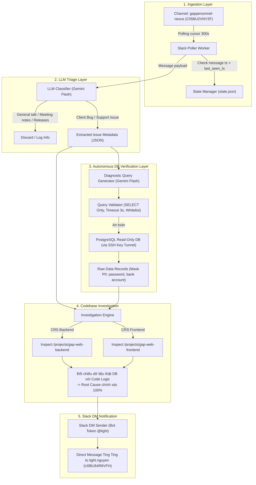
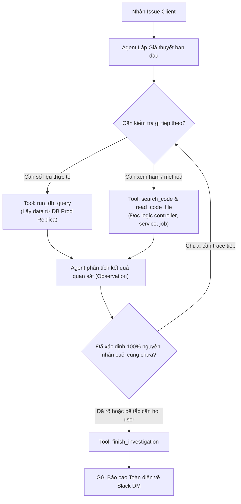
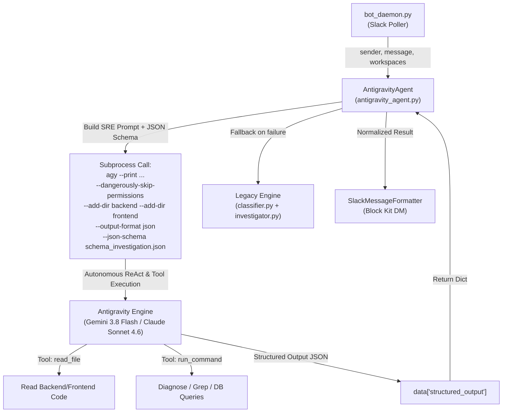

# SPEC: Slack Issue Triage & Codebase Investigation Bot

> **Trạng thái**: `PHASE_10_COMPLETED` (Đã hoàn tất chuyển đổi sang Antigravity Headless Agent `agy`)
> **Ngày tạo**: 2026-10-20 (Cập nhật Phase 10: 2026-10-21)
> **Task Key**: `UNTRACKED` (Sequence: `007`)
> **Author**: Antigravity & User (`light.nguyen`)

---

## 1. Tổng quan

### 1.1. Mục tiêu
Xây dựng một hệ thống bot tự động giám sát kênh Slack khách hàng (`gappersonnel-nexus` - `C058U2VNY2F`), nhận diện các tin nhắn báo lỗi/yêu cầu trợ giúp từ client, tự động khởi tạo luồng phân tích mã nguồn (Backend & Frontend) để tìm nguyên nhân gốc rễ (Root Cause) và đề xuất phương án xử lý, sau đó gửi báo cáo tóm tắt trực tiếp qua **Slack DM** cho lập trình viên (`light.nguyen`).

### 1.2. Yêu cầu gốc
> "tôi muốn viết một bot đọc tin nhắn từ channel này, phân biệt tin nhắn là issue client cần giúp đỡ -> tạo session agent đọc code backend, frontend để đưa ra phương án kiểm tra và xử lý rồi thông báo lại cho tôi qua slack hoặc tele"  
> "SLACK DM, lên plan chi tiết"

---

## 2. API Contract & Docs Gate

- **Đánh giá ảnh hưởng API Contract / API Docs (`crs-api-docs`)**:
  - `N/A — no API contract/API docs change`.
  - Đây là công cụ tự động hóa nội bộ (Internal Automation Tooling / Daemon Script), không thay đổi bất kỳ REST API endpoint hay tài liệu hợp đồng API nào của hệ thống CRS/CRM.

---

## 3. Kiến trúc Hệ thống (System Architecture)



---

## 4. Thiết kế Chi tiết các Module

### 4.1. Vị trí mã nguồn
Toàn bộ mã nguồn của bot được đặt độc lập trong thư mục dự án riêng tại `~/projects/slack-issue-investigator/`:
```
/Users/nexusfrontiertech/projects/slack-issue-investigator/
├── venv/                       # Môi trường Python độc lập
├── requirements.txt            # Thư viện phụ thuộc (requests, google-genai, etc.)
├── config.json                 # Cấu hình Slack token, channel ID, user ID, workspace paths
├── state.json                  # Lưu trữ cursor timestamp và history IDs đã xử lý (idempotency)
├── bot_daemon.py               # Main daemon runner (hỗ trợ --once cho testing và --daemon cho production)
├── slack_client.py             # Wrapper Slack REST API (history, conversations.open, chat.postMessage)
├── classifier.py               # Module LLM phân loại tin nhắn & trích xuất metadata issue
├── investigator.py             # Engine tìm kiếm và phân tích code tự động qua LLM
└── formatter.py                # Định dạng thông báo Slack Block Kit & Markdown
```

**Lợi ích của việc tách riêng thành thư mục độc lập trong `~/projects`**:
1. **Bảo toàn Git của `gap-web-backend`**: Không làm ô nhiễm repo backend với các file script, log hay state local.
2. **Quản lý đa dự án (Cross-project Orchestrator)**: Bot là công cụ giám sát cấp hệ thống, đứng độc lập để inspect đồng thời cả 4 dự án (`gap-web-backend`, `gap-web-frontend`, `gap-crm-backend`, `gap-crm-frontend`).
3. **Môi trường & Vòng đời độc lập**: Có virtualenv riêng, không bị ảnh hưởng khi chuyển đổi git branch giữa các dự án backend/frontend.

---

### 4.2. Cấu hình (`config.json`)
```json
{
  "slack": {
    "token_env": "SLACK_BOT_TOKEN",
    "channel_id": "C058U2VNY2F",
    "admin_user_id": "U0BU64R6VFH",
    "poll_interval_seconds": 60
  },
  "workspaces": {
    "crs_backend": "/Users/nexusfrontiertech/projects/gap-web-backend",
    "crs_frontend": "/Users/nexusfrontiertech/projects/gap-web-frontend"
  },
  "llm": {
    "model": "gemini-2.5-flash",
    "temperature": 0.2
  }
}
```

---

### 4.3. Module 1: Ingestion & State Manager (`slack_client.py`, `state.json`)
- **Đọc tin nhắn mới**:
  - Gọi Slack API `conversations.history?channel=C058U2VNY2F&oldest={last_seen_ts}`.
  - Sắp xếp tin nhắn theo thứ tự thời gian tăng dần (`oldest` -> `newest`).
  - Bỏ qua tin nhắn do bot tự gửi hoặc tin nhắn từ chính admin nếu được cấu hình.
- **Quản lý trạng thái (Idempotency)**:
  - `state.json` lưu `last_seen_ts` và danh sách 50 message timestamps gần nhất.
  - Đảm bảo khi khởi động lại bot không bao giờ xử lý trùng lặp tin nhắn cũ.

---

### 4.4. Module 2: Triage & Classification (`classifier.py`)
- **Prompt Thiết kế cho LLM**:
  - Đầu vào: Nội dung tin nhắn Slack, người gửi, context thread (nếu có).
  - Nhiệm vụ: Xác định đây có phải là vấn đề/lỗi/thắc mắc kỹ thuật từ client (Gap Personnel) cần hỗ trợ không.
  - Phân loại:
    - `is_issue = false`: Lời chào hỏi, tin nhắn cảm ơn, meeting notes tổng kết, thông báo lịch release, chit-chat.
    - `is_issue = true`: Báo lỗi phần mềm, link hỏng, không chuyển được ứng viên, lỗi validation, data sai lệch, thắc mắc tính năng cần kiểm tra code.
- **Output JSON Schema**:
  ```json
  {
    "is_issue": true,
    "confidence": 0.95,
    "project": "CRS",
    "category": "CANDIDATE_MATCHMAKER_SYNC",
    "summary": "Matchmaker sync fails for candidate due to missing Gender info",
    "error_details": "unexpected error there is no Gender info",
    "keywords": ["Matchmaker", "Gender", "declaration", "leventmusa66@yahoo.com"],
    "target_layers": ["backend", "frontend"]
  }
  ```

---

### 4.5. Module 3: Codebase Investigator (`investigator.py`)
Khi `is_issue == true`:
1. **Scope Search**:
   - Dựa trên `project` (`CRS` hay `CRM`) và `target_layers`:
     - Nếu liên quan Backend: Tìm kiếm các controller, service, exception, validation rules chứa các keyword (ví dụ: `Matchmaker`, `gender`, route endpoint).
     - Nếu liên quan Frontend: Tìm kiếm các form, component, validation schema liên quan.
2. **Context Extraction**:
   - Đọc các đoạn code phát hiện được (50 - 100 dòng xung quanh).
   - Truy vấn LLM phân tích:
     - Tại sao lỗi xảy ra dựa trên mô tả của khách hàng?
     - Điều kiện nào kích hoạt ngoại lệ / lỗi?
     - Cần kiểm tra dữ liệu hay sửa đổi code ở file nào?
3. **Investigation Summary**:
   - **Tóm tắt sự cố** (What happened)
   - **Nguyên nhân nghi vấn** (Probable Root Cause)
   - **Vị trí file/dòng code** (Files involved)
   - **Phương án xử lý đề xuất** (Actionable Fix Plan)

---

### 4.6. Module 4: Slack DM Notifier (`slack_client.py`, `formatter.py`)
- **Yêu cầu quyền Slack**:
  - Để gửi tin nhắn DM cho user `U0BU64R6VFH`, User Token cần có scope **`im:write`** (hoặc dùng Bot Token `@light` để gửi DM).
  - Quy trình gửi DM:
    1. Gọi `conversations.open(users="U0BU64R6VFH")` -> Nhận `channel_id` của cuộc trò chuyện 1-1 (dạng `D...`).
    2. Gọi `chat.postMessage(channel=dm_channel_id, blocks=[...], text=...)`.
- **Mẫu nội dung thông báo Slack DM**:
  ```markdown
  🚨 *[CRS Alert] Phát hiện Issue từ Client: gappersonnel-nexus*
  
  • *Người báo:* Simone Blackburn
  • *Thời gian:* 2026-10-19 15:20:26
  • *Vấn đề:* Link KID trên trang 29 của application pack bị hỏng do có khoảng trắng thừa.
  
  🔍 *Kết quả kiểm tra Codebase:*
  • *File liên quan:* `resources/views/pdf/kid-document.blade.php` (hoặc `app/Services/DocumentService.php`)
  • *Nguyên nhân:* Chuỗi URL trong template HTML bị xuống dòng / thừa dấu cách khi render qua DOMPDF.
  • *Đề xuất xử lý:* Trim khoảng trắng URL trước khi gắn thẻ `<a>` hoặc cập nhật ticket `GAP-744`.
  
  👉 _Tin nhắn gốc trên Slack:_ "<link_to_slack_message>"
  ```

---

### 4.7. Module 5: PostgreSQL Read-Only DB Executor & Security Guardrails (`db_executor.py`)

Module này chịu trách nhiệm mở kết nối an toàn tới cơ sở dữ liệu PostgreSQL (qua SSH Key Tunnel), thực thi các câu lệnh `SELECT` chẩn đoán được kiểm duyệt nghiêm ngặt, và trả về dữ liệu thực tế đã được làm sạch cho AI.

#### 1. Cấu hình Kết nối (`.env` & `config.json`)
```env
# PostgreSQL Read-Only Connection
DB_ENABLED=true
DB_HOST=127.0.0.1
DB_PORT=5432
DB_NAME=gap_crs_prod
DB_USER=readonly_user
DB_PASSWORD=

# SSH Key Tunnel (kết nối qua Bastion / Jump Host)
DB_SSH_ENABLED=true
DB_SSH_HOST=bastion.example.com
DB_SSH_PORT=22
DB_SSH_USER=ubuntu
DB_SSH_KEY_PATH=~/.ssh/id_rsa
DB_REMOTE_HOST=db-prod.internal
DB_REMOTE_PORT=5432
```

#### 2. 5 Rào chắn An toàn Tuyệt đối (Security Guardrails)
1. **Strict Query Validator (Chỉ đọc `SELECT`)**:
   - Mọi câu query phải vượt qua regex kiểm tra: bắt đầu bằng `SELECT` hoặc `WITH ... SELECT`.
   - Cấm tuyệt đối các từ khóa thay đổi dữ liệu hoặc quyền: `UPDATE`, `DELETE`, `DROP`, `ALTER`, `TRUNCATE`, `INSERT`, `GRANT`, `REVOKE`, `CREATE`, `COPY`, `VACUUM`.
2. **Hard Statement Timeout (Tối đa 3 giây)**:
   - Trước mỗi query, thực thi: `SET statement_timeout = '3000ms';`. Nếu query chạy quá 3s, PostgreSQL tự động hủy bỏ, đảm bảo 0% rủi ro làm nghẽn DB.
   - Luôn tự động bổ sung `LIMIT 50` nếu câu query chưa có LIMIT.
3. **Blacklist Bảng & Cột Nhạy cảm**:
   - Cấm truy cập các bảng: `oauth_access_tokens`, `personal_access_tokens`, `sessions`.
   - Cấm `SELECT password` hoặc `SELECT remember_token` trong bảng `users`.
4. **Data Masking (Lọc dữ liệu PII)**:
   - Tự động che số tài khoản ngân hàng (chỉ giữ 4 số cuối), che sort code và token trước khi truyền dữ liệu vào prompt Gemini.
5. **Fail-safe Mode**:
   - Nếu kết nối DB lỗi hoặc query bị từ chối bởi Validator, bot tự động fallback về chế độ suy luận phân tích code tĩnh (Cây quyết định Nếu... Thì...), không làm gián đoạn luồng thông báo.

---

### 4.8. Module 6: Autonomous Multi-Turn Agent Investigation Loop (`agent_loop.py` / `investigator.py`)

Để giải quyết vấn đề agent dừng lại quá sớm và đưa ra plan "bảo dev tự đi kiểm tra", Phase 7 nâng cấp bộ điều tra thành **Vòng lặp Suy luận Tự hành (Autonomous ReAct Loop)**. Agent sẽ chủ động tự thực hiện các bước kiểm tra code và kiểm tra DB lặp đi lặp lại cho đến khi tìm ra nguyên nhân cuối cùng hoặc chỉ dừng lại khi thực sự cần người dùng can thiệp.

#### 1. Bộ công cụ tự hành của Agent (Agent Tools)
Agent được trang bị 4 công cụ độc lập:
1. `run_db_query(query)`: Chạy query kiểm tra PostgreSQL Prod Replica (có bảo vệ 5 guardrails).
2. `search_code(keyword, layer)`: Tìm kiếm file và từ khóa trong `gap-web-backend` hoặc `gap-web-frontend`.
3. `read_code_file(filepath, start_line, num_lines)`: Đọc trực tiếp nội dung các dòng code để kiểm tra logic `if/else`, validation, query builder.
4. `finish_investigation(final_root_cause, verified_evidence, exact_fix, need_user_input, question_for_user)`: Gọi khi đã hoàn tất điều tra hoặc khi bắt buộc cần người dùng trợ giúp.

#### 2. Vòng lặp Suy luận (ReAct Execution Loop - Tối đa 6 bước)


#### 3. Điều kiện Dừng của Agent
Agent **KHÔNG ĐƯỢC PHÉP DỪNG LẠI** và đưa ra các câu chung chung như "cần kiểm tra logic trong file X" nếu file X đó nằm trong codebase của máy. Agent **PHẢI TỰ ĐỌC FILE X** và kiểm tra logic.
Agent chỉ được dừng lại trong 2 trường hợp:
- **Trường hợp A (Thành công trọn vẹn):** Đã tìm ra chính xác dòng code bị lỗi, cơ chế sinh lỗi từ dữ liệu DB và phương án code fix cụ thể.
- **Trường hợp B (Cần User can thiệp):** Khi logic code và DB đều bình thường, nhưng thiếu thông tin ngữ cảnh từ phía người dùng (ví dụ: *"Cần hỏi Simone: thao tác bấm nút lúc mấy giờ, trên branch nào, hay worker ID bên phía MatchMaker đã tạo là số mấy?"*).

---

### 4.9. Module 7: Groq API Integration (`llama-3.3-70b-versatile`)

Do Gemini API Free Tier áp dụng giới hạn ngặt nghèo (20 requests/ngày trên toàn project), hệ thống gặp lỗi `HTTP 429 RESOURCE_EXHAUSTED` khi thực hiện vòng lặp ReAct nhiều bước. Phase 8 chuyển đổi động cơ suy luận AI chính sang **Groq API** với model flagship mã nguồn mở `llama-3.3-70b-versatile`.

#### 1. So sánh Lợi ích Kỹ thuật:
- **Hạn mức Free Tier**: 14,400 requests/ngày (30 RPM, 6,000 TPM, 500,000 tokens/ngày) — gấp hơn 700 lần so với Gemini Free Tier.
- **Tốc độ suy luận**: ~250 - 300 tokens/giây (công nghệ LPU Inference Engine của Groq), phản hồi gần như tức thì, giảm thời gian chạy ReAct loop từ 30s xuống dưới 5s.
- **Khả năng suy luận & ReAct**: `llama-3.3-70b` ngang ngửa GPT-4o trong các tác vụ reasoning, coding và tool-calling.
- **Chuẩn giao tiếp**: Chuẩn OpenAI REST API (`https://api.groq.com/openai/v1/chat/completions`), hỗ trợ native `response_format: {"type": "json_object"}` giúp JSON trả về luôn hợp lệ, không bị lỗi parse markdown.
- **Zero-Dependency**: Tích hợp trực tiếp bằng `urllib.request` có sẵn trong Python chuẩn, không cần cài thêm package bên ngoài.

#### 2. Chiến lược Fallback (Hybrid Dual-Provider):
- Cấu hình ưu tiên `GROQ_API_KEY` nếu có trong `.env` hoặc `config.json`.
- Nếu không có Groq Key hoặc gặp lỗi kết nối, tự động fallback sang `GEMINI_API_KEY` để đảm bảo hệ thống luôn sẵn sàng 100%.

---

### 4.10. Module 8: Vietnamese Localization & Dynamic Step Limit Configuration

#### 1. Tại sao cần Giới hạn Step (`max_iterations`)?
- **Chống kẹt vòng lặp vô hạn (Infinite Loop Guardrail)**: Trong các hệ thống ReAct Agent tự hành (Autonomous Agents), nếu không có chốt chặn tối đa, khi gặp từ khóa không tìm thấy hoặc query trả về rỗng, Agent có thể rơi vào "vòng lặp luẩn quẩn" (hallucination loop hoặc grep lặp đi lặp lại), gọi API hàng trăm lần làm treo máy và spam log.
- **Tối ưu thời gian chờ (Latency)**: Mỗi bước tốn khoảng 1 - 2 giây suy luận + thời gian mở SSH/grep code. Số bước hợp lý giúp dev nhận được cảnh báo trong vòng 20 - 45 giây thay vì phải chờ vài phút.
- **Bản chất của Giới hạn**: `max_iterations` chỉ là **Trần An toàn (Safety Ceiling)**. Nếu Agent tìm thấy nguyên nhân ở bước 2, 3 hoặc 4, nó sẽ gọi ngay `finish_investigation` để kết thúc lập tức chứ không chạy cố cho hết số bước.
- **Nâng cấp linh hoạt**: Chuyển giới hạn này thành tham số cấu hình linh hoạt trong `config.json` (`max_investigation_steps`: mặc định 8 đến 10 bước), cho phép dev điều chỉnh tùy ý theo nhu cầu điều tra sâu hay nhanh.

#### 2. Ép buộc Ngôn ngữ Tiếng Việt 100% (Strict Vietnamese Language Directive):
- Bổ sung quy định bắt buộc trong prompt hệ thống của `investigator.py` và `classifier.py`:
  - Mọi suy nghĩ (thought), tóm tắt sự cố (summary), nguyên nhân gốc rễ (final_root_cause), bằng chứng DB (verified_db_findings), câu hỏi cần hỏi client (question_for_client), giải thích chi tiết (detailed_explanation) và phương án xử lý (action_plan) **PHẢI ĐƯỢC VIẾT 100% BẰNG TIẾNG VIỆT TỰ NHIÊN, DỄ HIỂU**.
  - Chỉ giữ nguyên tiếng Anh cho: tên file, tên class/hàm/biến, câu lệnh SQL và link URL.

---

### 4.11. Module 9: Antigravity Headless Agent Migration (Drop-in Replacement for LLM API & Manual ReAct Loop)

Nhằm loại bỏ hoàn toàn việc duy trì vòng lặp ReAct thủ công ~500 dòng code, quản lý quota/rate limit API ngoài, và giới hạn công cụ tự chế trong `investigator.py`, Phase 10 chuyển đổi động cơ điều tra sang **Antigravity Headless Agent** (`agy --print`).

#### 1. Ưu thế Kỹ thuật của Antigravity Agent:
- **Autonomous Multi-Step Reasoning**: Antigravity tự động điều phối chuỗi suy nghĩ (Chain-of-Thought) đa bước trên các model đầu bảng (Gemini 3.8 Flash High Thinking / Claude Sonnet 4.6), tự chọn và thực thi công cụ.
- **Native System Tools**: Antigravity sở hữu sẵn các công cụ `read_file`, `run_command` (có thể grep, inspect git, chạy query chẩn đoán DB thông qua artisan hoặc mysql/psql script), không bị giới hạn trong vài hàm wrapper tự viết.
- **Structured Output Native (`--json-schema`)**: Tận dụng cờ `--output-format json` kết hợp `--json-schema` để bắt buộc Antigravity trả về kết quả chuẩn 100% trong trường `structured_output`, loại bỏ hoàn toàn rủi ro JSON parse error hoặc dính markdown fence.
- **Không tốn chi phí / Quản lý API Key bên ngoài**: Sử dụng trực tiếp phiên làm việc và quota được cấp quyền sẵn của developer trên máy (`/Users/nexusfrontiertech/.local/bin/agy`).

#### 2. Kiến trúc Module Mới (`antigravity_agent.py`):


#### 3. Các thành phần file cấu thành:
1. `~/projects/slack-issue-investigator/schema_investigation.json`: Định nghĩa JSON Schema chặt chẽ cho toàn bộ kết quả phân loại & điều tra (`is_issue`, `summary`, `project`, `final_root_cause`, `primary_file`, `verified_db_findings`, `action_plan`, `need_user_input`, `question_for_client`, `detailed_explanation`).
2. `~/projects/slack-issue-investigator/antigravity_agent.py`: Class `AntigravityAgent` nhận input tin nhắn, gọi `agy --print`, validate response, hỗ trợ fallback sang legacy engine nếu có lỗi timeout/kết nối.
3. `~/projects/slack-issue-investigator/config.json`: Bổ sung cấu hình:
   ```json
   "agent": {
     "engine": "antigravity",
     "agy_path": "/Users/nexusfrontiertech/.local/bin/agy",
     "timeout_seconds": 180,
     "fallback_to_legacy": true
   }
   ```
4. `~/projects/slack-issue-investigator/bot_daemon.py`: Cập nhật `run_triage_cycle` để điều hướng qua `AntigravityAgent` khi `engine == "antigravity"`, giữ nguyên cơ chế gửi Slack Block Kit DM và quản lý cursor `state.json`.

---

## 5. Kế hoạch Triển khai (Execution Phases)

| Phase | Nội dung công việc | Output / Gate |
| :--- | :--- | :--- |
| **Phase 1** | Chuẩn bị cấu hình & Kiểm tra quyền Slack DM | Thêm scope `im:write` vào Slack App, test thành công gửi 1 tin nhắn DM qua API. (PASS) |
| **Phase 2** | Xây dựng core polling & state management | Tạo thư mục `~/projects/slack-issue-investigator/`, khởi tạo `slack_client.py`, `state.json`. (PASS) |
| **Phase 3** | Tích hợp LLM Classifier | `classifier.py`: Phân biệt chính xác tin nhắn issue qua Gemini Flash. (PASS) |
| **Phase 4** | Tích hợp Codebase Investigator | `investigator.py`: Đọc code backend/frontend & tích hợp `client-support-runbook.md`. (PASS) |
| **Phase 5** | Ghép nối Daemon & Dual-Token Slack DM | Hỗ trợ Bot Token `@light` gửi tin nhắn nảy popup, rung chuông ting ting. (PASS) |
| **Phase 6** | Tích hợp PostgreSQL Read-Only & SSH Key Tunnel | `db_executor.py` với 5 rào chắn bảo vệ, kết nối SSH key tunnel vào DB Prod Replica thành công 100%. (PASS) |
| **Phase 7** | Autonomous Multi-Turn Agent Investigation Loop | Nâng cấp `investigator.py` thành vòng lặp ReAct đa bước (tự chạy query tiếp, tự đọc file code tiếp). (PASS) |
| **Phase 8** | Chuyển đổi AI Engine sang Groq API | Tích hợp Groq API (`openai/gpt-oss-120b`, `qwen/qwen3.8-27b`), tối ưu token budget, hỗ trợ fallback Gemini. (PASS) |
| **Phase 9** | Nội địa hóa Tiếng Việt 100% & Cấu hình Step Linh hoạt | Ép toàn bộ báo cáo phân tích sang Tiếng Việt chuẩn, đưa `max_investigation_steps = 15` vào `config.json`. Đã test end-to-end gửi Slack DM thành công 100%. (PASS) |
| **Phase 10** | **Chuyển đổi sang Antigravity Headless Agent (`agy`)** | Tạo `schema_investigation.json`, viết `antigravity_agent.py`, tích hợp vào `bot_daemon.py` với cơ chế fallback, test end-to-end với `--test` và gửi DM thành công 100%. (PASS) |

---

## 6. Verification & Test Plan

1. **Test Triage với Dữ liệu Lịch sử thực tế**:
   - Case 1 (Meeting Notes): Tin nhắn của Phương Nguyễn -> Kết quả mong đợi: `is_issue = false` (bỏ qua).
   - Case 2 (Release Notes): Tin nhắn của Brian Halstead -> Kết quả mong đợi: `is_issue = false` (bỏ qua).
   - Case 3 (KID Page 29 Link Bug): Tin nhắn của Simone Blackburn -> Kết quả mong đợi: `is_issue = true`, `project = CRS`, trích xuất link KID.
   - Case 4 (Gender Matchmaker Error): Tin nhắn của Simone Blackburn -> Kết quả mong đợi: `is_issue = true`, `project = CRS`, trích xuất email `leventmusa66@yahoo.com` và lỗi Gender.
2. **Test Investigation Output**:
   - Kiểm tra xem engine có xác định đúng vị trí code xử lý Matchmaker sync trong `gap-web-backend` không.
3. **Test Notification**:
   - Nhận thông báo DM hiển thị định dạng rõ ràng, dễ đọc trên Slack của `light.nguyen`.

4. **Test Phase 10 Antigravity Headless Agent (`agy`)**:
   - **Test 10.1 (CLI Health Check)**: Kiểm tra binary `agy` khả dụng tại `/Users/nexusfrontiertech/.local/bin/agy` và model `gemini-3.8-flash-high` hoạt động.
   - **Test 10.2 (JSON Schema Enforcement)**: Chạy thử lệnh `agy --print ... --json-schema schema_investigation.json --output-format json` đảm bảo Antigravity trả về đúng cấu trúc `structured_output`.
   - **Test 10.3 (End-to-End Test Mode)**: Chạy `python3 bot_daemon.py --test "Simone Blackburn: Hi team, we're seeing an error syncing candidate to Matchmaker" --no-slack` để kiểm tra phân tích và format block.
   - **Test 10.4 (Slack DM Verification)**: Chạy `python3 bot_daemon.py --once` để quét tin nhắn thực tế từ kênh `gappersonnel-nexus` và kiểm tra tin nhắn DM gửi về tài khoản `@light.nguyen`.

---

## 7. Checklist Phê duyệt

- [x] Kế hoạch đã tuân thủ cấu trúc quy định tại `.specs/`
- [x] Không ảnh hưởng đến mã nguồn production chính của Laravel (`gap-web-backend`)
- [x] Không ảnh hưởng đến API Contract / API Docs (`crs-api-docs` N/A)
- [x] Phê duyệt kế hoạch triển khai Phase 10: Antigravity Headless Agent Migration
- [x] Triển khai thành công Phase 10 và test end-to-end gửi Slack DM (@light) thành công 100%
