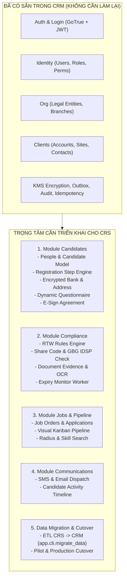

# SPEC-008: Kế Hoạch Triển Khai Chuyển Đổi Tính Năng CRS Sang `gap-crm-backend`

> **Trạng thái**: `DRAFT` (Đã đối chiếu với codebase thực tế tại `~/projects/gap-crm-backend`)  
> **Ngày cập nhật**: 2026-10-21  
> **Author**: Antigravity AI  
> **Target Codebase**: `~/projects/gap-crm-backend` (FastAPI, Python 3.12, SQLAlchemy Async, Alembic, GoTrue, Valkey)  
> **Tài liệu tham chiếu**:  
> - `~/projects/gap-crm-backend/docs/architecture/overview.md`  
> - `~/projects/gap-crm-backend/docs/database/03-people-candidates.md`  
> - `~/projects/gap-crm-backend/docs/database/04-compliance.md`  
> - `~/projects/gap-crm-backend/docs/database/05-jobs-matching.md`  
> - `~/projects/gap-crm-backend/docs/database/10-communications.md`  
> - `~/projects/gap-crm-backend/docs/database/12-data-migration.md`  
> - Google Sheet (Tab CRS - 20 Tasks): [Nexus Frontiertech (Tab CRS)](https://docs.google.com/spreadsheets/d/1mb6TYhNqSI7_l5DfT2qmLFkJrmAfx6xGAQj0zMEhACE/edit?gid=1988775611#gid=1988775611)  
> - Google Sheet (Tab Đối soát Tính năng & APIs): [Nexus Frontiertech (Tab CRS Features & APIs)](https://docs.google.com/spreadsheets/d/1mb6TYhNqSI7_l5DfT2qmLFkJrmAfx6xGAQj0zMEhACE/edit?gid=1431551022#gid=1431551022)

---

## 1. Kết Quả Khảo Sát Codebase Hiện Tại (`~/projects/gap-crm-backend`)

Sau khi rà soát trực tiếp mã nguồn và tài liệu kiến trúc tại `gap-crm-backend`, hệ thống CRM mới đã hoàn thành phần móng vững chắc:

### 1.1. Các phần ĐÃ HOÀN TẤT (Cắt bỏ khỏi kế hoạch phát triển mới):
1. **Thiết kế Cơ sở Dữ liệu (Database Architecture)**: Đã có sẵn 13 tài liệu đặc tả schema hoàn chỉnh trong `docs/database/` (bảng, cột, enum, blind index, khóa ngoại). **Không cần thiết kế DB từ đầu.**
2. **Luồng Xác thực & Đăng nhập (Auth & Login)**:
   - Tích hợp GoTrue client (`src/app/auth/gotrue.py`), JWT token verification qua JWKS (`tokens.py`), MFA TOTP (`mfa.py`).
   - Quản lý tài khoản, roles, permissions, login events đã hoàn tất trong `src/app/modules/identity/` (service 107KB).
   - Đã có migration Alembic: `identity_users_roles_login_events.py` và CLI `python -m app.cli.users create/set-password`.
3. **Cơ cấu Tổ chức & Chi nhánh (Org Structure)**:
   - Module `src/app/modules/org/` đã hoàn tất Legal Entities, Branches, Lookups, Roster loader (`python -m app.cli.org load-roster`).
   - Đã có migration Alembic: `org_structure_and_audit_events.py`.
4. **Quản lý Khách Hàng (Clients & Sites)**:
   - Module `src/app/modules/clients/` đã hoàn tất quản lý Doanh nghiệp, Chi nhánh/Site, Người liên hệ (service 121KB, models 28KB).
   - Đã có 4 migration Alembic cho clients.
5. **Nền tảng Kỹ thuật Dùng Chung (Core Infrastructure)**:
   - `app.core.encryption`: Mã hóa KMS envelope + HMAC-SHA256 blind index (`*_enc`, `*_bidx`) cho PII (NI, Bank).
   - `app.core.outbox`: Transactional outbox writer.
   - `app.core.audit`: Append-only audit logging.
   - `app.core.idempotency`: Xử lý Idempotency-Key trên Postgres.

---

## 2. Phạm Vi Thực Tế Cần Triển Khai (CRS Features to Implement)

Các module nghiệp vụ trọng tâm của CRS hiện đang là **stub** trong `gap-crm-backend/src/app/modules/` và cần được xây dựng theo đúng tài liệu thiết kế có sẵn:

---

## 3. Lộ Trình & Danh Mục 20 Tasks Chi Tiết (Kèm Estimate & Nguồn/Đích Đến)

### Phase 1: Phân Hệ Candidates & Onboarding (`src/app/modules/candidates/`) — Dự kiến: 20.5 man-days (~4 tuần)
- `CRM-CRS-01`: **Alembic Migration cho Candidates**
  - *Estimate*: **2.5 days (20h)**
  - *Nội dung*: Tạo bảng `people`, `person_emergency_contacts`, `candidates`, `candidate_registrations`, `registration_steps`, `candidate_bank_accounts` (encrypted), `candidate_terms`, `candidate_invitations`.
  - *Nguồn nghiệp vụ CRS*: SPEC-002, SPEC-004; `app/Models/Candidate.php`, `database/migrations/`
  - *Thiết kế đích CRM*: `docs/database/03-people-candidates.md`; `src/app/modules/candidates/models.py`, `alembic/versions/`
- `CRM-CRS-02`: **Candidate Onboarding Step Engine**
  - *Estimate*: **3.5 days (28h)**
  - *Nội dung*: Xây dựng `CandidateService` quản lý tiến độ từng bước theo `registration_steps` (thay thế JSON `progresses`), tính toán % hoàn thành cho Portal (`/api/v1/portal`).
  - *Nguồn nghiệp vụ CRS*: SPEC-002, SPEC-013, SPEC-034, SPEC-039 (`GAP-691`); `app/Utilities/RegistrationProgressUtility.php`, `app/Http/Controllers/Api/Candidate/ProgressController.php`
  - *Thiết kế đích CRM*: `docs/database/03-people-candidates.md` (`registration_steps`); `src/app/modules/candidates/service.py`, `routers/portal.py`
- `CRM-CRS-03`: **Address Geocoding & Encrypted Bank Account Service**
  - *Estimate*: **2.5 days (20h)**
  - *Nội dung*: Tích hợp tra cứu địa chỉ Loqate/Data8 kèm Geocoding Lat/Long; lưu tài khoản ngân hàng dưới dạng `account_number_enc`/`bidx` và Modulus checking.
  - *Nguồn nghiệp vụ CRS*: SPEC-008, SPEC-025, SPEC-029; `app/Services/CandidateBankAccountService.php`, `app/Http/Controllers/Api/General/AddressSearchController.php`
  - *Thiết kế đích CRM*: `docs/database/03-people-candidates.md`; `src/app/core/encryption.py`, `src/app/integrations/data8/`
- `CRM-CRS-04`: **Dynamic Questionnaires & Declarations Engine**
  - *Estimate*: **3.5 days (28h)**
  - *Nội dung*: Form thu thập HMRC starter declaration, WTD 48-hour opt-out, preferences theo version; xử lý xác minh người giới thiệu (Referee Verification qua token link).
  - *Nguồn nghiệp vụ CRS*: SPEC-005, SPEC-006 (`GAP-723`); `app/Services/QuestionService.php`, `app/Http/Controllers/Api/Candidate/RefereeEmploymentHistoryReferenceController.php`
  - *Thiết kế đích CRM*: `docs/database/03-people-candidates.md` (`wtd_opt_outs`, `candidate_employments`, `candidate_references`); `src/app/modules/candidates/service.py`
- `CRM-CRS-05`: **Mobile E-Signature & Work Finder Agreement**
  - *Estimate*: **2.5 days (20h)**
  - *Nội dung*: Nhận chữ ký điện tử trực tiếp từ mobile/web, lưu `candidate_terms` kèm chữ ký, mã băm SHA-256, IP address và sinh tài liệu xác nhận theo từng pháp nhân (Hawk 3, GPHL).
  - *Nguồn nghiệp vụ CRS*: SPEC-012, SPEC-039 (`GAP-691`); `app/Services/PermanentCandidateIntakeService.php`, `resources/views/pdf/work_finder_agreement*.blade.php`
  - *Thiết kế đích CRM*: `docs/database/03-people-candidates.md` (`candidate_terms`), `docs/database/09-documents.md`; `src/app/modules/candidates/service.py`
- `CRM-CRS-06`: **Candidate Desk 360 & Recruiter Search / Filters**
  - *Estimate*: **4.0 days (32h)**
  - *Nội dung*: Xây dựng màn hình 360° Candidate Profile cho Consultant; hỗ trợ tìm kiếm theo bán kính địa lý (Postcode Radius), Kỹ năng/Tags, Xử lý chuyển pháp nhân (`entity_switch_requests`).
  - *Nguồn nghiệp vụ CRS*: SPEC-019, SPEC-027, SPEC-033, SPEC-036, SPEC-038; `app/Services/CandidateService.php`, `app/Http/Controllers/Api/Admin/CandidateController.php`
  - *Thiết kế đích CRM*: `docs/database/03-people-candidates.md`, `docs/database/07-matching.md`; `src/app/modules/candidates/routers/crm.py`, `service.py`
- `CRM-CRS-07`: **Candidate Invitation Engine**
  - *Estimate*: **2.0 days (16h)**
  - *Nội dung*: Sinh link mời ứng viên có tracking (Branch, Job, UTM attribution, Consultant ID), hỗ trợ gửi SMS và Email mời ứng viên đăng ký.
  - *Nguồn nghiệp vụ CRS*: SPEC-032 (`GAP-734`); `app/Services/CandidateInvitationService.php`, `app/Http/Controllers/Api/Admin/CandidateInvitationController.php`
  - *Thiết kế đích CRM*: `docs/database/03-people-candidates.md` (`candidate_invitations`); `src/app/modules/candidates/service.py`, `routers/crm.py`

### Phase 2: Phân Hệ Compliance & RTW (`src/app/modules/compliance/`) — Dự kiến: 19.5 man-days (~4 tuần)
- `CRM-CRS-08`: **Alembic Migration cho Compliance & RTW**
  - *Estimate*: **2.5 days (20h)**
  - *Nội dung*: Tạo bảng `rtw_checks`, `rtw_share_codes`, `compliance_clearances`, `escalated_issues`, `document_evidences`.
  - *Nguồn nghiệp vụ CRS*: SPEC-009, SPEC-010, SPEC-011, SPEC-016, SPEC-017; `app/Models/CandidateRightToWork.php`, `app/Models/EscalatedIssue.php`
  - *Thiết kế đích CRM*: `docs/database/04-compliance.md`; `src/app/modules/compliance/models.py`, `alembic/versions/`
- `CRM-CRS-09`: **Autonomous RTW Decision Engine**
  - *Estimate*: **3.5 days (28h)**
  - *Nội dung*: Xây dựng quy tắc phân luồng tự động cho hộ chiếu Anh/Ireland, Visa lao động, Định cư (Settlement), Visa sinh viên (20h term-time limit); kích hoạt sự kiện cấp thẻ OnePay khi RTW PASS.
  - *Nguồn nghiệp vụ CRS*: SPEC-010, SPEC-011, SPEC-017, SPEC-018; `app/Services/CandidateRightToWorkService.php`, `app/Utilities/RightToWorkUtility.php`
  - *Thiết kế đích CRM*: `docs/database/04-compliance.md` (RTW decision trees); `src/app/modules/compliance/service.py`
- `CRM-CRS-10`: **Home Office Share Code & GBG IDSP Verification**
  - *Estimate*: **3.5 days (28h)**
  - *Nội dung*: Tích hợp API kiểm tra Share Code tự động (Home Office employer check) và GBG IDSP passport check; lưu kết quả bất biến có hash.
  - *Nguồn nghiệp vụ CRS*: SPEC-010, SPEC-011; `app/Services/RightToWorkShareCodeService.php`, `app/Services/GbgService.php`
  - *Thiết kế đích CRM*: `docs/database/04-compliance.md` (`rtw_share_codes`, `idsp_checks`); `src/app/integrations/gbg/`, `src/app/integrations/home_office/`
- `CRM-CRS-11`: **Document Evidence & Intelligent OCR Verification**
  - *Estimate*: **3.5 days (28h)**
  - *Nội dung*: Quản lý chứng từ đính kèm trên S3; bóc tách thông tin hộ chiếu/visa tự động bằng OCR; quy trình yêu cầu tài liệu còn thiếu (`missing documents`).
  - *Nguồn nghiệp vụ CRS*: SPEC-009, SPEC-015; `app/Services/CandidateFileService.php`, `app/Http/Controllers/Api/Candidate/FileController.php`
  - *Thiết kế đích CRM*: `docs/database/04-compliance.md` (`document_evidences`), `docs/database/09-documents.md`; `src/app/modules/compliance/service.py`
- `CRM-CRS-12`: **Automated Expiry Monitor & Sync Worker**
  - *Estimate*: **3.0 days (24h)**
  - *Nội dung*: Xây dựng scheduled background job trong `app.workers.scheduler` quét tài liệu sắp hết hạn hàng ngày (cảnh báo 90/60/30 ngày); quét nhắc lịch screening, recheck GBG REFER, đồng bộ MatchMaker status/on-plan.
  - *Nguồn nghiệp vụ CRS*: SPEC-022, SPEC-023, SPEC-024, SPEC-026; `app/Console/Commands/CheckRightToWorkExpiry.php`, `app/Console/Kernel.php`
  - *Thiết kế đích CRM*: `docs/database/04-compliance.md`; `src/app/workers/scheduler.py`, `src/app/modules/compliance/service.py`
- `CRM-CRS-13`: **Escalated Issues & Compliance Clearance Sign-off Workflow**
  - *Estimate*: **3.5 days (28h)**
  - *Nội dung*: Quy trình phân xử tranh chấp (Escalated Issues), phỏng vấn phúc lợi công nhân (Worker Welfare Check) và phê duyệt điều kiện đi làm (Clearance LIVE) giữa Consultant và Compliance Officer.
  - *Nguồn nghiệp vụ CRS*: SPEC-016, SPEC-017, SPEC-020; `app/Services/EscalatedIssueService.php`, `app/Services/CandidateWelfareCheckService.php`
  - *Thiết kế đích CRM*: `docs/database/04-compliance.md` (`escalated_issues`, `compliance_clearances`, `welfare_checks`); `src/app/modules/compliance/service.py`

### Phase 3: Phân Hệ Jobs, Applications & Pipeline (`src/app/modules/jobs/`) — Dự kiến: 8.0 man-days (~1.5 tuần)
- `CRM-CRS-14`: **Alembic Migration cho Jobs & Applications Schema**
  - *Estimate*: **2.0 days (16h)**
  - *Nội dung*: Tạo bảng `job_orders`, `adverts`, `candidate_applications`.
  - *Nguồn nghiệp vụ CRS*: SPEC-007; `app/Models/Job.php`, `app/Models/CandidateJob.php`, `database/migrations/`
  - *Thiết kế đích CRM*: `docs/database/05-jobs-matching.md`; `src/app/modules/jobs/models.py`, `alembic/versions/`
- `CRM-CRS-15`: **Visual Kanban Pipeline & Stage Machine**
  - *Estimate*: **3.5 days (28h)**
  - *Nội dung*: Quản lý vòng đời ứng tuyển theo từng Job Order; kéo thả trạng thái ứng viên có kiểm tra điều kiện RTW (chặn điều phối ứng viên chưa LIVE).
  - *Nguồn nghiệp vụ CRS*: SPEC-007, SPEC-017; `app/Services/CandidateJobService.php`, `app/Http/Controllers/Api/Admin/JobCandidateController.php`
  - *Thiết kế đích CRM*: `docs/database/05-jobs-matching.md` (pipeline stages); `src/app/modules/jobs/service.py`, `routers/crm.py`
- `CRM-CRS-16`: **Interview & Appointment Scheduler**
  - *Estimate*: **2.5 days (20h)**
  - *Nội dung*: Quản lý lịch phỏng vấn và hẹn gặp ứng viên, tích hợp gửi reminder tự động qua SMS/Email.
  - *Nguồn nghiệp vụ CRS*: SPEC-014; `app/Services/CandidateAppointmentService.php`, `app/Http/Controllers/Api/Admin/CandidateAppointmentController.php`
  - *Thiết kế đích CRM*: `docs/database/05-jobs-matching.md` (`interviews`, `candidate_appointments`); `src/app/modules/jobs/service.py`

### Phase 4: Phân Hệ Communications & Activity Timeline (`src/app/modules/communications/`) — Dự kiến: 6.0 man-days (~1.2 tuần)
- `CRM-CRS-17`: **SMS & Email Dispatcher & Dynamic Template Engine**
  - *Estimate*: **3.5 days (28h)**
  - *Nội dung*: Tích hợp gửi tin qua Esendex/Twilio và Amazon SES theo mẫu email/SMS động ghi đè theo chi nhánh; chiến dịch SMS Marketing theo trạng thái RRR (`GAP-727`); Rich-text short-link redirect (`GAP-743`).
  - *Nguồn nghiệp vụ CRS*: SPEC-021 (`GAP-727`), SPEC-028, SPEC-040 (`GAP-743`); `app/Services/EsendexService.php`, `app/Services/CandidateSmsMarketingService.php`, `app/Services/ShortLinkService.php`
  - *Thiết kế đích CRM*: `docs/database/10-communications.md` (`messages`, `campaigns`, `email_templates`, `delivery_markers`); `src/app/modules/communications/service.py`
- `CRM-CRS-18`: **Central Activity Timeline & Interaction Audit Log**
  - *Estimate*: **2.5 days (20h)**
  - *Nội dung*: Dòng thời gian duy nhất (Unified Timeline) tổng hợp toàn bộ tương tác: cuộc gọi, SMS, email, tải giấy tờ, ghi chú tư vấn viên (`communication_notes`) và đổi trạng thái hồ sơ.
  - *Nguồn nghiệp vụ CRS*: SPEC-030, SPEC-036; `app/Models/CandidateNote.php`, `app/Services/CandidateTimelineService.php`
  - *Thiết kế đích CRM*: `docs/database/10-communications.md` (`communication_activities`, `notes`); `src/app/modules/communications/service.py`

### Phase 5: Di Trú Dữ Liệu & Cutover (`src/app/cli/` & `docs/database/12-data-migration.md`) — Dự kiến: 10.5 man-days (~2 tuần)
- `CRM-CRS-19`: **CRS Historical Data ETL Migration CLI**
  - *Estimate*: **6.0 days (48h)**
  - *Nội dung*: Xây dựng lệnh `python -m app.cli.migrate_data` đọc dữ liệu từ database CRS (`candidates`, `files`, `answers`, `timings`, `legal_entities`) chuyển sang schema CRM PostgreSQL; xử lý mapping trạng thái, re-hash token và retry cơ chế đồng bộ MatchMaker S2S.
  - *Nguồn nghiệp vụ CRS*: SPEC-019, SPEC-024, SPEC-027, SPEC-031; `app/Console/Commands/SyncMatchMakerCandidate.php`, `app/Services/MatchMakerSyncService.php`
  - *Thiết kế đích CRM*: `docs/database/12-data-migration.md`; `src/app/cli/migrate_data.py`, `src/app/integrations/matchmaker/`
- `CRM-CRS-20`: **Pilot Branch Testing & Production Cutover from CRS to CRM**
  - *Estimate*: **4.5 days (36h)**
  - *Nội dung*: Kiểm thử UAT trên chi nhánh thí điểm (Hawk 3 / GPHL), chuyển đổi DNS và đưa CRM chính thức vào vận hành thay thế CRS.
  - *Nguồn nghiệp vụ CRS*: Toàn bộ 40 SPECs của CRS (`.business-spec/backend-business-flow-spec.md`)
  - *Thiết kế đích CRM*: Toàn bộ tài liệu `docs/architecture/` và `docs/database/` của `gap-crm-backend`

---

---

## 4. Ma Trận Đối Chiếu Bao Phủ 100% Toàn Bộ 40 SPECs Nghiệp Vụ Của CRS

Dưới đây là bảng đối soát chi tiết chứng minh toàn bộ 40 SPEC nghiệp vụ (tương ứng 248 API routes) của CRS đã được bao phủ hoàn toàn trong kiến trúc và các task của CRM mới:

| CRS SPEC ID | Tên Luồng Nghiệp Vụ CRS | Trạng Thái Trong `gap-crm-backend` | Task / Thành Phần Đảm Nhiệm |
|:---|:---|:---:|:---|
| **SPEC-001** | API request lifecycle & error handling | Đã có sẵn | `app.core.errors` (Error envelope, HTTP codes chuẩn) |
| **SPEC-002** | Candidate signup & initial registration | Cần implement | `CRM-CRS-01`, `CRM-CRS-02` (Bảng `people`, `candidate_registrations`) |
| **SPEC-003** | Candidate auth & password reset | Đã có sẵn | `app.auth.gotrue`, `app.modules.identity` (Portal auth) |
| **SPEC-004** | Candidate profile & MatchMaker duplicate check | Cần implement | `CRM-CRS-01`, `CRM-CRS-03` (`people.name_key`, `ni_number_bidx`) |
| **SPEC-005** | Declaration, PPE và question answers | Cần implement | `CRM-CRS-04` (Questionnaires, WTD opt-out, Starter declaration) |
| **SPEC-006** | Employment history & referee verification (GAP-723) | Cần implement | `CRM-CRS-04` (`candidate_histories`, `candidate_references` qua token) |
| **SPEC-007** | Candidate apply job & application tracking | Cần implement | `CRM-CRS-14` (Bảng `candidate_applications`, `adverts`) |
| **SPEC-008** | Bank & financial info (OnePay, modulus check) | Cần implement | `CRM-CRS-03` (Bảng `candidate_bank_accounts` mã hóa KMS + Modulus) |
| **SPEC-009** | File upload, approval & lifecycle | Cần implement | `CRM-CRS-11` (Bảng `documents`, `document_evidences` trên S3) |
| **SPEC-010** | Passport identity check với GBG IDSP | Cần implement | `CRM-CRS-10` (`right_to_work_checks`, `face_match_results`, GBG client) |
| **SPEC-011** | Right-to-work share code (Home Office) | Cần implement | `CRM-CRS-10` (`right_to_work_checks` với Home Office API) |
| **SPEC-012** | Contract & Work Finder Agreement (Hawk3/GPHL) | Cần implement | `CRM-CRS-05` (`candidate_terms`, E-sign canvas, legal entity branding) |
| **SPEC-013** | Registration progress calculation | Cần implement | `CRM-CRS-02` (`registration_steps` state machine thay thế JSON cũ) |
| **SPEC-014** | Appointment & interview lifecycle | Cần implement | `CRM-CRS-16` (`interviews`, `calendar_events`) |
| **SPEC-015** | Missing document / information request | Cần implement | `CRM-CRS-02`, `CRM-CRS-11` (`registration_steps` blocked + notify) |
| **SPEC-016** | Escalated issue lifecycle | Cần implement | `CRM-CRS-13` (`escalated_issues`, `escalated_issue_events`) |
| **SPEC-017** | Compliance review & clearance sign-off (`LIVE`) | Cần implement | `CRM-CRS-13` (`compliance_clearances`, `consultant_declarations`) |
| **SPEC-018** | RTW approval event $\rightarrow$ alternative bank trigger | Cần implement | `CRM-CRS-03`, `CRM-CRS-09` (Domain event listener) |
| **SPEC-019** | Transfer candidate to MatchMaker (Epsilon API) | Cần implement | `CRM-CRS-06`, `CRM-CRS-19` (Outbox adapter gọi S2S API) |
| **SPEC-020** | Worker welfare check & certificate queue | Cần implement | `CRM-CRS-13` (`welfare_checks`, `welfare_interviews`) |
| **SPEC-021** | SMS campaign lifecycle (Bulk SMS, RRR - GAP-727) | Cần implement | `CRM-CRS-17` (`campaigns`, `messages`, Esendex integration) |
| **SPEC-022** | Screening reminder cron | Cần implement | `CRM-CRS-12` (Worker scheduler job `screening_reminders`) |
| **SPEC-023** | GBG REFER recheck cron | Cần implement | `CRM-CRS-12` (Worker scheduler job `gbg_recheck`) |
| **SPEC-024** | MatchMaker status/on-plan/marketing sync | Cần implement | `CRM-CRS-12`, `CRM-CRS-19` (Worker scheduler jobs) |
| **SPEC-025** | OnePay mailbox ingestion & card application | Cần implement | `CRM-CRS-03` (`integrations/onepay`) |
| **SPEC-026** | RTW expiry cron & proactive alerts | Cần implement | `CRM-CRS-12` (Worker scheduler job `rtw_expiry_check`) |
| **SPEC-027** | Admin candidate reset, delete, GDPR erasure (GAP-534) | Cần implement | `CRM-CRS-06`, `CRM-CRS-19` (`erasure_requests`, tombstoning) |
| **SPEC-028** | Email template resolution by branch | Cần implement | `CRM-CRS-17` (`email_templates`, `email_template_overrides`) |
| **SPEC-029** | Tracking & address lookup (Loqate, PCA, UTM) | Cần implement | `CRM-CRS-03` (`integrations/data8`, geocoding) |
| **SPEC-030** | Audit log & integration log retention | Đã có sẵn | `app.core.audit` (`audit_events` append-only) |
| **SPEC-031** | Trace lỗi `worker not found` khi sync MatchMaker | Cần implement | `CRM-CRS-19` (Retry với exponential backoff & DLQ) |
| **SPEC-032** | Candidate invitation & tracking (GAP-734) | Cần implement | `CRM-CRS-07` (`candidate_invitations` có UTM & Branch attribution) |
| **SPEC-033** | Request/approve chuyển legal entity | Cần implement | `CRM-CRS-06` (`entity_switch_requests`) |
| **SPEC-034** | Reset, re-registration & snapshot (`RE REG NEEDED`)| Cần implement | `CRM-CRS-02` (`candidate_registrations` mở episode mới) |
| **SPEC-035** | Staff auth, role/branch/job scope & lockout | Đã có sẵn | `app.auth`, `app.modules.identity`, `app.modules.org` |
| **SPEC-036** | Tags, skills, starred candidate & notes | Cần implement | `CRM-CRS-06`, `CRM-CRS-18` (`candidate_tags`, `communication_notes`) |
| **SPEC-037** | Staff/master data, branch, legal entities, lookups | Đã có sẵn | `app.modules.org` (`legal_entities`, `branches`, `lookup_values`) |
| **SPEC-038** | Candidate search, list, detail (Radius & Skills) | Cần implement | `CRM-CRS-06` (Candidate Desk 360 router) |
| **SPEC-039** | Permanent candidate intake fast-track (GAP-691) | Cần implement | `CRM-CRS-02`, `CRM-CRS-05` (Fast-track onboarding episode) |
| **SPEC-040** | Rich-text email short-link redirect (GAP-743) | Cần implement | `CRM-CRS-17` (`delivery_markers`, `/api/r/{token}`) |

---

## 5. Các Quyết Định Cần Chốt (Dành Cho Triển Khai `gap-crm-backend`)

1. **Frontend Repository**:
   - Hiện tại `gap-crm-backend` đã cung cấp sẵn 3 cụm API routers: `/api/v1/portal` (Candidate), `/api/v1/crm` (Staff), `/api/v1/admin` (Admin). Frontend tương ứng sẽ được phát triển trong repository nào?
2. **Chiến lược Chạy thử nghiệm ETL (Data Migration)**:
   - Có thể cấp quyền đọc (Read-only) trực tiếp vào bản sao (Replica) database CRS hiện tại để chạy thử nghiệm lệnh `migrate_data` không?
3. **Chi nhánh Thí điểm (Pilot Branch)**:
   - Thống nhất chọn chi nhánh nào để chạy thí điểm đầu tiên (ví dụ Hawk 3 hay GPHL)?

---
> [!IMPORTANT]
> **TIẾT KIỆM TỐI ĐA THỜI GIAN**: Nhờ tận dụng toàn bộ thiết kế DB và module Auth/Identity/Org/Clients đã có trong `gap-crm-backend`, số lượng task đã được giảm từ **33 task xuống còn 20 task**, tập trung 100% vào giá trị nghiệp vụ cốt lõi của CRS!
